# Topic 15: The MOS capacitor: accumulation, depletion, inversion

Tutorial questions: Ch3 Q1 · Past finals: 2016 Q1d i, 2016 Q3b, 2014 Q3b ii, 2017 Q3c

Slides: SSD_3, pages 7 to 12 and 17 to 19. Booklet §4.2 (pages 59 to 63).

---

## The big idea

A MOSFET's gate is a **capacitor**: metal, then oxide (an insulator), then the Si substrate.

**M**etal, **O**xide, **S**emiconductor = **MOS**.

No current can cross the oxide. So the gate voltage can only **push or pull charge** at the Si surface.

There are three things it can do to p-type Si:

1. **Accumulation** (V < 0): pull extra holes to the surface.
2. **Depletion** (V > 0): push the holes away. A depletion region forms.
3. **Inversion** (V ≥ V_th): pull so many electrons to the surface that it turns **n-type**. That n-layer is the MOSFET's channel.

You draw all three as band diagrams from the gate into the substrate. Same rules as Topic 8: E_F lines up at zero bias, the bands bend at the surface.

---

**How to use these notes:**
When you see 🧠, stop.
Answer it on paper first.
Then click to check.

---

## ⭐ Learn by heart from this topic

None of this is on the formula sheet.

| Gate voltage (p-type Si) | Name | Bands at the surface | Charge at the Si surface |
|---|---|---|---|
| V < 0 | accumulation | bend **up** (E_V closer to E_F) | extra holes |
| V = V_FB | flat band | flat | none |
| 0 < V < V_th | depletion | bend **down** | fixed N_A⁻ ions, no holes |
| V ≥ V_th | inversion | bend down so far that E_C is near E_F | electrons |

**Threshold (definition):** the gate voltage where the **electron density at the surface = the hole density in the bulk**.

**Memory hook:**
"Negative gate grabs holes. Positive gate pushes holes, then grabs electrons."

For **n-type** Si, swap every sign and swap electrons ↔ holes.

---

## 1. The MOS with no voltage

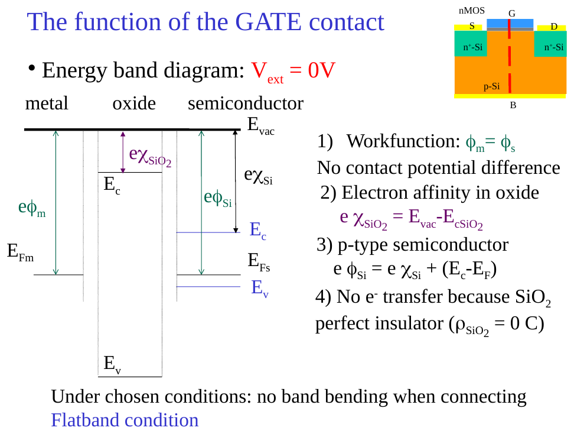

**How to read this diagram:**

- Left to right: **metal**, **oxide** (SiO₂), **p-type Si**.
- E_vac is the vacuum level, the same height everywhere here.
- The metal has one level, E_Fm, a distance eφ_m below E_vac (its workfunction, Topic 6).
- The oxide has a **huge** gap. E_C,ox is high up, E_V,ox is far down. Nothing gets through.
- The Si has E_C, E_F, E_V. Its E_F is a distance eφ_Si below E_vac.
- Here φ_m = φ_Si. So the two Fermi levels are **already level**. No charge moves. No bands bend.

This is called the **flat band** condition.

**Why no electrons cross:** the oxide is a perfect insulator (slide point 4: ρ_SiO₂ = 0).

 

### What if φ_m ≠ φ_s?

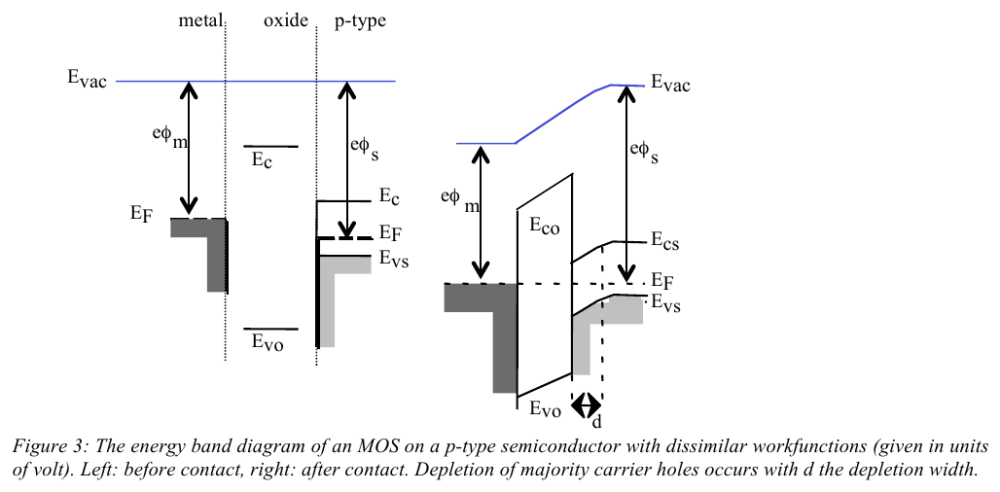

**How to read this diagram:**

- Left: before contact. φ_m < φ_s, so E_F of the metal is **higher** than E_F of the Si.
- Right: after contact. The Fermi levels line up (Topic 8 rule).
- Electrons left the metal for the Si. The Si surface lost holes. A depletion region of width **d** forms, and the Si bands bend **down** at the surface.
- E_vac is no longer flat. It has a step across the oxide and a bend in the Si.

**So:** the workfunction difference alone can put the surface in depletion (or accumulation) with **no gate voltage**.

The gate voltage that makes the bands flat again is the **flat band voltage**:

$$V_{FB} = \phi_m - \phi_s$$

 

### 🧠 Check
A gate has φ_G = φ_p + 1 V on p-type Si (2016 Q3b). At zero bias, is the surface in accumulation or depletion?

Answer

φ_G > φ_p, so the Si Fermi level starts **higher** than the gate's.

Electrons flow from the Si to the gate. The gate goes negative, the Si surface goes positive.

Positive surface = extra holes = **accumulation**. Bands bend **up** at the surface.

---

## 2. Accumulation: V < 0

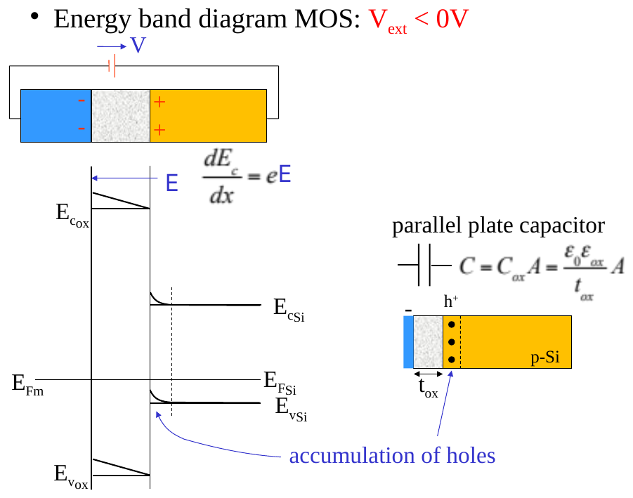

**How to read this diagram:**

- The battery puts the gate at **−V**. Minus on the metal, plus on the Si.
- A negative voltage **raises** the metal's E_F by e|V| (electrons gain energy at low voltage, Topic 7).
- The field ℰ points from the Si to the metal (+ to −). Arrow at the top points **left**.
- The oxide bands **tilt**: dE_C/dx = eℰ.
- The Si bands bend **up** near the oxide. E_V comes closer to E_F.
- E_V close to E_F = **more holes**. They pile up at the surface: **accumulation of holes**.
- It's a parallel-plate capacitor: metal plate, oxide gap t_ox, hole "plate".

$$C = C_{ox} A = \frac{\varepsilon_0\varepsilon_{ox}}{t_{ox}} A$$

---

## 3. Depletion: V > 0

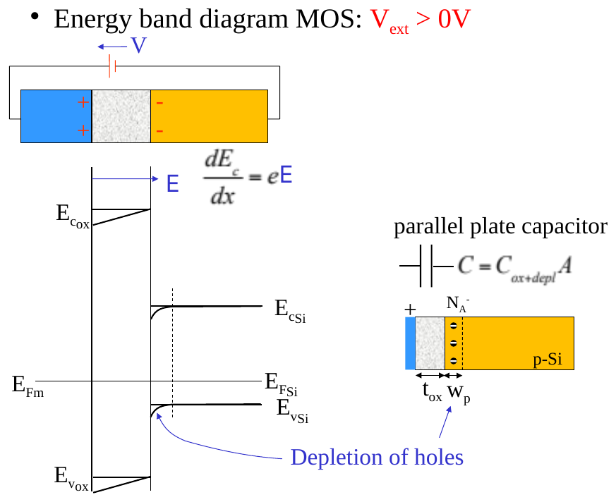

**How to read this diagram:**

- Now the gate is **+V**.
- The metal's E_F drops by eV.
- ℰ points from the metal into the Si. Arrow points **right**.
- The Si bands bend **down** near the oxide. E_V moves away from E_F.
- Fewer holes at the surface. They are pushed away, leaving the fixed **N_A⁻ ions**.
- That's a **depletion region** of width w_p.
- The capacitor gap is now **bigger**: t_ox of oxide plus w_p of depleted Si. So C goes down (Topic 16).

 

### 🧠 Check
In depletion, what carries the negative charge in the Si: electrons or ions?

Answer

**Ions.** The N_A⁻ acceptor ions left behind when the holes were pushed away.

There are no free carriers in a depletion region (the depletion approximation, Topic 10 §2).

---

## 4. Threshold and inversion: V = V_th

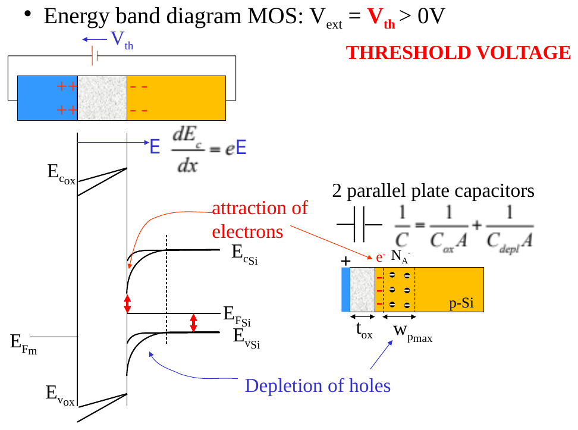

**How to read this diagram:**

- More positive gate. The bands bend down **further**.
- E_C at the surface comes close to E_F. Electrons start to collect there: "attraction of electrons".
- The depletion region has reached its **maximum** width w_p,max.
- Now there are **two** capacitors in series: the oxide, and the depletion layer.

 

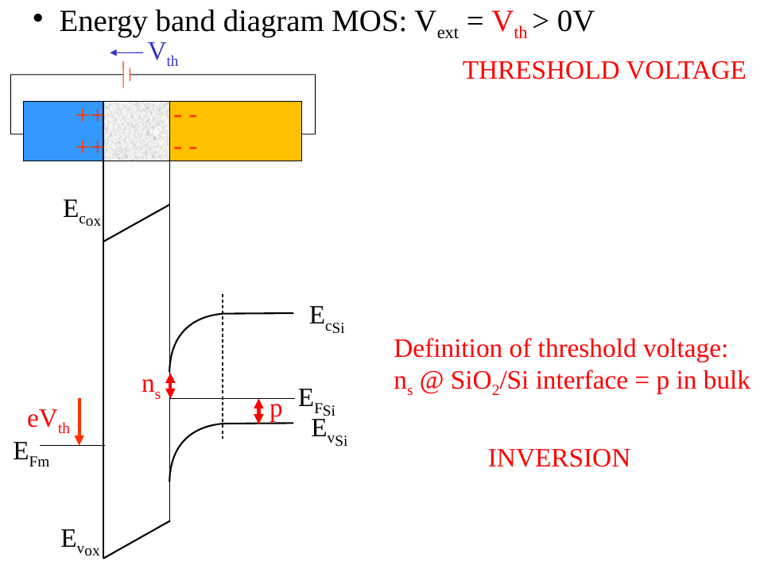

**How to read this diagram:**

- Look at the two red arrows.
- At the surface: the gap from E_F up to E_C. That sets n_s, the electron density at the surface.
- In the bulk: the gap from E_V up to E_F. That sets p, the hole density in the bulk.
- **Threshold = the two gaps are equal.** So n_s at the surface = p in the bulk.
- The surface is now as n-type as the bulk is p-type. It has **inverted**.

 

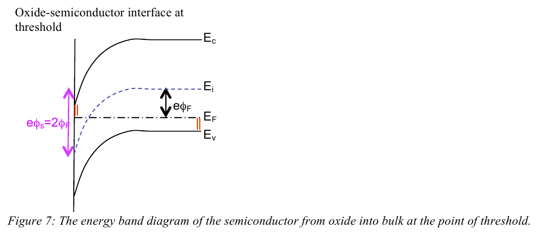

**How to read this diagram (booklet Fig. 7):**

- This is just the Si side, at threshold.
- In the bulk, E_i is **eφ_F** above E_F (p-type).
- At the surface, E_i is eφ_F **below** E_F (inverted, n-type).
- So E_i has bent down by **2eφ_F** in total. The surface potential is φ_s = 2φ_F.

---

### 📐 Equation 27: the Fermi potential and the threshold condition (NOT on the formula sheet)

$$\phi_F = \frac{kT}{e}\ln\!\left(\frac{N_A}{n_i}\right) \qquad \text{threshold when } \phi_s = 2\phi_F$$

| Symbol | Means | Units |
|---|---|---|
| φ_F | how far E_i sits above E_F in the p-type bulk, in volts | V |
| φ_s | how far E_i has bent down at the surface (surface potential) | V |
| N_A | substrate doping | cm⁻³ |
| nᵢ | 1.45 × 10¹⁰ cm⁻³ | cm⁻³ |

**What it means:**
φ_F is just Topic 5's "E_i − E_F = kT ln(N_A/nᵢ)", in volts.

Inversion needs the surface to bend **twice** that.

**Use it when:**
You need the band bending at threshold, or to explain V_th. The ln(N_A/nᵢ) inside W_depl^max (Topic 16) is this same φ_F.

**Not used for:** a number for V_th itself. The booklet's full expression V_th = (φ_m − φ_s) − Q_B/C_ox + 2φ_F needs Q_B, which the exam never gives you. Past finals always **give** V_th or ask you to read it off a graph.

---

### 🧠 Check
p-type Si with N_A = 10¹⁶ cm⁻³. How far do the bands bend at the surface at threshold?

Answer

φ_F = 0.026 × ln(10¹⁶ ÷ 1.45 × 10¹⁰) = 0.026 × 13.4 = 0.35 V.

At threshold φ_s = 2φ_F = **0.70 V**. So E_C, E_i, E_V at the surface sit **0.70 eV** below their bulk values.

---

## 5. The same thing inside a MOSFET: gate → bulk

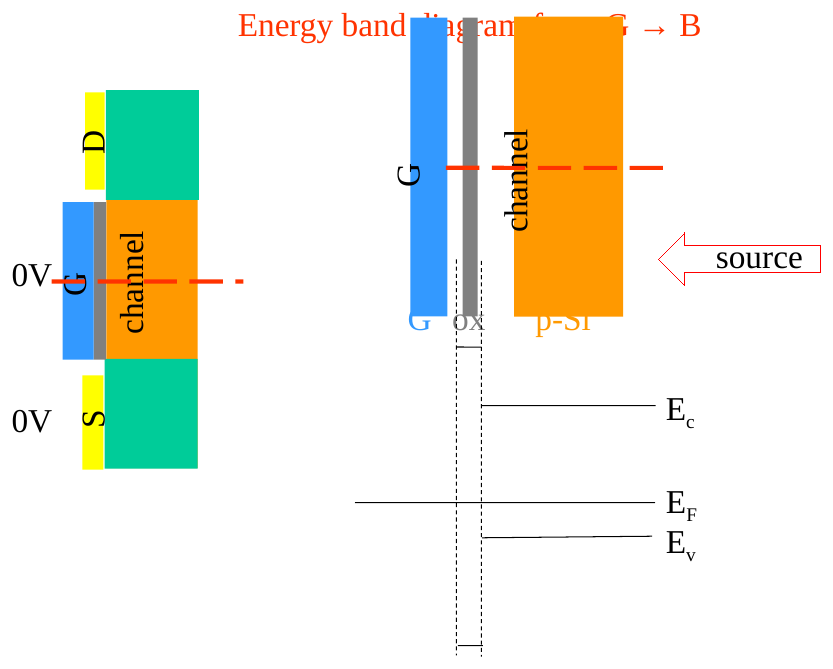

**How to read this diagram:**

- Turn the MOSFET on its side. The red dashed line runs from the **gate** (G), through the **oxide**, down into the **p-Si** under the channel.
- At 0 V the bands are flat (φ_m = φ_s again).

 

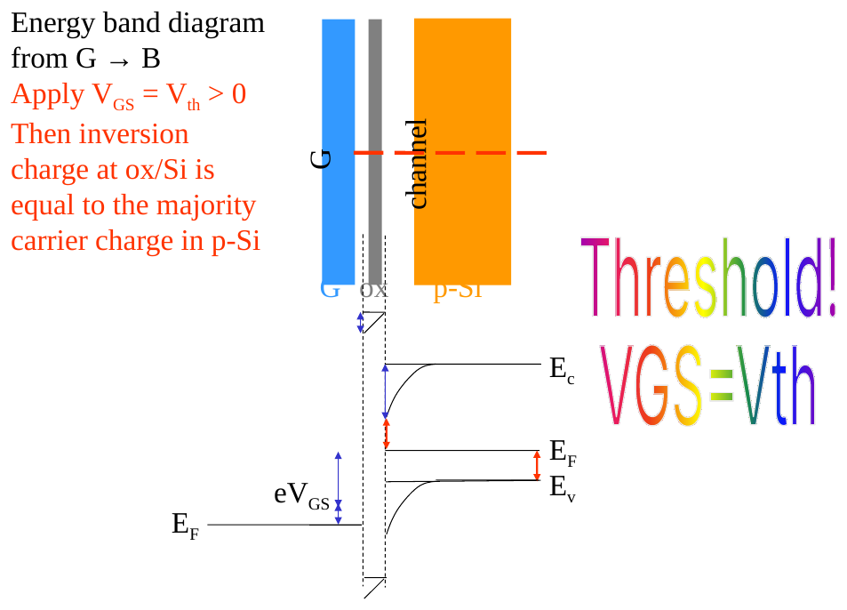

**How to read this diagram:**

- V_GS = V_th > 0. The gate's E_F drops by **eV_GS**.
- The Si bands bend down. At the surface, E_C − E_F equals E_F − E_V in the bulk (the two red arrows).
- The channel charge at the oxide/Si interface now equals the majority carrier charge in the p-Si. **Threshold.**

 

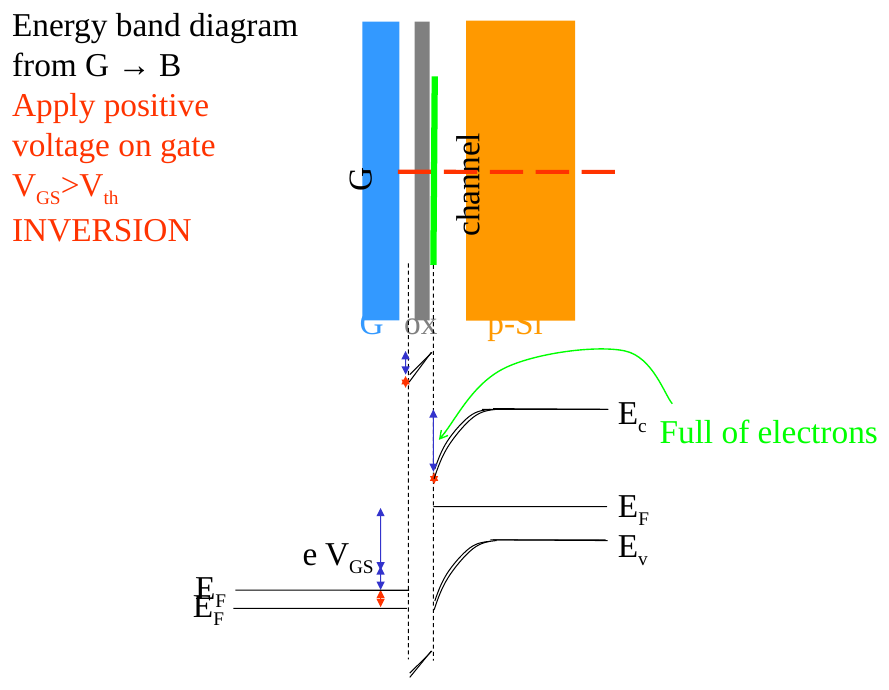

**How to read this diagram:**

- V_GS > V_th. Bending is even stronger.
- The green curve: the surface is **full of electrons**. That's the **inversion layer**: the MOSFET's channel.
- Past threshold, extra gate voltage mostly adds electrons to the channel. The depletion width hardly grows.

 

### 🧠 Check
In a MOS capacitor (no source or drain), where do the inversion electrons come from?

Answer

From **thermal generation** of electron-hole pairs near the depletion edge. The field drags the electrons to the surface. That's slow.

In a **MOSFET**, the n⁺ source and drain supply them, which is much faster (booklet footnote 69).

---

## 6. Worked example: Tutorial Ch3 Q1

> Draw the band diagram of the MOS in Fig. 1 under accumulation, depletion and strong inversion. Give the sign and relative size of the voltage. Include the field direction.

In Fig. 1, φ_m < φ_s (the metal's E_F is higher).

**Step 1: contact, no voltage.** The Fermi levels line up. Because φ_m < φ_s, there is already some band bending at the surface (a surface potential φ_surf).

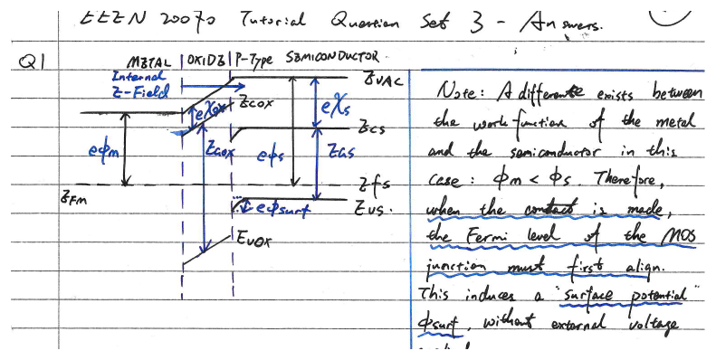

**Step 2: accumulation.** V < 0 lifts E_Fm. Field points from Si to metal. Bands bend up, holes collect.

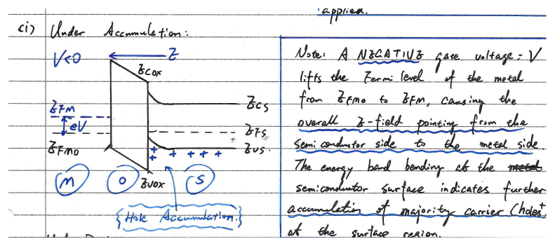

**Step 3: depletion.** V > 0 drops E_Fm. Field points from metal to Si. Bands bend down, holes pushed away.

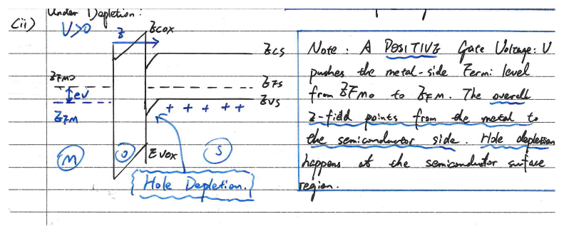

**Step 4: strong inversion.** V ≫ 0, V > V_th. E_Fm drops further. Electrons collect at the surface: an n-type channel.

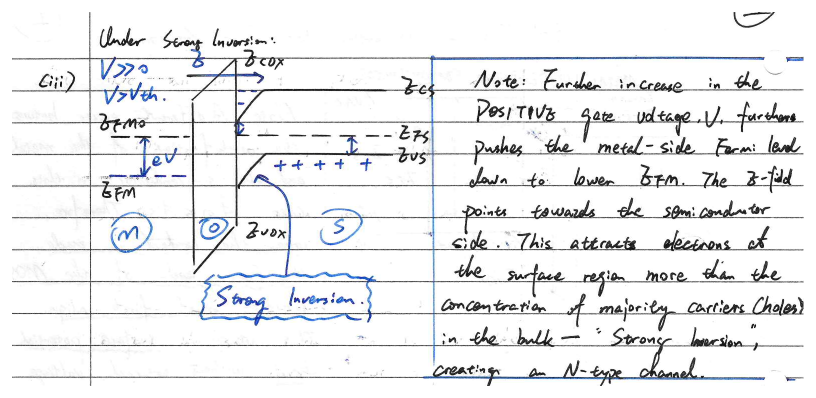

**Relative sizes:** V_accumulation < 0 < V_depletion < V_th ≤ V_inversion.

---

## 7. Worked example: 2014 Q3b ii (flat band gives the doping)

> pMOS on n-type Si. At V_GS = 0 the bands are flat. φ_m = 4.259 eV, χ = 4.05 eV. Find the substrate doping.

Flat band at 0 V means **φ_m = φ_s**.

$$e\phi_s = e\chi + (E_C - E_F) \;\Rightarrow\; E_C - E_F = 4.259 - 4.05 = 0.209\text{ eV}$$

$$N_D = n = N_C\,e^{-(E_C - E_F)/kT} = 3.2\times10^{19}\,e^{-0.209/0.026} = 1.03\times10^{16}\text{ cm}^{-3}$$

From: Topic 6 workfunction, Topic 5 Equation for n.

---

## Drawing checklist: MOS band diagram (gate → substrate)

1. Three regions, left to right: **metal | oxide | Si**. Label them.
2. Metal: one line, **E_Fm**.
3. Oxide: E_C,ox high and E_V,ox low (huge gap). Under bias, both **tilt** with the same slope.
4. Si: E_C, E_V, and a **flat E_F** in the bulk (the Si is grounded).
5. Shift E_Fm by **eV**: **up** for V < 0, **down** for V > 0. Label the gap "eV".
6. Bend the Si bands at the surface:
   - V < 0 (p-Si): **up**. Write "hole accumulation".
   - V > 0: **down**. Mark the depletion width.
   - V ≥ V_th: down so far that E_C at the surface is as close to E_F as E_V is in the bulk. Write "inversion".
7. Draw the **ℰ arrow**: from + to −. V > 0 → pointing from gate into Si.
8. If φ_m ≠ φ_s, start from the zero-bias bending, not flat bands.

---

## Method: MOS capacitor questions

| You're asked for | Use |
|---|---|
| accumulation / depletion / inversion band diagram | the checklist, §2 to §4 |
| direction of the field | + to −. Gate positive → from gate into Si |
| the definition of V_th | surface n = bulk p (§4) |
| band bending at threshold | 2φ_F, Equation 27 |
| state at zero bias with φ_m ≠ φ_s | §1: which E_F is higher, which way electrons flow |
| doping from a flat-band condition | φ_m = φ_s, then Topic 6 and Topic 5 (§7) |
| an n-type substrate | flip every sign, swap holes ↔ electrons |

---

Next: [End-of-topic test](../questions/15-mos-capacitor.md)
