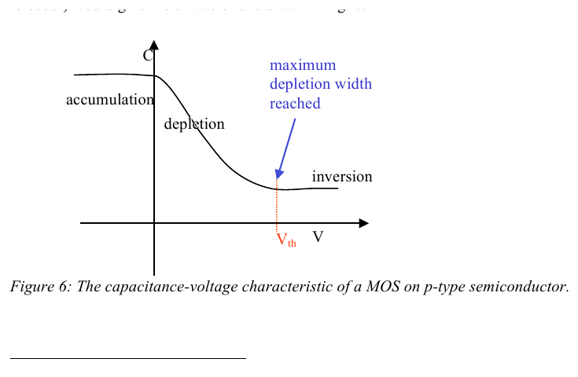
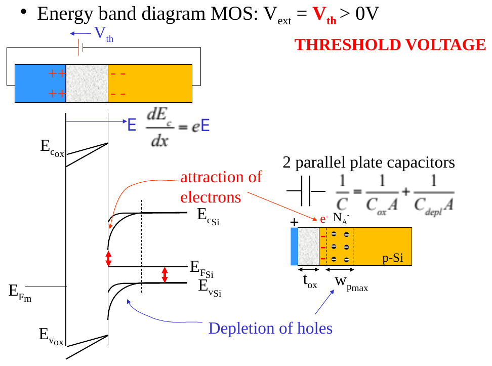
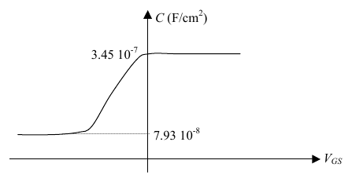
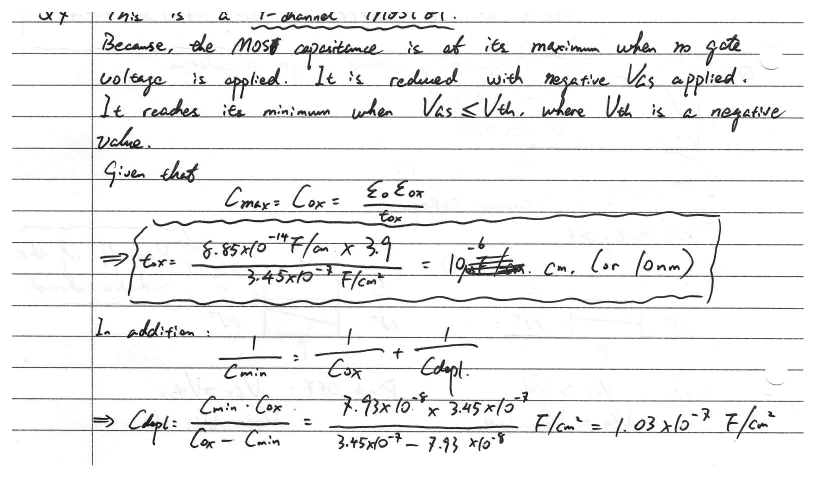
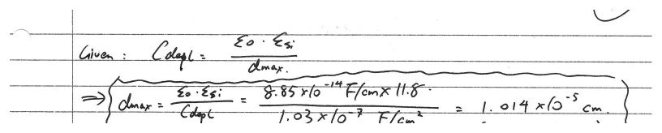
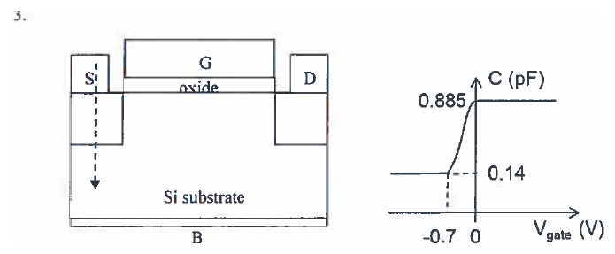
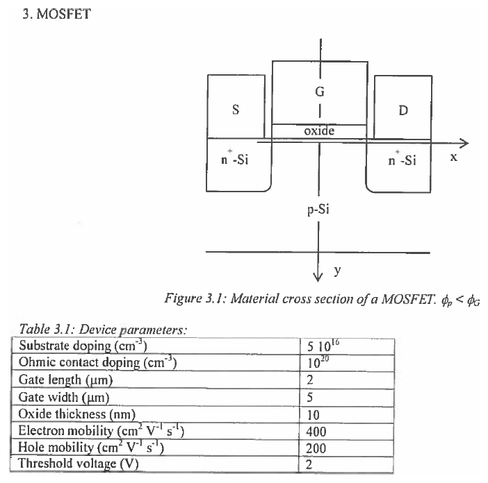
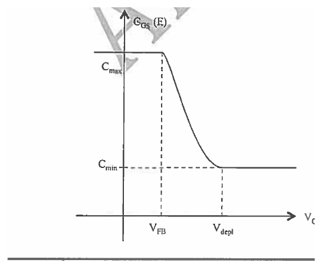
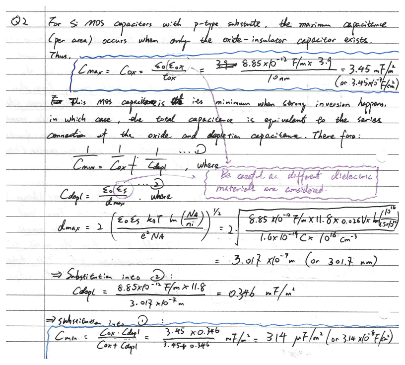

# Topic 16: MOS capacitance–voltage (C–V)

Tutorial questions: Ch3 Q2, Q7 · Past finals: 2014 Q3a i, 2014 Q3b i and iii, 2014 Q3c i, 2016 Q3c and d, 2017 Q3e

Slides: SSD_3, pages 9 to 11 (the capacitor sketches). Booklet §4.2 (pages 61 and 62, Fig. 6 and equations 3 to 5).

---

## The big idea

Topic 15 showed what the gate voltage does to the Si surface.

This topic turns that into **one graph**: the capacitance C against the gate voltage V.

- **Accumulation:** only the oxide separates the "plates". C is **biggest**: C_max = C_ox.
- **Depletion:** a depleted layer adds to the gap. C **drops**.
- **Inversion:** the depletion layer stops growing (it's at its maximum). C stays at its **smallest**: C_min.

From a measured C–V curve the exam asks you to read off: the **type** (n or p-channel), **t_ox**, **W_depl,max**, and **V_th**.

That's 2014 Q3, 2016 Q3 and Ch3 Q7. Big marks for one graph.

---

**How to use these notes:**
When you see 🧠, stop.
Answer it on paper first.
Then click to check.

---

## ⭐ Learn by heart from this topic

$$C_{ox} = \frac{\varepsilon_0\,\varepsilon_{ox}}{t_{ox}} \quad\text{(per area)} \qquad C_{max} = C_{ox}\,W L$$

$$\frac{1}{C_{min}} = \frac{1}{C_{ox}} + \frac{1}{C_{depl}} \qquad C_{depl} = \frac{\varepsilon_0\,\varepsilon_{Si}}{W_{depl}^{max}}$$

**Which side is high?**

| Substrate | MOSFET | C is high (accumulation) when | V_th (enhancement) |
|---|---|---|---|
| p-type | n-channel | V_GS **negative** | positive |
| n-type | p-channel | V_GS **positive** | negative |

**Memory hook:**
"High C is where the majority carriers pile up. The curve drops towards the side that makes a channel."

**Unit trap:** a C–V graph in **F** (or pF) is the **whole** capacitance. Divide by W × L to get C_ox in F/cm².

---

## 1. The C–V curve

**How to read this diagram (booklet Fig. 6):**

- x axis: gate voltage V. y axis: capacitance C.
- **Left, V < 0: accumulation.** Holes sit right against the oxide. The gap is just t_ox. C is flat and **high**.
- **Middle: depletion.** As V rises, the depletion layer under the oxide gets wider. Bigger gap → **smaller C**. The curve slopes down.
- **At V_th:** the depletion width reaches its **maximum** (blue arrow). The inversion layer forms.
- **Right, V > V_th: inversion.** Extra gate charge goes into the inversion electrons, not into a wider depletion layer. C stays at its **minimum**.

This is the **high-frequency** curve that every past final uses: C stays at C_min after V_th.

 

**How to read this diagram (slide 11, the right half):**

- "2 parallel plate capacitors": the oxide (thickness t_ox) and the depletion layer (width w_p,max).
- They are in **series**: 1/C = 1/(C_ox A) + 1/(C_depl A).
- Series capacitors: the total is **smaller** than either one.

---

### 📐 Equation 28: oxide capacitance (NOT on the formula sheet)

$$C_{ox} = \frac{\varepsilon_0\,\varepsilon_{ox}}{t_{ox}}$$

| Symbol | Means | Value / units |
|---|---|---|
| C_ox | capacitance **per unit area** of the gate oxide | F/cm² |
| ε₀ | permittivity of free space | **8.85 × 10⁻¹⁴ F/cm** |
| ε_ox | dielectric constant of SiO₂ | **4** on the exam sheet (3.9 in the Ch3 tutorial) |
| t_ox | oxide thickness | cm (10 nm = 10⁻⁶ cm) |

**What it means:**
A thinner oxide = a bigger C_ox = more channel charge per volt on the gate.

**Use it when:**
Any MOS or MOSFET calculation. It's inside the MOSFET current on the formula sheet, but the sheet doesn't tell you what C_ox is.

**Get t_ox from a C–V curve:** C_max = C_ox × W L, so t_ox = ε₀ ε_ox W L ÷ C_max.

---

### 📐 Equation 29: minimum capacitance (NOT on the formula sheet)

$$\frac{1}{C_{min}} = \frac{1}{C_{ox}} + \frac{1}{C_{depl}} \qquad C_{depl} = \frac{\varepsilon_0\,\varepsilon_{Si}}{W_{depl}^{max}}$$

| Symbol | Means | Units |
|---|---|---|
| C_min | capacitance per area in inversion | F/cm² |
| C_depl | capacitance per area of the maximum depletion layer | F/cm² |
| ε_Si | dielectric constant of Si | **11** on the exam sheet (11.8 in the tutorial, 12 in the booklet) |
| W_depl^max | maximum depletion width | cm |

**What it means:**
Two capacitors in series. **Different dielectrics!** ε_ox for the oxide, ε_Si for the depletion layer.

**Use it when:**
You're asked for C_min, or you're given C_min and want W_depl^max.

**Working backwards (2014 Q3b iii, Ch3 Q7):**

$$C_{depl} = \frac{C_{min}\,C_{ox}}{C_{ox} - C_{min}} \qquad W_{depl}^{max} = \frac{\varepsilon_0\varepsilon_{Si}}{C_{depl}}$$

With whole capacitances (F) instead of per area, multiply ε₀ε_Si by the area W L:

$$W_{depl}^{max} = \frac{\varepsilon_0\,\varepsilon_{Si}\,W L\,(C_{max} - C_{min})}{C_{max}\,C_{min}}$$

---

### 📐 Equation 30: maximum depletion width (on the formula sheet)

$$W_{depl}^{max} = 2\left[\frac{\varepsilon\,kT\,\ln(N_{sub}/n_i)}{e^2\,N_{sub}}\right]^{1/2}$$

| Symbol | Means | Value |
|---|---|---|
| ε | ε₀ ε_Si | 11 × 8.85 × 10⁻¹⁴ F/cm |
| kT/e | thermal voltage | 0.026 V |
| N_sub | substrate doping | cm⁻³ |

**What it means:**
It's the one-sided depletion width (Topic 14) with the band bending at threshold, 2φ_F (Topic 15 Equation 27), put in.

**Use it when:**
You need C_min from the doping (Ch3 Q2, 2016 Q3d).

**Unit tip:** write it as $2\sqrt{\varepsilon\,(kT/e)\ln(N/n_i)\,/\,(e N)}$. Then kT/e = 0.026 V and only one e is left in the bottom.

---

### 🧠 Check
t_ox = 10 nm, ε_ox = 4. Find C_ox in F/cm².

Answer

t_ox = 10 nm = 10 × 10⁻⁷ cm = 10⁻⁶ cm.

C_ox = 8.85 × 10⁻¹⁴ × 4 ÷ 10⁻⁶ = **3.54 × 10⁻⁷ F/cm²**

---

## 2. Reading a measured C–V curve (Ch3 Q7)

**How to read this diagram:**

- C is **high** at V_GS ≥ 0 and **drops** when V_GS goes negative.
- High C = accumulation of majority carriers. Accumulating at **positive** gate means the majority carriers are **electrons**: an **n-type substrate**.
- n-type substrate = **p-channel** MOSFET. The channel appears at **negative** V_GS, so V_th < 0.
- The top value is C_max = C_ox = 3.45 × 10⁻⁷ F/cm². Bottom: C_min = 7.93 × 10⁻⁸ F/cm².

**Step 1: oxide thickness**

t_ox = ε₀ε_ox ÷ C_ox = 8.85 × 10⁻¹⁴ × 3.9 ÷ 3.45 × 10⁻⁷ = **1.0 × 10⁻⁶ cm = 10 nm**

**Step 2: depletion capacitance**

C_depl = C_min C_ox ÷ (C_ox − C_min) = 7.93 × 10⁻⁸ × 3.45 × 10⁻⁷ ÷ 2.66 × 10⁻⁷ = **1.03 × 10⁻⁷ F/cm²**

**Step 3: maximum depletion width**

W = ε₀ε_Si ÷ C_depl = 8.85 × 10⁻¹⁴ × 11.8 ÷ 1.03 × 10⁻⁷ = **1.01 × 10⁻⁵ cm ≈ 101 nm**

(The tutorial uses 3.9 and 11.8. In the exam use the sheet's 4 and 11.)

 

### 🧠 Check
The curve in 2014 Q3 is high (0.885 pF) for V_gate > 0 and low (0.14 pF) below −0.7 V. n-channel or p-channel? What is V_th?

Answer

High at positive gate → electrons accumulate → **n-type substrate** → **p-channel** MOSFET.

The source and drain are then **p⁺**.

C hits its minimum at V_gate = −0.7 V, so **V_th = −0.7 V**.

---

## 3. Gate C–V in a MOSFET with a workfunction difference (2016 Q3c)

**How to read this diagram:**

- n⁺ source and drain on p-Si: an nMOS. φ_G − φ_p = 1 V.
- **V_GS < V_FB: accumulation.** C_GS is at its maximum, set by the oxide only.
- At zero bias the surface is already in accumulation (Topic 15 §1), so accumulation lasts until the **flat band** voltage V_FB = φ_G − φ_p = **+1 V**.
- **V_FB < V_GS < V_th: depletion.** C_GS drops as the depletion layer grows.
- **V_GS ≥ V_th:** maximum depletion width, inversion. C_GS = C_min.

So the drop starts at V_FB, not at 0 V. That's the "twist" in 2016.

---

## 4. Worked example: Tutorial Ch3 Q2 (C_max and C_min from the doping)

> p-type Si, N_A = 10¹⁶ cm⁻³, nᵢ ≈ 1.5 × 10¹⁰ cm⁻³, t_ox = 10 nm, ε_Si = 11.8, ε_ox = 3.9. Find C_max and C_min per area.

**C_max = C_ox**

C_ox = 8.85 × 10⁻¹⁴ × 3.9 ÷ 10⁻⁶ = **3.45 × 10⁻⁷ F/cm²**

**W_depl^max** (Equation 30)

ε = 11.8 × 8.85 × 10⁻¹⁴ = 1.04 × 10⁻¹² F/cm. ln(10¹⁶ ÷ 1.5 × 10¹⁰) = 13.4.

W = 2 × √(1.04 × 10⁻¹² × 0.026 × 13.4 ÷ (1.6 × 10⁻¹⁹ × 10¹⁶)) = 2 × √(2.28 × 10⁻¹⁰) = **3.0 × 10⁻⁵ cm = 302 nm**

**C_depl** = 1.04 × 10⁻¹² ÷ 3.02 × 10⁻⁵ = 3.46 × 10⁻⁸ F/cm²

**C_min** = C_ox C_depl ÷ (C_ox + C_depl) = 3.45 × 10⁻⁷ × 3.46 × 10⁻⁸ ÷ 3.80 × 10⁻⁷ = **3.14 × 10⁻⁸ F/cm²**

---

## 5. Worked example: 2016 Q3d (whole capacitances, triode)

> Table 3.1: N_sub = 5 × 10¹⁶ cm⁻³, L = 2 µm, W = 5 µm, t_ox = 10 nm. Find the maximum and minimum C_GS (V_DS in the triode region).

In the triode region the gate charge is shared by the source and drain ends, so the official answer uses **C_GS = ½ C_ox W L** (Topic 19).

C_max = ½ × (4 × 8.85 × 10⁻¹⁴ ÷ 10⁻⁶) × (2 × 10⁻⁴ × 5 × 10⁻⁴) = **1.77 × 10⁻¹⁴ F**

W_depl^max = 2 × √(11 × 8.85 × 10⁻¹⁴ × 0.026 × ln(5 × 10¹⁶ ÷ 1.45 × 10¹⁰) ÷ (1.6 × 10⁻¹⁹ × 5 × 10¹⁶)) = **1.38 × 10⁻⁵ cm**

C_depl = 11 × 8.85 × 10⁻¹⁴ × 10⁻⁷ cm² ÷ 1.38 × 10⁻⁵ = 7.1 × 10⁻¹⁵ F

C_min = C_max C_depl ÷ (C_max + C_depl) = **5.0 × 10⁻¹⁵ F**

**⚠️ Note:** the official answer writes C_depl = 5 × 10⁻¹⁵ F and gets C_min = 3.9 × 10⁻¹⁵ F. Recomputing their own numbers gives 7.1 × 10⁻¹⁵ F, so that looks like a slip. The **method** is what earns the marks.

---

## Drawing checklist: C–V curve

1. Axes: **C** (or C_GS) up, **V_GS** across. Mark 0 V.
2. **Flat high line** on the accumulation side. Label it C_max = C_ox W L.
3. **S-shaped drop** through depletion.
4. **Flat low line** from V_th onwards. Label it C_min.
5. Mark **V_th** where the curve reaches C_min.
6. Side check: p-substrate (nMOS) → high on the **left**. n-substrate (pMOS) → high on the **right**.
7. If φ_m ≠ φ_s, the drop starts at **V_FB**, not at 0.

---

## Method: C–V questions

| You're asked for | Use |
|---|---|
| n- or p-channel from a C–V curve | which side is high (the ⭐ table) |
| doping type of source, drain, substrate | substrate from the curve; source/drain the opposite, heavily doped |
| t_ox | C_max = C_ox W L, then Equation 28 |
| C_max | Equation 28 (× W L for a whole capacitance; × ½ in triode for C_GS) |
| W_depl^max from the doping | Equation 30 (formula sheet) |
| W_depl^max from the curve | Equation 29 worked backwards |
| C_min | Equation 29 |
| V_th from the curve | where C reaches C_min |
| where C_GS stops being constant | V_FB (start of drop), V_th (end of drop), §3 |

---

Next: [End-of-topic test](../questions/16-mos-cv.md)
