# Topic 17: The MOSFET: channel charge, current, triode and saturation

Tutorial questions: Ch3 Q5 · Past finals: 2015 Q1g, 2015 Q2a, b, c, 2014 Q3c ii and iii, 2018 Q1c v

Slides: SSD_3, pages 5 and 6, 13 to 16, 20 to 46. Booklet §4.3 (pages 63 to 68).

---

## The big idea

A MOSFET is a MOS capacitor (Topics 15 and 16) with an **n⁺ source** on one side and an **n⁺ drain** on the other.

- With no gate voltage, source → p-Si → drain is **n⁺pn⁺**: two back-to-back diodes. **No current.**
- A gate voltage above V_th inverts the surface. Now it's **n⁺ n n⁺**: a conducting **channel**.
- The gate does this by **lowering the barrier** between the source and the channel.
- Once electrons are in the channel, V_DS makes them **drift** to the drain.

Two regions:

- **Triode** (small V_DS): a resistor whose value the gate sets.
- **Saturation** (V_DS ≥ V_GS − V_th): the channel **pinches off** at the drain. The current stops rising: a current source the gate sets.

---

**How to use these notes:**
When you see 🧠, stop.
Answer it on paper first.
Then click to check.

---

## ⭐ Learn by heart from this topic

$$Q_n(x) = -C_{ox}\big(V_{GS} - V_{th} - V(x)\big) \qquad \text{(channel charge per area)}$$

$$\text{Pinch-off: } V_{DS}^{sat} = V_{GS} - V_{th} \qquad I_{DS}^{sat} = \frac{\mu C_{ox}W}{2L}(V_{GS} - V_{th})^2$$

| Region | Condition | Behaves like | Current |
|---|---|---|---|
| off | V_GS < V_th | open switch | 0 |
| triode | V_DS < V_GS − V_th | gate-controlled **resistor** | formula sheet I_DS |
| saturation | V_DS ≥ V_GS − V_th | gate-controlled **current source** | I_DS^sat |

**Facts examiners love:**
- A MOSFET is a **majority carrier** device. The channel current is **drift**.
- The gate controls the **source–channel barrier**, so it controls how many electrons **diffuse** into the channel.
- I_DS ∝ W/L. Shorter gate = more current.
- nMOS substrate is **p-type** (2018 Q1c v: "n-type" is **no**).

**Memory hook:**
"Gate opens the door. Drain pulls them through. Pinch-off means the drain end of the channel is shut, but the door is still the same size."

---

## 1. The structure, and why there's no current without the gate

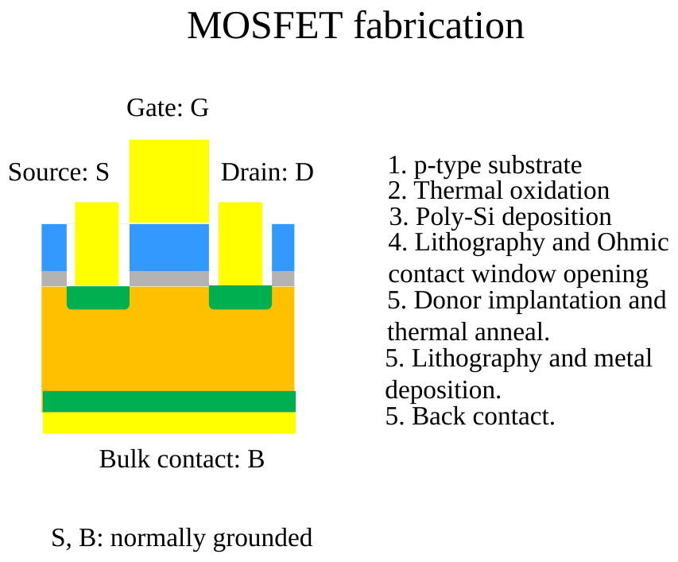

**How to read this diagram:**

- Yellow: metal contacts. **S** source, **G** gate, **D** drain, **B** bulk (back contact).
- Blue: the gate oxide and field oxide. Green: the n⁺ implanted source and drain.
- Orange: the p-type substrate.
- The steps on the right: start with p-Si, grow oxide, put down poly-Si, open contact windows, implant donors, deposit metal.
- S and B are normally **grounded**.

 

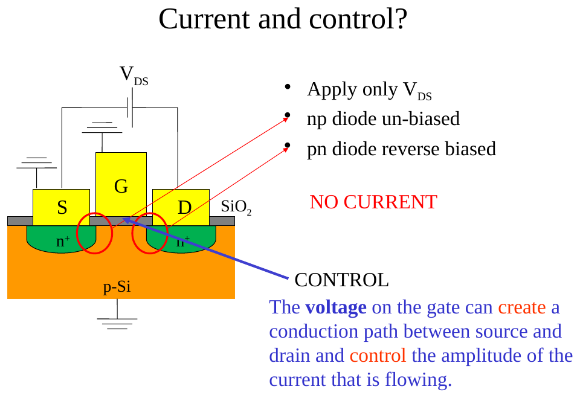

**How to read this diagram:**

- Only V_DS is applied, the gate is at 0.
- Source side: an n⁺p diode at zero bias. Drain side: a pn⁺ diode in **reverse** bias.
- A reverse-biased diode lets almost nothing through. **No current.**
- The gate voltage can **create a conducting path** between S and D, and set how much current flows.

---

## 2. The band diagram from source to drain

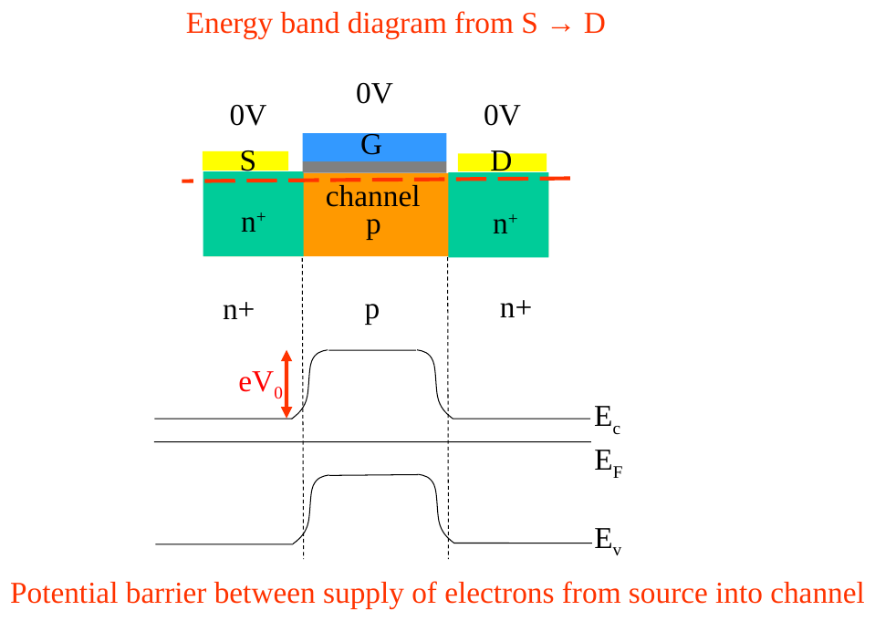

**How to read this diagram:**

- We follow a line along the surface, **source → channel → drain**.
- n⁺ | p | n⁺: E_C is close to E_F in the source and drain, far above it in the p channel region.
- There's a **hump** of height **eV₀** (the built-in barrier, Topic 10). Electrons in the source can't climb it.

 

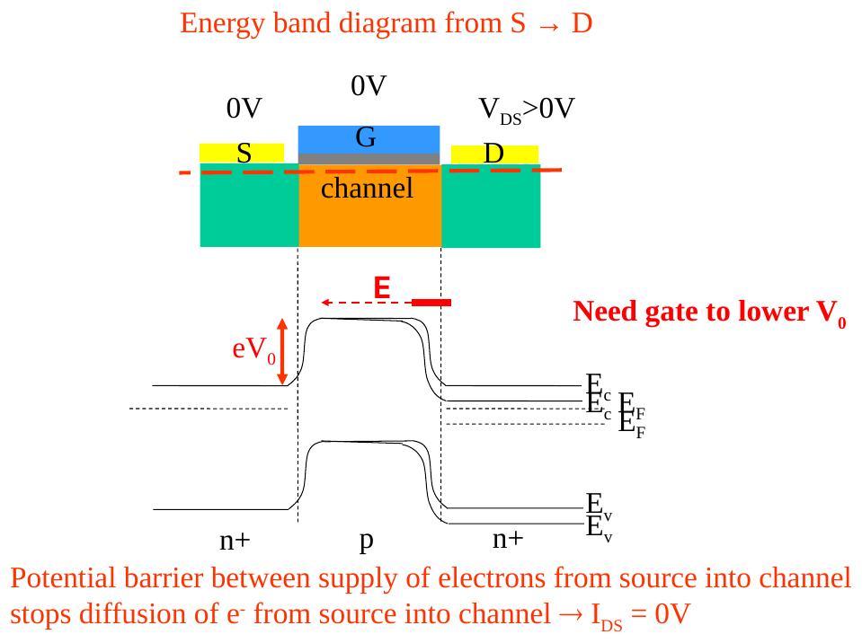

**How to read this diagram:**

- Now V_DS > 0. The drain side drops (positive voltage lowers electron energy).
- But the source-side barrier eV₀ **is still there**. It stops electrons diffusing from the source into the channel.
- **I_DS = 0.** "Need gate to lower V₀."

 

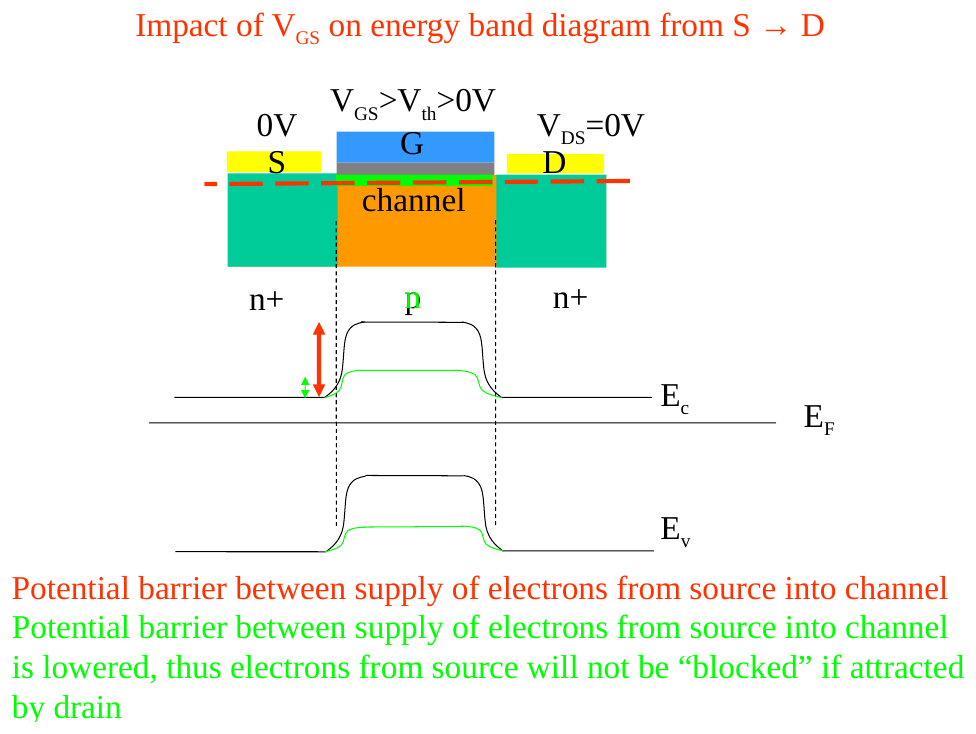

**How to read this diagram:**

- Black: V_GS = 0. Green: V_GS > V_th.
- The gate pulls the channel bands **down**. The hump gets **lower** (green arrow is shorter than red).
- Electrons from the source now get into the channel. They won't be blocked if the drain attracts them.

 

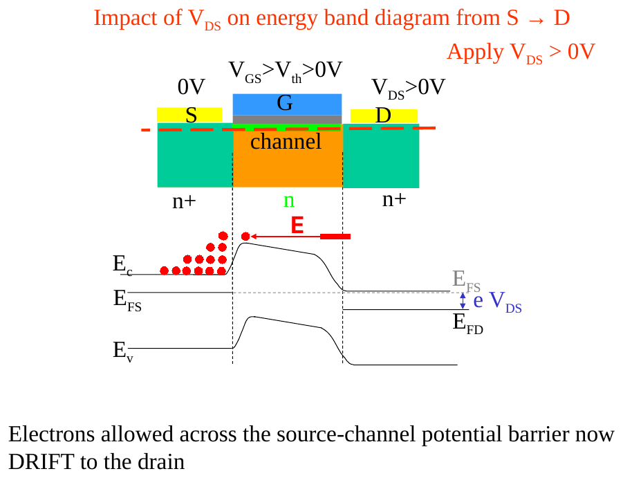

**How to read this diagram:**

- V_GS > V_th **and** V_DS > 0.
- The drain's E_F is eV_DS **below** the source's.
- The channel bands now **tilt** down towards the drain. That tilt is a field ℰ (red arrow, pointing to the source).
- The red dots: electrons that crossed the lowered barrier now **roll down** the slope to the drain. That's **drift**.

 

### 🧠 Check
In the S → D band diagram, what does a higher V_GS change, and what does a higher V_DS change?

Answer

- **Higher V_GS:** lowers the **source–channel barrier**. More electrons get in.
- **Higher V_DS:** increases the **tilt** across the channel (the field). Electrons drift faster.

---

## 3. The charge in the channel

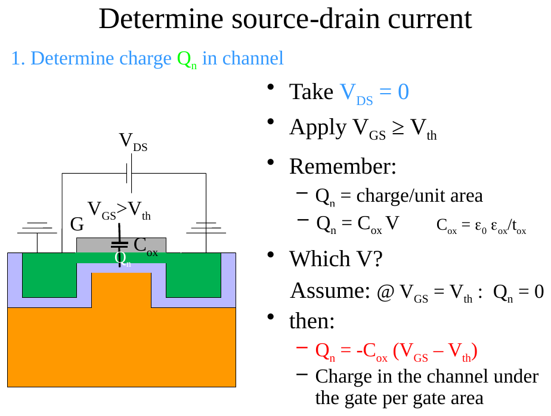

**How to read this diagram:**

- The gate is a capacitor plate. Q = C V, per area: **Q_n = C_ox V**.
- Which V? We take **no channel charge at V_GS = V_th**. Only the voltage **above** V_th makes channel electrons.
- So with V_DS = 0: **Q_n = −C_ox(V_GS − V_th)**. Minus because they're electrons.

 

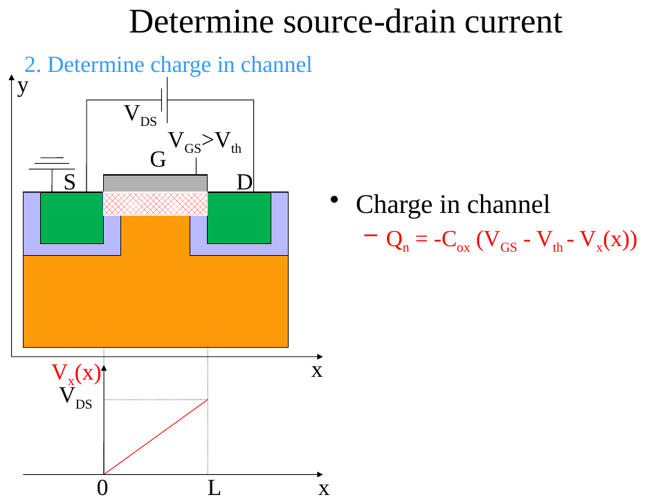

**How to read this diagram:**

- Now V_DS > 0. The voltage **along** the channel, V_x(x), rises from 0 at the source to V_DS at the drain (red line, bottom).
- The voltage **across the oxide** at point x is V_GS − V_x(x). Smaller towards the drain.
- So the channel holds less charge near the drain.

---

### 📐 Equation 31: channel charge (NOT on the formula sheet)

$$Q_n(x) = -C_{ox}\big(V_{GS} - V_{th} - V(x)\big)$$

| Symbol | Means | Units |
|---|---|---|
| Q_n(x) | inversion charge per gate area at point x | C/cm² (or C/m²) |
| C_ox | oxide capacitance per area, ε₀ε_ox/t_ox (Topic 16) | F/cm² |
| V_GS | gate–source voltage | V |
| V_th | threshold voltage | V |
| V(x) | channel voltage at x: 0 at the source, V_DS at the drain | V |

**What it means:**
Capacitor charge = C × (voltage across the oxide that's above threshold).

**Use it when:**
2015 Q2c asks you to derive it and to calculate it halfway along the channel. Take V(L/2) ≈ V_DS/2 (linear in triode).

---

## 4. The current

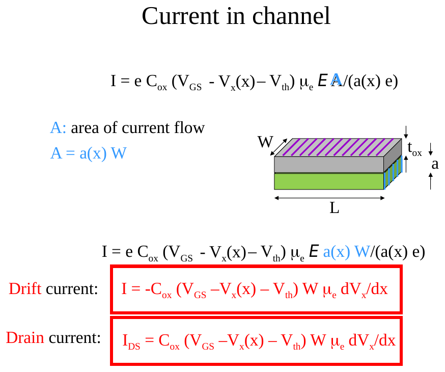

**How to read this diagram:**

- Drift current: I = e n µ ℰ A (Topic 3).
- n = −Q_n ÷ (e × channel thickness a). Area A = a × W. The a cancels.
- ℰ = −dV_x/dx.
- Result in the red box: **I_DS = C_ox(V_GS − V_x − V_th) W µ dV_x/dx**.

 

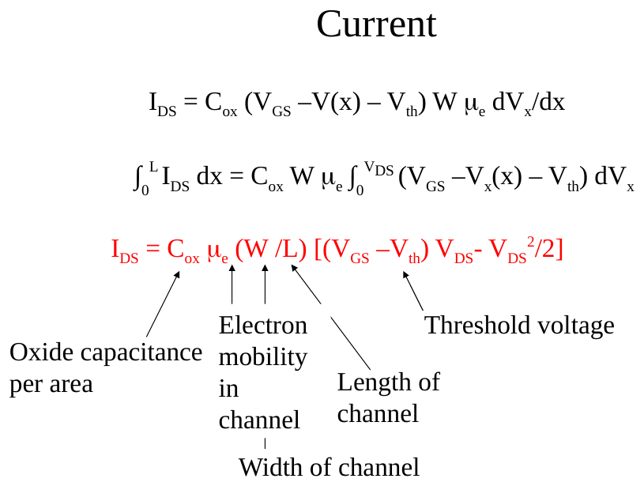

**How to read this diagram:**

- I_DS is the **same at every x** (charge isn't lost). So integrate both sides: x from 0 to L, V_x from 0 to V_DS.
- You get the formula on the sheet. Each symbol is labelled: C_ox per area, µ in the channel, W, L, V_th.

---

### 📐 Equation 32: MOSFET current (on the formula sheet)

$$I_{DS} = \frac{\mu C_{ox}W}{L}\left[(V_{GS} - V_{th})V_{DS} - \frac{V_{DS}^2}{2}\right]$$

| Symbol | Means | Units |
|---|---|---|
| µ | mobility of the carriers **in the channel** (electrons for nMOS, holes for pMOS) | cm²/Vs |
| C_ox | oxide capacitance per area | F/cm² |
| W | gate width | cm |
| L | gate length (source to drain) | cm |

**What it means:**
Current grows with V_GS (more charge) and with V_DS (more field), until pinch-off.

**Use it when:**
**V_GS > V_th and V_DS ≤ V_GS − V_th** only. Past that, use Equation 33.

**Mobility trap (2014 Q3c ii):** pick the mobility of the **channel** carrier only. pMOS → hole mobility. Read it off the mobility-vs-doping graph at the **substrate** doping.

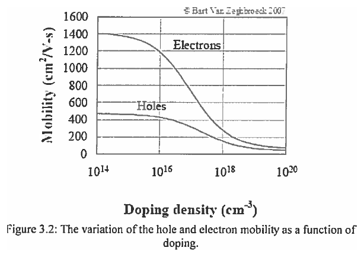

---

## 5. Pinch-off and saturation

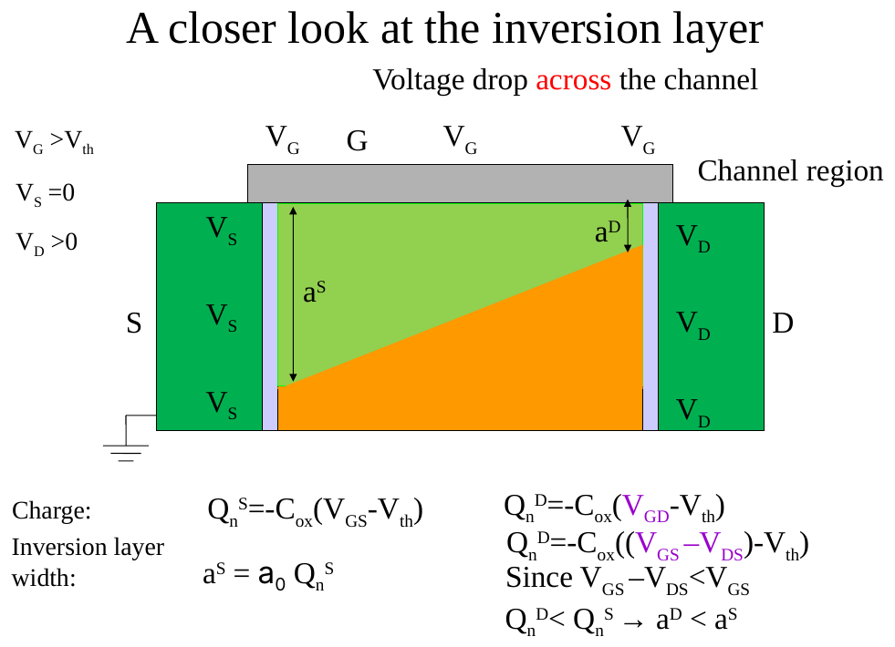

**How to read this diagram:**

- Green wedge: the inversion layer. Thick at the source (a^S), thin at the drain (a^D).
- Because Q_n^D = −C_ox(V_GD − V_th) is smaller than Q_n^S.

 

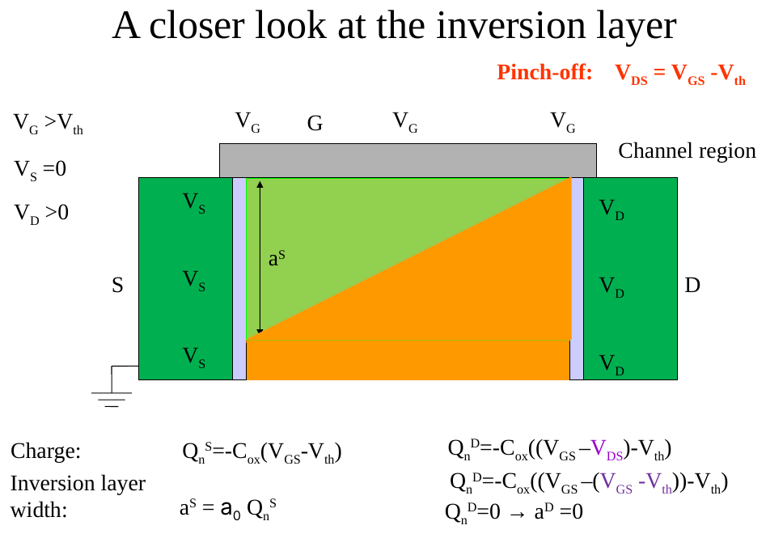

**How to read this diagram:**

- Push V_DS up to **V_GS − V_th**. Then V_GD = V_th at the drain end.
- The drain-end charge Q_n^D = 0. The wedge touches zero: the channel is **pinched off**.

 

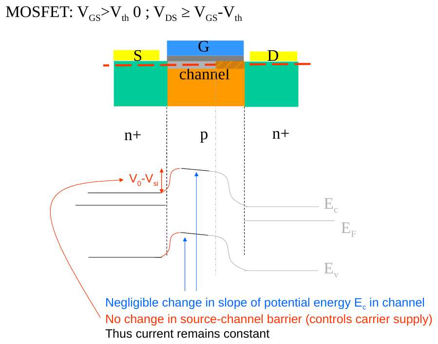

**How to read this diagram:**

- V_DS ≥ V_GS − V_th.
- Near the drain the channel is no longer inverted, it's **depleted**: a reverse-biased channel–drain junction.
- Any **extra** V_DS drops across that depletion region (the steep drop on the right), not across the channel.
- So the slope in the channel hardly changes, and the **source–channel barrier doesn't change**.
- The supply of electrons is unchanged → **the current stays constant**.

**Why can current cross a depletion region?** It's like a reverse-biased diode: the field sweeps across whatever carriers arrive. Here the source supplies them through the channel (slide 43).

---

### 📐 Equation 33: saturation current (NOT on the formula sheet)

$$I_{DS}^{sat} = \frac{\mu C_{ox}W}{2L}(V_{GS} - V_{th})^2$$

| Symbol | Means |
|---|---|
| I_DS^sat | the flat current past pinch-off |
| (V_GS − V_th) | the "overdrive" above threshold |

**What it means:**
Put V_DS = V_GS − V_th into Equation 32. The bracket becomes (V_GS − V_th)²/2.

**Use it when:**
V_DS ≥ V_GS − V_th. Also the starting point for g_m in saturation (Topic 19).

**pMOS:** V_GS, V_th and V_DS are all **negative**. (V_GS − V_th)² is still positive; the current is quoted **negative** (2014 Q3c iii).

---

### 🧠 Check
nMOS, V_th = 1 V, V_GS = 3 V. Is it in triode or saturation at V_DS = 1.5 V? At V_DS = 2.5 V?

Answer

Pinch-off at V_DS = V_GS − V_th = 2 V.

- V_DS = 1.5 V < 2 V: **triode**.
- V_DS = 2.5 V ≥ 2 V: **saturation**.

---

## 6. Output and transfer characteristics

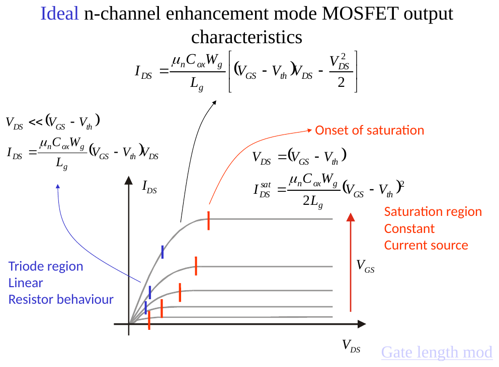

**How to read this diagram:**

- I_DS against V_DS, one curve per V_GS. Higher V_GS = higher curve.
- **Left (blue): triode.** Straight-ish rise: a resistor.
- **Red ticks: onset of saturation**, where V_DS = V_GS − V_th. They move right as V_GS grows.
- **Right (red): saturation.** Flat: a constant current source.

 

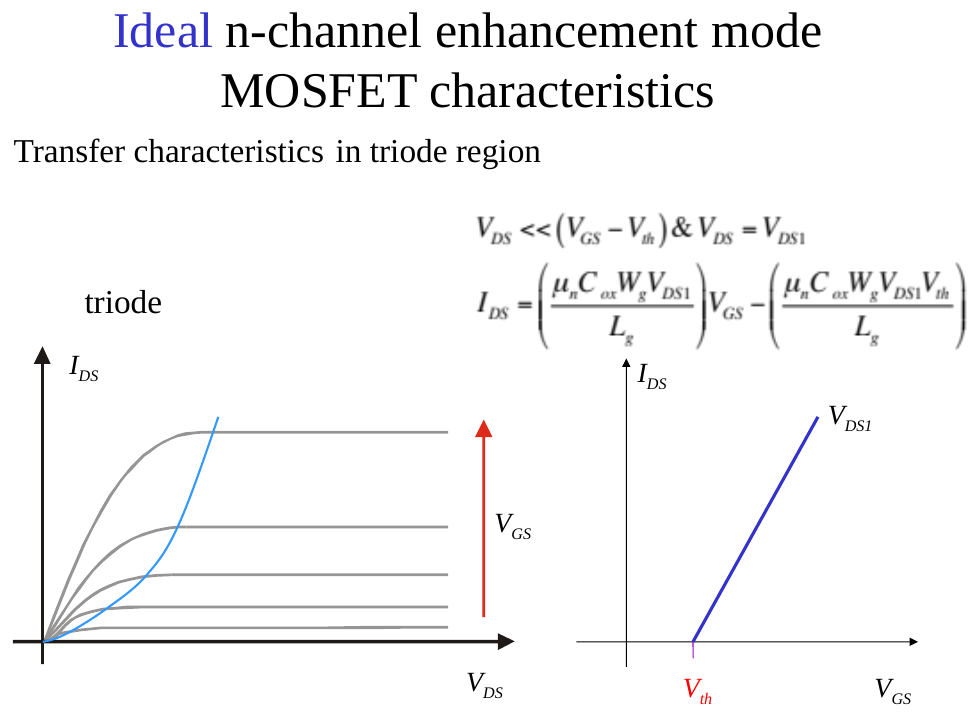

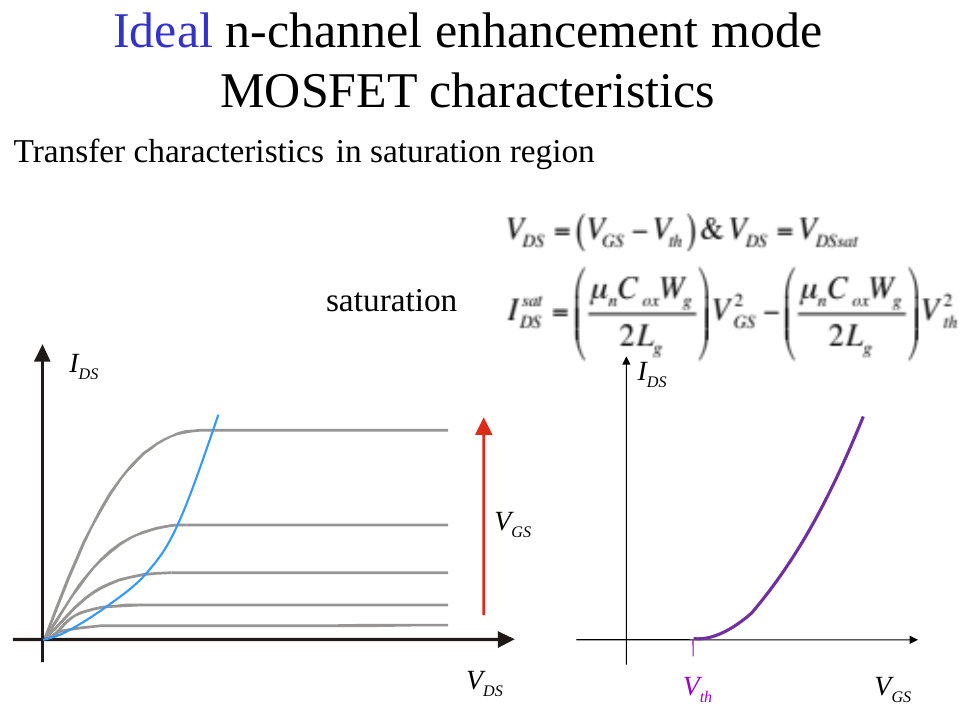

**How to read these diagrams:**

- Transfer characteristic: I_DS against **V_GS**, at one fixed V_DS.
- Zero until **V_th**.
- **Triode** (small V_DS): a **straight line** from V_th.
- **Saturation:** a **parabola** from V_th, (V_GS − V_th)².

---

## 7. Drift in the channel, diffusion at the source (2015 Q2a and b)

This was "the most difficult question in the exam" (2015 examiner). You need both halves.

**(a) Why is diffusion along the channel negligible?** (triode, V_GS ≫ V_th)

- J_n = drift + diffusion. Drift ∝ n(x), and n(x) is large in strong inversion.
- Diffusion ∝ dn/dx. n is set by the oxide voltage: V_GS at the source end, V_GD at the drain end.
- In triode V_DS is small, so V_GD ≈ V_GS. The band bending at both ends is almost the same.

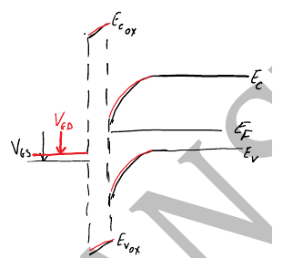

- So n is almost the same along the channel: **tiny gradient, tiny diffusion**. Drift wins.

**(b) But diffusion controls I_DS.** Look at the S → D band diagram for three V_GS:

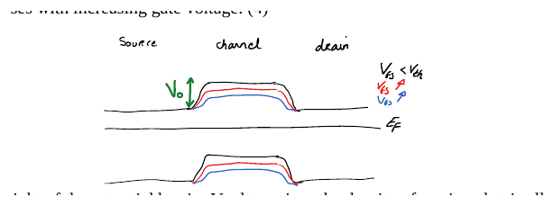

- Higher V_GS = lower barrier V₀ between source and channel.
- Only source electrons with energy **above** the barrier (the Fermi tail) can **diffuse** into the channel:

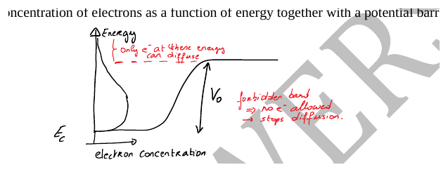

- Lower barrier → more electrons diffuse in → more current to drift through.

---

## 8. Worked example: 2014 Q3c iii (pMOS output characteristic)

> pMOS: V_th = −0.7 V, µ_p = 410 cm²/Vs, C_ox = 1.77 × 10⁻⁷ F/cm², W = 100 µm, L = 5 µm. Sketch I_DS–V_DS for V_GS = −1 V and 0 < |V_DS| < 1 V. Give the voltage and current at saturation.

**Pinch-off:** V_DS = V_GS − V_th = −1 − (−0.7) = **−0.3 V**

**Saturation current:**

I_sat = µC_ox W ÷ (2L) × (V_GS − V_th)²

= 410 × 1.77 × 10⁻⁷ × 100 × 10⁻⁴ ÷ (2 × 5 × 10⁻⁴) × (−0.3)²

= **6.53 × 10⁻⁵ A**, quoted as **−65 µA** for a pMOS.

**Sketch:** both axes negative (third quadrant, or label them −I_DS and −V_DS). A rising curve up to |V_DS| = 0.3 V, flat at 65 µA after.

---

## 9. Worked example: 2015 Q2c ii (channel charge halfway)

> t_ox = 10 nm, V_th = 1 V, V_GS = 1.5 V, V_DS = 0.1 V. Find Q halfway between source and drain.

C_ox = 8.85 × 10⁻¹² × 4 ÷ 10 × 10⁻⁹ = 3.54 × 10⁻³ F/m²

Halfway, V(x) ≈ V_DS/2 = 0.05 V (linear in triode).

Q = −3.54 × 10⁻³ × (1.5 − 1 − 0.05) = **−1.6 × 10⁻³ C/m²**

---

## Drawing checklist

**S → D band diagram:**
1. Three regions: **n⁺ source | channel | n⁺ drain**. E_C near E_F in the n⁺ regions.
2. V_GS < V_th: a **hump** (eV₀) in the channel. V_GS > V_th: hump **lower**.
3. V_DS > 0: drain E_F (and bands) **eV_DS lower**. Channel bands **tilt** down to the drain.
4. Saturation: the drop is mostly at the **drain end** (channel–drain depletion), the source barrier unchanged.

**Cross section, triode vs pinch-off (Ch3 Q5):**
1. Triode: inversion layer from S to D, **thinner** at the drain.
2. Pinch-off: inversion layer **touches zero** at the drain.
3. Show depletion around the drain (bigger, reverse biased) and under the gate.

**Output characteristic:** curves rise then flatten; mark the pinch-off locus V_DS = V_GS − V_th.

---

## Method: MOSFET current questions

| You're asked for | Use |
|---|---|
| triode or saturation? | compare V_DS with V_GS − V_th |
| I_DS in triode | Equation 32 (sheet) |
| I_DS in saturation | Equation 33 |
| V_DS at pinch-off | V_GS − V_th |
| channel charge | Equation 31, V(x) ≈ x V_DS/L in triode |
| the derivation | §3 then §4: Q = CV, drift, integrate 0 → L |
| why diffusion is negligible / why diffusion controls I_DS | §7 |
| mobility | channel carrier only, at substrate doping |
| depletion regions for 0 < V_GS < V_th, V_DS > 0 (2015 Q1g) | under the gate + around S and D, **bigger at D**. No inversion layer |

---

Next: [End-of-topic test](../questions/17-mosfet-current.md)
