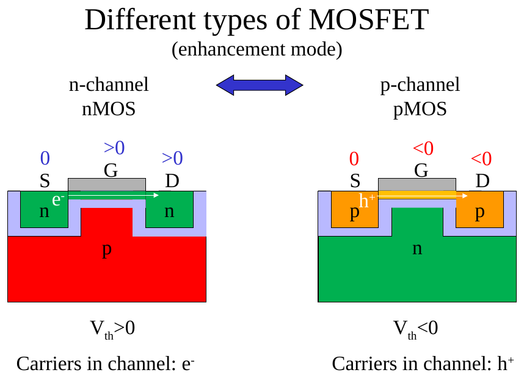
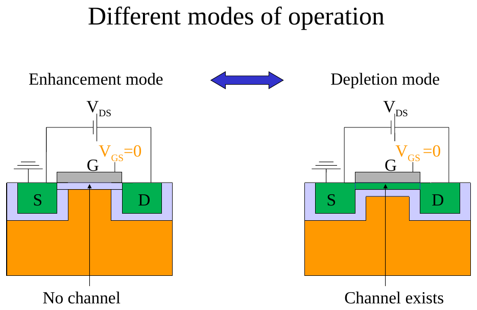
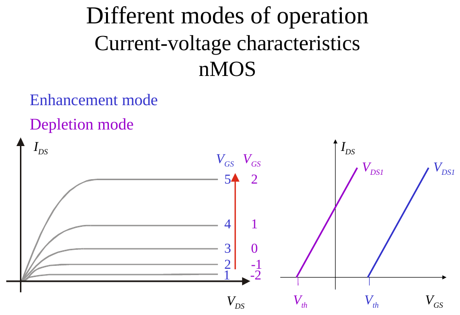
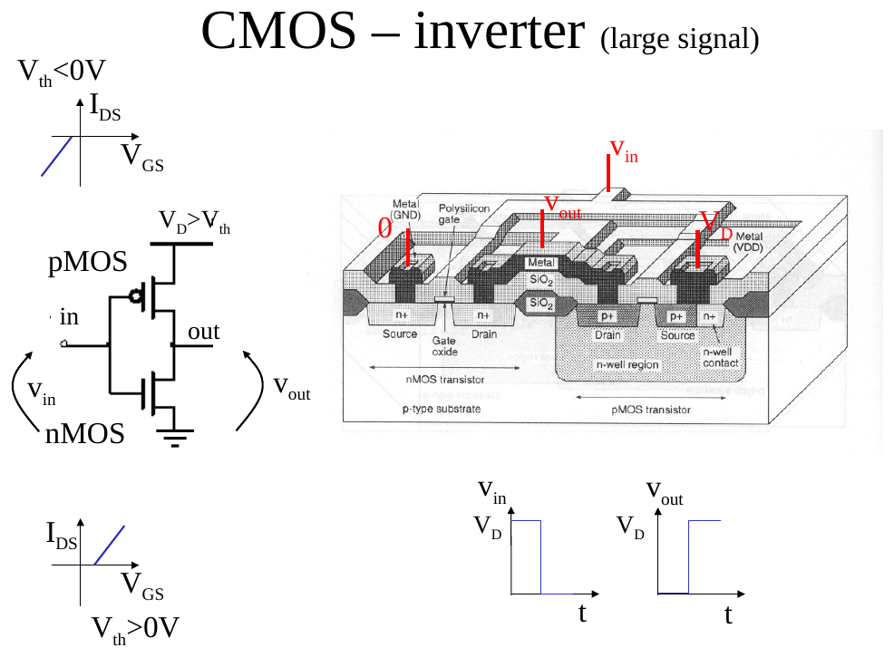
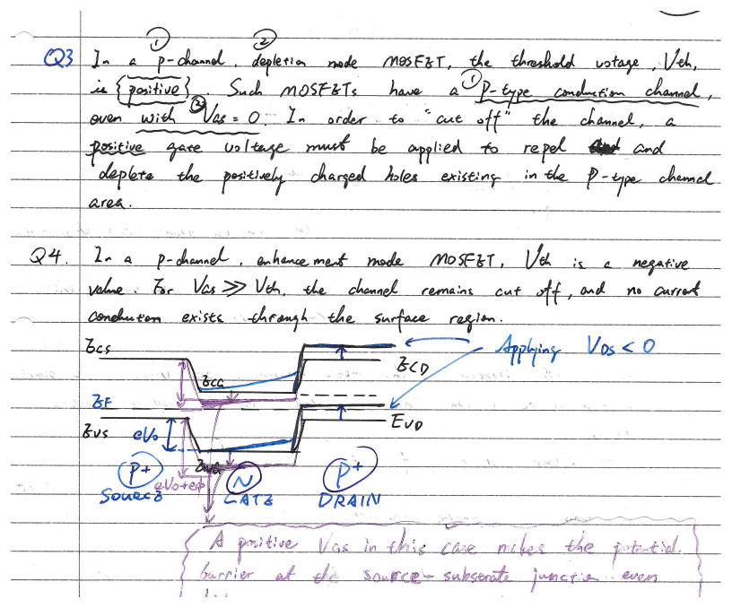
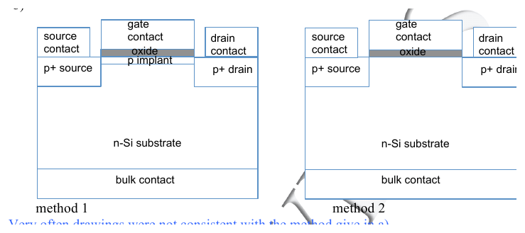
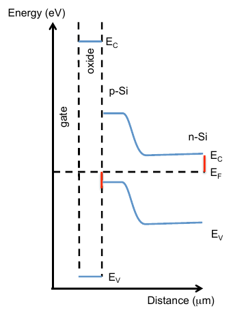
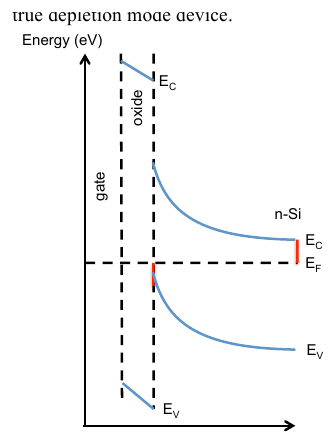
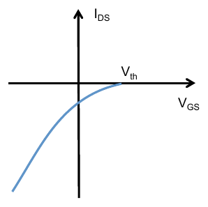

# Topic 18: MOSFET types: n or p channel, enhancement or depletion

Tutorial questions: Ch3 Q3, Q4 · Past finals: 2017 Q3a to d, 2017 Q1i, 2014 Q3a iii, 2018 Q1c v

Slides: SSD_3, pages 49 to 52. Booklet §4.4 and §4.5 (pages 68 and 69).

---

## The big idea

There are **four** MOSFETs. Two questions sort them:

1. **What carries the current in the channel?** Electrons → **n-channel (nMOS)**. Holes → **p-channel (pMOS)**.
2. **Is there a channel at V_GS = 0?** No → **enhancement mode** (normally off). Yes → **depletion mode** (normally on).

Everything else follows: the doping of each region, the sign of V_th, the shape of the curves.

A whole 30-mark question (2017 Q3) was on one of them: the p-channel depletion mode MOSFET.

---

**How to use these notes:**
When you see 🧠, stop.
Answer it on paper first.
Then click to check.

---

## ⭐ Learn by heart from this topic

| Type | Source & drain | Substrate | Channel carriers | Channel at V_GS = 0? | V_th |
|---|---|---|---|---|---|
| n-channel enhancement | n⁺ | p | electrons | no | **> 0** |
| n-channel depletion | n⁺ | p (n implant under gate) | electrons | yes | **< 0** |
| p-channel enhancement | p⁺ | n | holes | no | **< 0** |
| p-channel depletion | p⁺ | n (p implant under gate) | holes | yes | **> 0** |

**Rule for V_th:** V_th is the gate voltage that puts the channel on the **edge**.
- Enhancement: you must **create** a channel → V_th has the sign that attracts the channel carriers (+ for electrons, − for holes).
- Depletion: you must **remove** the channel → the opposite sign.

**pMOS signs:** V_GS, V_DS, V_th (enhancement) and I_DS are all **negative**.

**Two ways to make a depletion-mode device** (2017 Q3a):
1. **Implant** the surface under the gate with the opposite doping (compensation doping, Topic 2).
2. Pick a **gate metal** whose workfunction difference already inverts the surface at 0 V.

**Memory hook:**
"Enhancement: add a voltage to make the channel. Depletion: add a voltage to kill it."

---

## 1. n-channel and p-channel

**How to read this diagram:**

- **Left, nMOS:** n source and drain in a red p substrate. Electrons flow S → D. Biases: S = 0, G > 0, D > 0. **V_th > 0.**
- **Right, pMOS:** p source and drain in a green n substrate. Holes flow S → D. Biases: S = 0, G < 0, D < 0. **V_th < 0.**
- The pMOS is the nMOS with every doping and every sign flipped.

 

### 🧠 Check
Is the substrate of an n-channel enhancement MOSFET n-type? (2018 Q1c v, yes/no)

Answer

**No.** The substrate is **p-type**. The n-channel is an **inversion** layer in p-Si.

---

## 2. Enhancement and depletion mode

**How to read this diagram:**

- Both nMOS, both at V_GS = 0.
- **Left, enhancement:** no channel under the gate. No current at V_GS = 0.
- **Right, depletion:** a green n-layer already joins S and D at V_GS = 0. Current flows with no gate voltage.
- To switch the depletion device **off**, you apply a **negative** gate to push the electrons out of that layer. So V_th < 0.

 

**How to read this diagram:**

- Left: output curves. The V_GS labels show both modes: enhancement curves at V_GS = 1 to 5 V, depletion at V_GS = −2 to 2 V.
- Right: transfer curves (I_DS vs V_GS at one V_DS).
- **Purple (depletion):** starts at a **negative** V_th, and already has current at V_GS = 0.
- **Blue (enhancement):** starts at a **positive** V_th.
- Same shape, just shifted along the V_GS axis.

---

## 3. CMOS

**How to read this diagram:**

- A pMOS (V_th < 0) on top, an nMOS (V_th > 0) below, gates joined.
- **Input high:** nMOS on, pMOS off → output pulled to ground (low).
- **Input low:** pMOS on, nMOS off → output pulled to V_D (high).
- So it **inverts**. One of the pair is always off, so almost no current flows except while switching. That's why CMOS is low power.

---

## 4. Worked example: Tutorial Ch3 Q3 and Q4

> Q3: What is the sign of V_th for a **p-channel depletion mode** MOSFET? Explain.

**Positive.** It already has a p-type (hole) channel at V_GS = 0. To cut it off, a **positive** gate voltage must push the holes out of the channel.

> Q4: Sketch the band diagram from source to drain through the channel of a **p-channel enhancement** MOSFET with V_DS small (triode), V_GS ≫ V_th. Include the source and drain.

**How to read the official answer:**

- p⁺ source | n channel region | p⁺ drain. For **holes** the barrier is the **dip** in E_V in the n region.
- V_th is negative. The official answer reads "V_GS ≫ V_th" as V_GS **more positive** than V_th, so the channel is still **off** and the barrier stays (eV₀ + eφ).
- Applying V_DS < 0 raises the drain bands.

**⚠️ Watch the wording.** For a pMOS, "on" means V_GS **more negative** than V_th (|V_GS| > |V_th|). If an exam asks for the **on** state, draw the n region inverted: a **small** barrier for holes, and the channel bands tilting **up** towards the drain (V_DS < 0) so the holes drift S → D.

---

## 5. Worked example: Final 2017 Q3, the p-channel depletion MOSFET

**(a) Key features + two ways to make it** [6]

- p⁺ source and drain, n-type bulk, **holes in the channel at V_GS = 0**.
- A positive V_GS is needed to deplete the channel and switch it off: **V_th > 0**.
- **Method 1:** implant acceptors into the top surface under the gate, with N_A > N_D (compensation doping), so that region is p-type.
- **Method 2:** choose a gate material with φ_Si < φ_gate, so the workfunction difference creates a hole inversion layer at 0 V.

The examiners: "Very often only one method was given."

**(b) Cross section** [6]

- Method 1: a **p implant** strip under the gate oxide, joining the p⁺ source and drain, on n-Si.
- Method 2: no implant. The channel comes from the gate metal.

**(c) Band diagram gate → substrate, V_DS = V_GS = V_BS = 0** [6]

 

- **Method 1** (left): assume no workfunction difference, so the **oxide bands are flat**. Under the oxide: the p-implanted layer (E_V near E_F), then a graded junction into n-Si (E_C near E_F).
- **Method 2** (right): the bands bend **up** at the surface, far enough that E_V is near E_F there (hole inversion).
- Both: the bands bend **further** than needed for threshold, so it's a true depletion device.

**(d) Transfer characteristic in saturation** [6]

- Quadratic in saturation [2]. V_th **positive** [2]. Currents **negative** for a pMOS [2].
- So: I_DS is negative and growing in size as V_GS goes below V_th, zero at V_GS ≥ V_th.

**(e) C–V:** see Topic 16, F2017-3e.

---

## 6. The source contact (2014 Q3a iii)

> Sketch the band diagram along a line from the source contact, through the source, into the substrate of the pMOS. Make the contact type clear.

- **Metal → p⁺ source:** this is an **ohmic** contact (Topic 9). For p-type, ohmic means hole **accumulation**: the p⁺ bands bend **up** towards the metal.
- **p⁺ source → n substrate:** an ordinary p⁺n junction at zero bias (Topic 10): flat E_F, bands step **down** from p⁺ to n, depletion mostly on the n side.

Examiners' notes: marks were lost for leaving out the metal–p⁺ contact, or drawing it as depletion (Schottky). "Source and drain contacts in ordinary MOSFETs are Ohmic."

---

## Drawing checklist

**Cross section:**
1. Substrate with its doping type, bulk contact underneath.
2. Source and drain: **heavily doped, opposite type** to the substrate.
3. Thin gate oxide + gate contact between them.
4. Depletion mode: add the **implanted strip** under the gate (method 1), or note the gate metal (method 2).

**Transfer characteristic:**
1. Mark V_th on the V_GS axis with the right **sign** (⭐ table).
2. Parabola (saturation) or straight line (triode) from V_th.
3. pMOS: current **negative**, curve on the **negative** V_GS side of V_th.

---

## Method: MOSFET type questions

| You're asked for | Use |
|---|---|
| sign of V_th | the ⭐ table: create vs remove the channel |
| doping of S, D, substrate | ⭐ table |
| how to make a depletion device | implant or workfunction (§5a) |
| cross section | drawing checklist |
| band diagram S → D for a pMOS | flip the nMOS one: holes, E_V barrier, negative V_DS (§4) |
| band diagram G → B at 0 V | Topic 15, with the extra bending for depletion mode (§5c) |
| transfer characteristic | §2 and the checklist |
| contact band diagram | ohmic on heavily doped region (§6, Topic 9) |
| why CMOS is low power | one transistor is always off (§3) |

---

Next: [End-of-topic test](../questions/18-mosfet-types.md)
