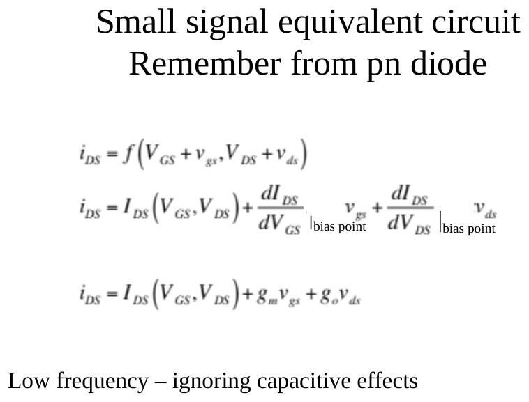
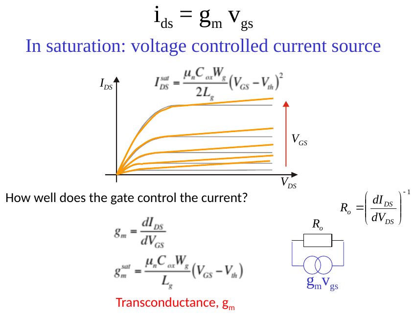
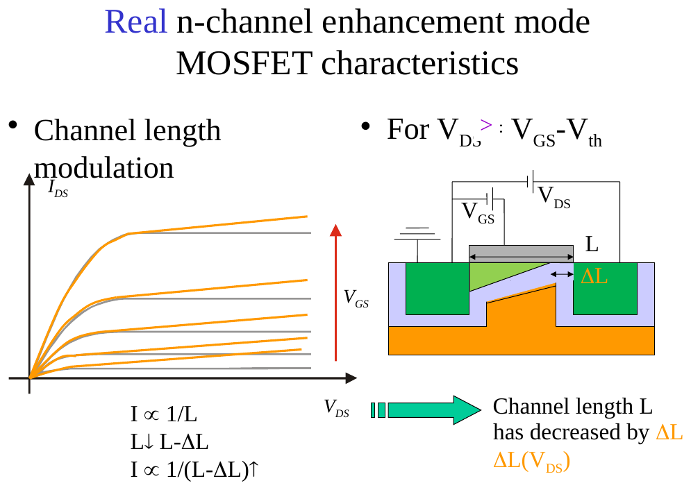
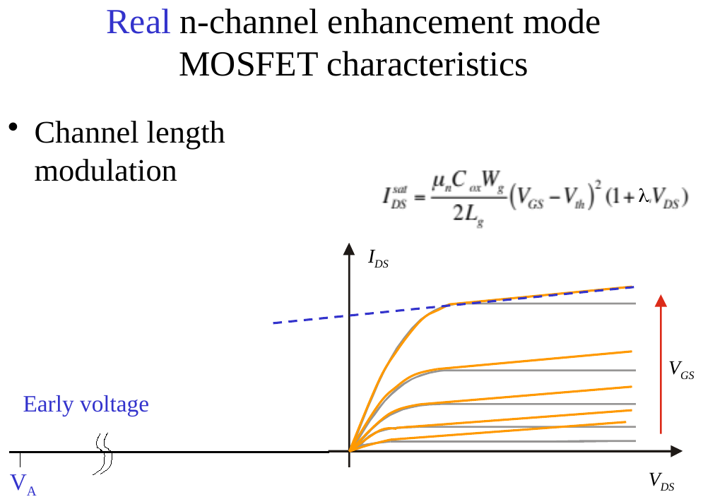
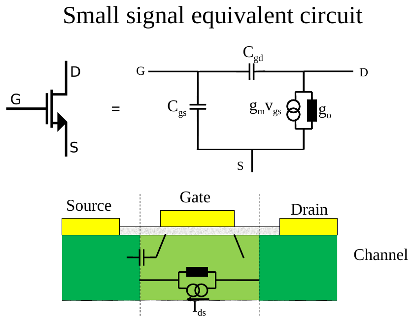
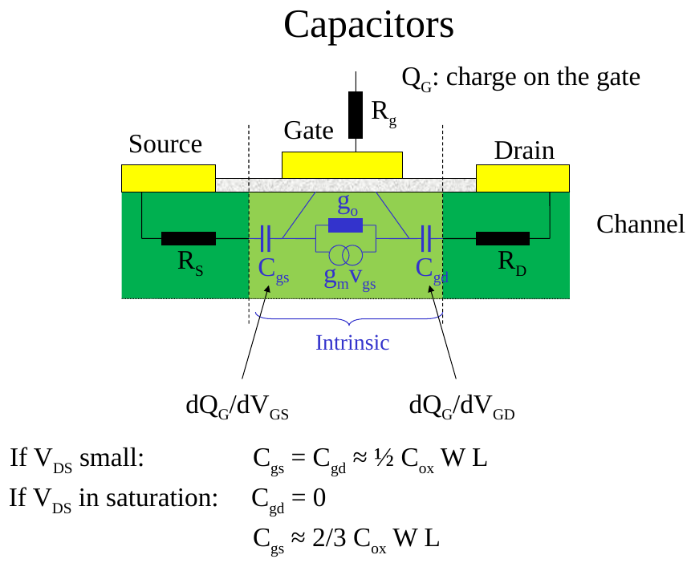
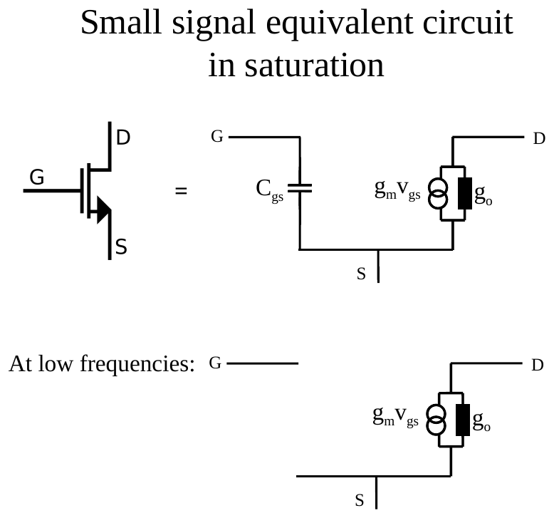
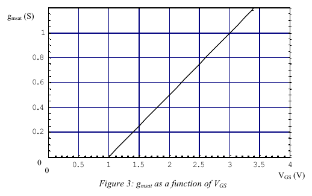
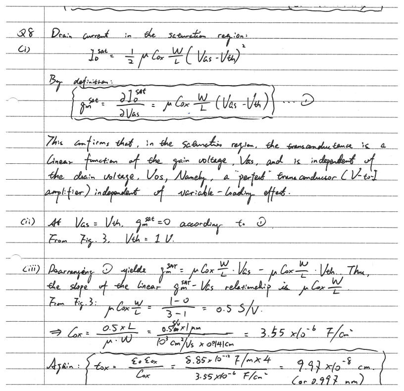

# Topic 19: MOSFET small signal: transconductance, output resistance, capacitances

Tutorial questions: Ch3 Q6, Q8 · Past finals: 2016 Q1d ii, 2018 Q1c vii and viii

Slides: SSD_3, pages 47, 48 and 53 to 58. Booklet §4.3.2 and §4.6 (pages 67, 69 and 70).

---

## The big idea

Bias the MOSFET at a point (V_GS, V_DS). Then wiggle the gate a little: v_gs.

The drain current wiggles too: i_ds. How much?

- **Transconductance g_m** = how much the drain current changes per volt on the gate. "How well the gate controls the current."
- **Output conductance g_o** (= 1/R_o) = how much the drain current changes per volt on the drain. Ideally 0 in saturation; not quite 0 because of **channel length modulation**.
- **C_gs, C_gd** = the gate capacitances, for high frequency.

Every one of these is a **derivative** of the I_DS formula. The exam wants you to **derive** them, not just quote them.

---

**How to use these notes:**
When you see 🧠, stop.
Answer it on paper first.
Then click to check.

---

## ⭐ Learn by heart from this topic

$$g_m = \frac{\partial I_{DS}}{\partial V_{GS}}\Big|_{V_{DS}} \qquad g_o = \frac{1}{R_o} = \frac{\partial I_{DS}}{\partial V_{DS}}\Big|_{V_{GS}}$$

| Region | g_m | depends on |
|---|---|---|
| triode | $\dfrac{\mu C_{ox}W}{L}V_{DS}$ | V_DS, not V_GS |
| saturation | $\dfrac{\mu C_{ox}W}{L}(V_{GS} - V_{th})$ | V_GS, not V_DS |

**Small-signal circuit in saturation:** a current source **g_m v_gs** from drain to source, with **g_o** in parallel. C_gs from gate to source.

| | triode (small V_DS) | saturation |
|---|---|---|
| C_gs | ½ C_ox W L | ⅔ C_ox W L |
| C_gd | ½ C_ox W L | **0** (channel pinched off at the drain) |

**Memory hook:**
"g_m: wiggle the gate. g_o: wiggle the drain. Saturation kills C_gd."

---

## 1. Small signal: the idea

**How to read this diagram:**

- The total current is the DC bias current plus a small change: i_DS = f(V_GS + v_gs, V_DS + v_ds).
- First-order Taylor: i_DS = I_DS + (dI/dV_GS) v_gs + (dI/dV_DS) v_ds.
- Name the two slopes: **g_m** and **g_o**. So i_ds = g_m v_gs + g_o v_ds.
- Same trick as the diode's small-signal resistance (Ch2). Low frequency: ignore capacitors.

---

## 2. Transconductance

**How to read this diagram:**

- In saturation the MOSFET is a voltage-controlled current source: **i_ds = g_m v_gs**.
- g_m = dI_DS/dV_GS. Differentiate I_DS^sat = (µC_ox W/2L)(V_GS − V_th)²:

$$g_m^{sat} = \frac{\mu C_{ox}W}{L}(V_{GS} - V_{th})$$

- R_o = (dI_DS/dV_DS)⁻¹. It shows how flat the curves are.

---

### 📐 Equation 34: transconductance (NOT on the formula sheet)

$$g_m^{triode} = \frac{\mu C_{ox}W}{L}V_{DS} \qquad g_m^{sat} = \frac{\mu C_{ox}W}{L}(V_{GS} - V_{th})$$

| Symbol | Means | Units |
|---|---|---|
| g_m | transconductance | S (A/V) |
| µ, C_ox, W, L | as in Topic 17 | |

**Where they come from:**
- Triode: d/dV_GS of [(V_GS − V_th)V_DS − V_DS²/2] = V_DS.
- Saturation: d/dV_GS of (V_GS − V_th)²/2 = (V_GS − V_th).

**What it means:**
- In **triode**, g_m changes with the **output** voltage V_DS. The tutorial calls this the "variable loading effect": the gain is modulated by the load. Bad for amplifiers.
- In **saturation**, g_m depends only on V_GS. It's a straight line in V_GS that hits **zero at V_th**. That's why amplifiers use saturation.

**Use it when:**
"Derive the transconductance" (Ch3 Q6, Q8, 2016 Q1d ii). Write I_DS, write the definition, differentiate.

**Graph trick (Ch3 Q8):** g_m^sat vs V_GS is a straight line. Its **x-intercept is V_th**, its **slope is µC_ox W/L**.

---

### 🧠 Check
Does g_m in the triode region depend on the substrate doping? (2018 Q1c vii)

Answer

**No** (the official answer). g_m^triode = (µC_ox W/L) V_DS has no V_th in it, and V_th is the only place the substrate doping enters.

(Heavier doping actually lowers µ a little, so it certainly doesn't increase g_m.)

---

## 3. Channel length modulation and output resistance

**How to read this diagram:**

- Past pinch-off, the pinch-off point moves from the drain **towards the source** as V_DS rises.
- So the real channel is shorter: L → **L − ΔL**.
- I ∝ 1/L, so a shorter channel = a bit **more** current. The curves slope up slightly in saturation (orange).

 

**How to read this diagram:**

- Extend the sloped saturation lines backwards. They all meet the V_DS axis at one point: **−V_A**, the **Early voltage**.
- I_DS^sat = (µC_ox W/2L)(V_GS − V_th)² (1 + λV_DS), with λ = 1/V_A.
- Slope = g_o ≈ I_DS ÷ V_A. So **R_o ≈ V_A ÷ I_DS**.

---

## 4. The small-signal circuit and the capacitors

**How to read this diagram:**

- **G to S:** a capacitor C_gs. No DC current into the gate (perfect oxide), so no resistor there. Input resistance is **infinite**.
- **G to D:** a capacitor C_gd.
- **D to S:** the current source g_m v_gs and the output conductance g_o in parallel.
- Bottom: where each part lives in the device. The gate oxide gives the capacitors, the channel gives g_m and g_o.

 

**How to read this diagram:**

- C_gs = dQ_G/dV_GS, C_gd = dQ_G/dV_GD.
- **V_DS small:** the channel is even from S to D, so the gate charge is shared: C_gs = C_gd ≈ ½ C_ox W L.
- **Saturation:** the channel is pinched off at the drain, so the drain can't change the gate charge: **C_gd = 0**, C_gs ≈ ⅔ C_ox W L.
- R_S, R_D, R_g are the contact resistances (outside the "intrinsic" box).

 

**How to read this diagram:**

- In saturation C_gd is gone. Just C_gs, g_m v_gs and g_o.
- **At low frequency** C_gs is an open circuit too: only g_m v_gs and g_o remain.

---

## 5. Worked example: Tutorial Ch3 Q8

> g_m^sat is measured against V_GS (Fig. 3). µ = 10³ cm²/Vs, W = 0.0141 cm, L = 1 µm.
> (i) Derive g_m^sat. (ii) Find V_th from the graph. (iii) Find t_ox from the graph.

**(i)** I_DS^sat = ½ µC_ox (W/L)(V_GS − V_th)². Differentiate: **g_m^sat = µC_ox (W/L)(V_GS − V_th)**. Linear in V_GS, independent of V_DS: a "perfect" transconductor.

**(ii)** g_m = 0 at V_GS = V_th. The line hits zero at **V_th = 1 V**.

**(iii)** Slope = µC_ox W/L. From the graph: (1 − 0) ÷ (3 − 1) = 0.5 S/V.

C_ox = 0.5 × L ÷ (µ W) = 0.5 × 10⁻⁴ ÷ (10³ × 0.0141) = **3.55 × 10⁻⁶ F/cm²**

t_ox = ε₀ε_ox ÷ C_ox = 8.85 × 10⁻¹⁴ × 4 ÷ 3.55 × 10⁻⁶ = **1.0 × 10⁻⁷ cm ≈ 1 nm**

---

## Drawing checklist: small-signal circuit (saturation)

1. Three nodes: **G**, **D**, **S** (S at the bottom, often shared).
2. **C_gs** between G and S. **No resistor** G–S.
3. **C_gd** between G and D, **only in triode**. Leave it out in saturation.
4. A current source **g_m v_gs** from D to S.
5. **g_o** (or R_o) in parallel with the current source.
6. Low frequency: drop the capacitors.

---

## Method: small-signal questions

| You're asked for | Use |
|---|---|
| derive g_m in triode | ∂/∂V_GS of the sheet formula (Equation 34) |
| derive g_m in saturation | ∂/∂V_GS of Topic 17 Equation 33 |
| V_th from a g_m–V_GS graph | x-intercept (§5) |
| µC_ox W/L or t_ox from that graph | slope (§5) |
| why the saturation curves slope up | channel length modulation (§3) |
| R_o | V_A ÷ I_DS, or 1 ÷ slope |
| is C_gd negligible in saturation? | **yes**, pinched-off drain (§4) |
| why amplifiers use saturation | g_m doesn't depend on V_DS (§2) |
| input resistance | infinite: no DC gate current |

---

Next: [End-of-topic test](../questions/19-mosfet-small-signal.md)
