# Topic 20: The BJT: how it works, modes and band diagrams

Tutorial questions: none (there is no BJT tutorial) · Past finals: 2018 Q3a and b, 2015 Q3a, 2016 Q1c i and ii, 2014 Q1f, 2017 Q1j, 2018 Q1c x

Slides: SSD_4, pages 1 to 9, 16, 22 to 27. Booklet §5.1 and §5.4 (pages 72 to 74, 78 and 79).

---

## The big idea

A BJT is **two pn diodes back to back**: emitter–base and base–collector. npn or pnp.

The trick:

1. A **forward-biased p⁺n** diode is a great **injector** of holes into the n side (Topic 12: the heavy side injects).
2. A **reverse-biased np** diode is a great **collector** of minority carriers: anything that arrives at its edge is swept across (Topic 11).
3. Make the shared middle layer (the **base**) **short**. Then the holes injected by the first diode **diffuse across the base** and are collected by the second before they can recombine.

So the **collector current** is set by the **emitter–base** voltage, and a small **base current** controls a big collector current.

A BJT is a **minority carrier** device and its currents are **diffusion** (opposite to the MOSFET: majority carriers, drift).

---

**How to use these notes:**
When you see 🧠, stop.
Answer it on paper first.
Then click to check.

---

## ⭐ Learn by heart from this topic

**Modes (npn or pnp):**

| Mode | EB junction | BC junction | What it does |
|---|---|---|---|
| **forward active** | forward | reverse | amplifier: I_C = βI_B |
| saturation | forward | **forward** | switch fully on; I_C rises steeply with V_CE |
| cut-off (off) | reverse | reverse | switch off |
| reverse active | reverse | forward | works, but badly (low β) |

**Nodal analysis:** I_E = I_B + I_C. Always.

**Transport through a short BJT in forward active mode** (2018 Q3b):

| Region | Process |
|---|---|
| emitter | diffusion |
| EB depletion region | diffusion |
| base | diffusion |
| BC depletion region | **drift** |
| collector | diffusion |

**Who carries what (npn):** electrons carry I_C (from E through B to C). The base current is **holes** injected from the base into the emitter. (pnp: swap.)

**Saturation means opposite things:** for a BJT it's the **steep** part of the output curve, for a MOSFET it's the **flat** part.

**Memory hook:**
"Forward to inject, reverse to collect, short base so nothing's lost."

---

## 1. What it looks like

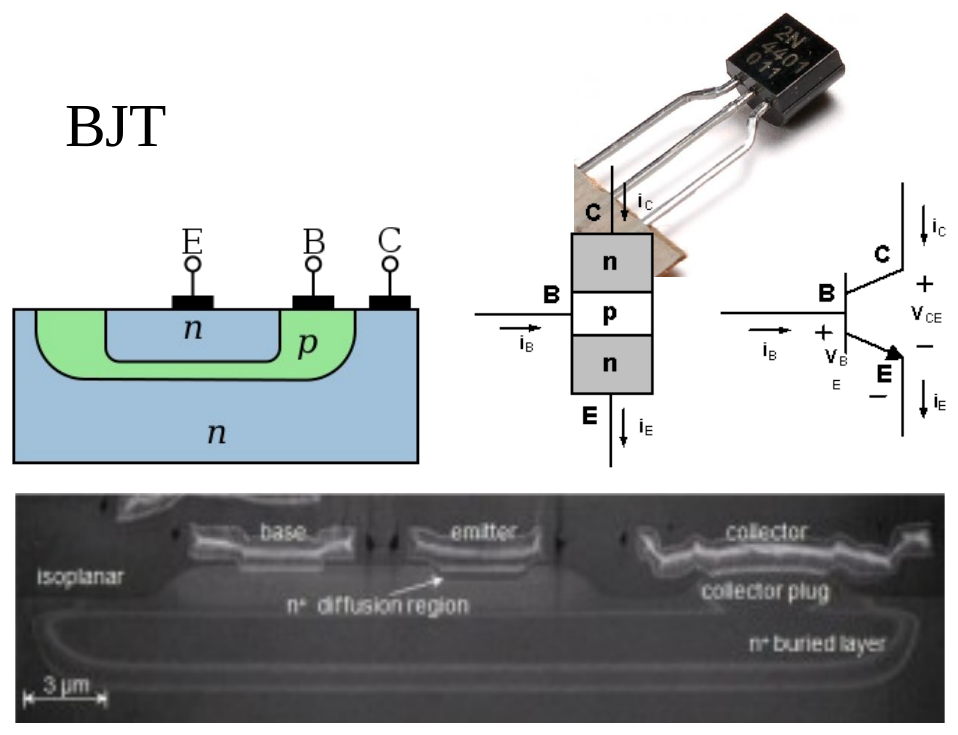

**How to read this diagram:**

- Top left: a planar npn on a chip. All three contacts (E, B, C) are on the top.
- The vertical stack: **n** (collector, bottom), **p** (base, thin middle), **n** (emitter, top).
- Symbols, right: the arrow sits on the **emitter**, pointing the way conventional current flows (out of an npn).
- Bottom: a real cross section. The base is very thin.

 

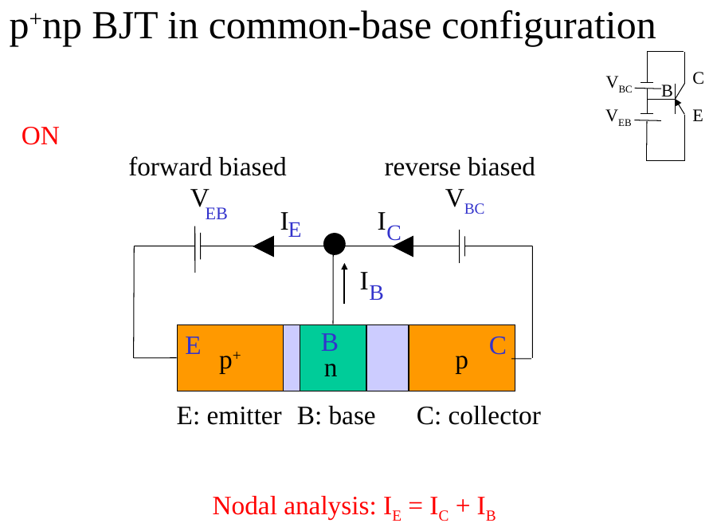

**How to read this diagram:**

- A **p⁺np** BJT. E is p⁺ (heavy), B is n, C is p.
- V_EB **forward** biases the EB junction. V_BC **reverse** biases the BC junction.
- Currents: I_E in, I_C and I_B out. **I_E = I_C + I_B.**
- "Common base": the base is shared by the input and output circuits.

---

## 2. Why two diodes make a transistor

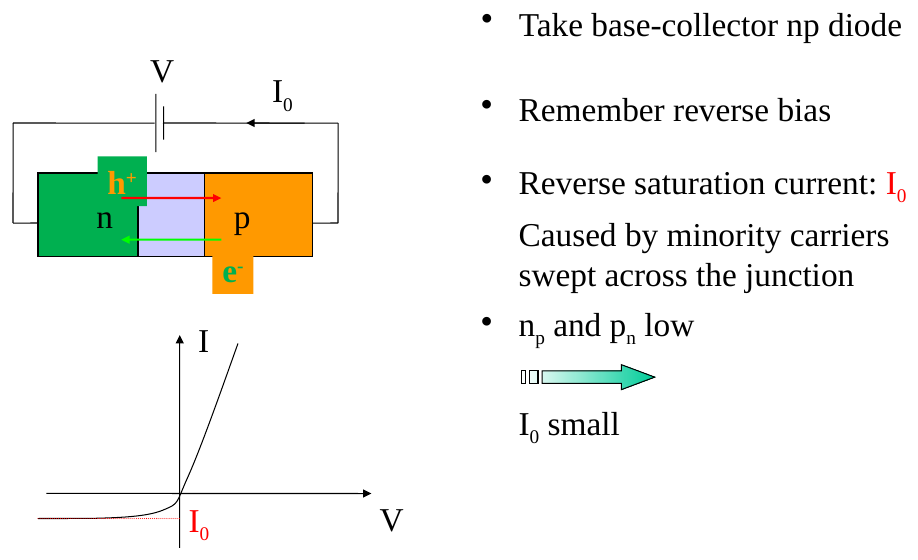

**How to read this diagram:**

- Take the **base–collector** n p diode, reverse biased.
- The tiny reverse current I₀ is **minority carriers** (holes on the n side, electrons on the p side) being swept across by the field.
- There are few minority carriers, so I₀ is small.
- **If you add more minority carriers near the junction, I₀ grows.** (Light can do it. So can a second diode.)

 

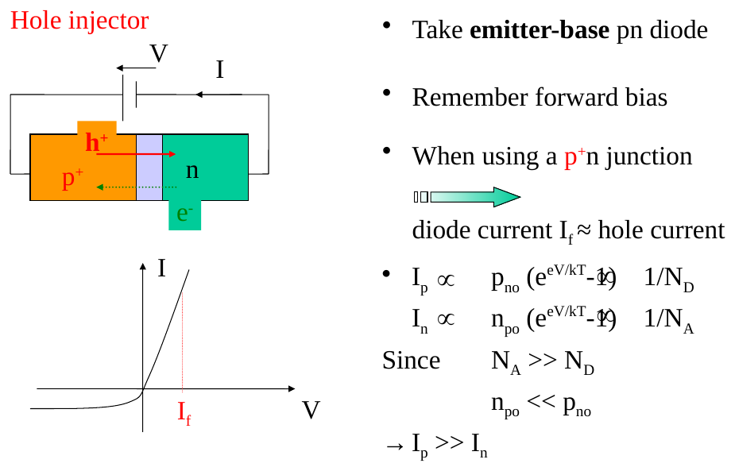

**How to read this diagram:**

- Now the **emitter–base** p⁺n diode, forward biased.
- I_p ∝ p_n0 ∝ 1/N_D and I_n ∝ n_p0 ∝ 1/N_A.
- N_A ≫ N_D (p⁺), so **I_p ≫ I_n**. The diode current is almost all **holes** injected into the n side.
- A forward-biased p⁺n diode is a **hole injector**.

 

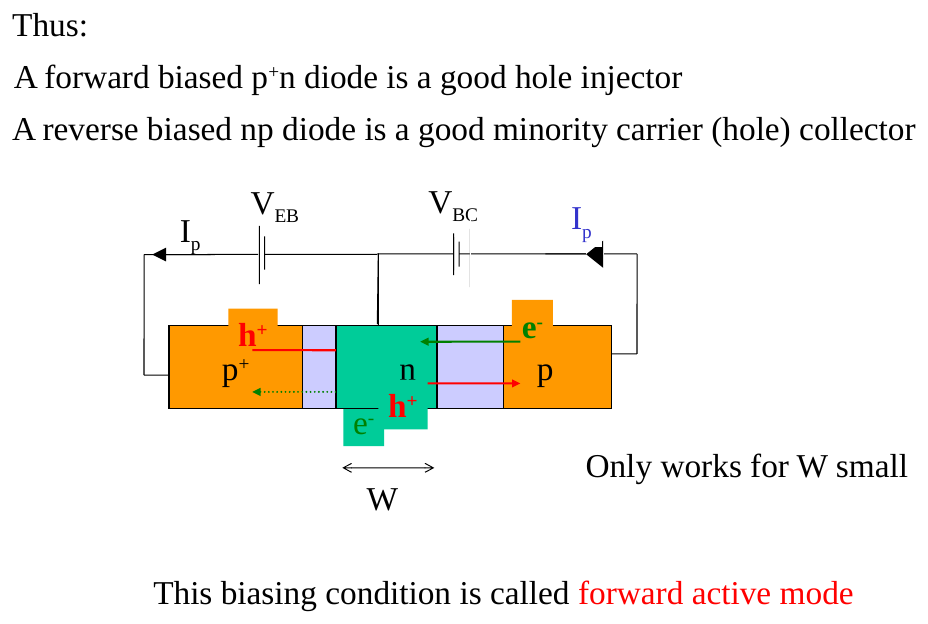

**How to read this diagram:**

- Join them: p⁺ | n | p. The injector feeds holes into the n base; the collector junction sweeps them out.
- **Only works if W (the base) is small.** Otherwise the holes recombine in the base.
- This bias (EB forward, BC reverse) is **forward active mode**.

 

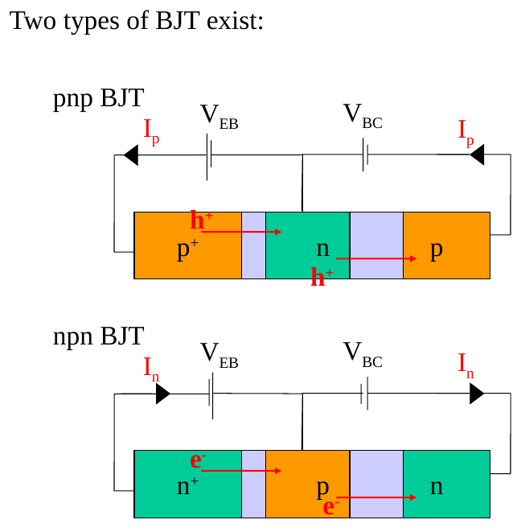

**How to read this diagram:**

- **pnp:** holes are the main current, injected E → B, collected B → C.
- **npn:** electrons are the main current. Same biasing idea, all polarities flipped.

 

### 🧠 Check
Which region of a short BJT sets the size of the collector current? (2017 Q1j)

Answer

**The base.** The collector current is the diffusion of minority carriers across the base, so it's set by the **minority carrier gradient in the base** (Topic 21).

---

## 3. Band diagrams in each mode (npn)

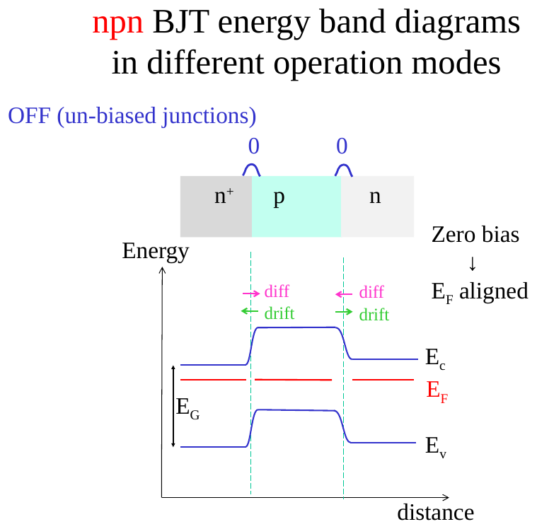

**How to read this diagram:**

- n⁺ | p | n at zero bias. **E_F flat.** Two barriers, like two Topic 10 diodes.
- At each junction diffusion and drift balance (pink and green arrows).
- E_C is closest to E_F in the **n⁺ emitter**.

 

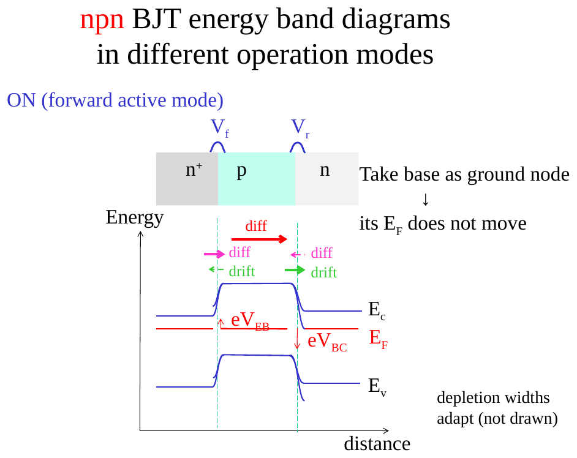

**How to read this diagram:**

- **Take the base as ground**: its E_F doesn't move.
- EB **forward** (V_f): the emitter's E_F goes **up** by eV_EB. The EB barrier shrinks. Electrons diffuse E → B (big red arrow).
- BC **reverse** (V_r): the collector's E_F goes **down** by eV_BC. The BC step gets bigger. Electrons reaching it slide down into the collector.

 

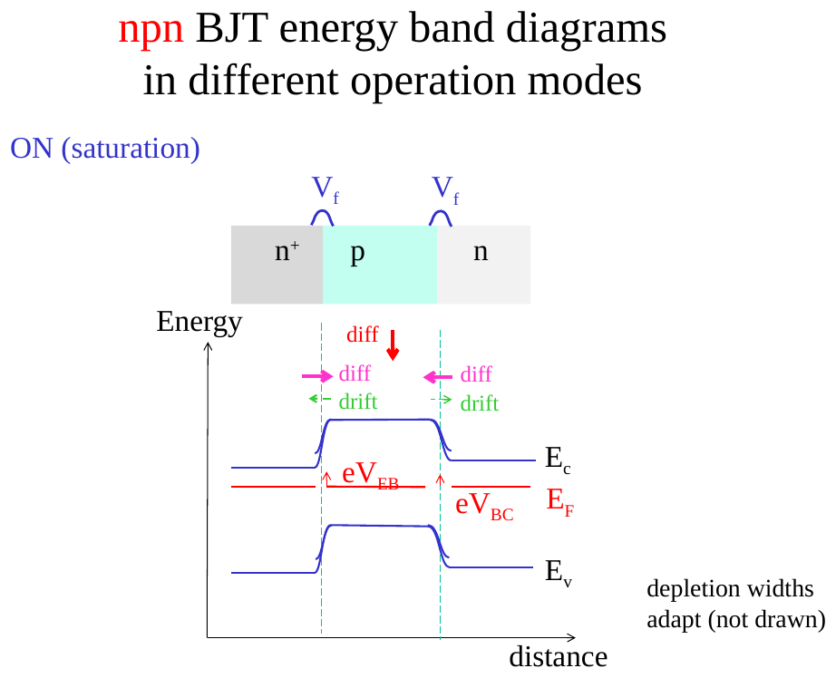

**How to read this diagram:**

- **Both** junctions forward. Both outer E_F levels go **up**. Both barriers shrink.
- Electrons are now injected into the base from **both** sides.

 

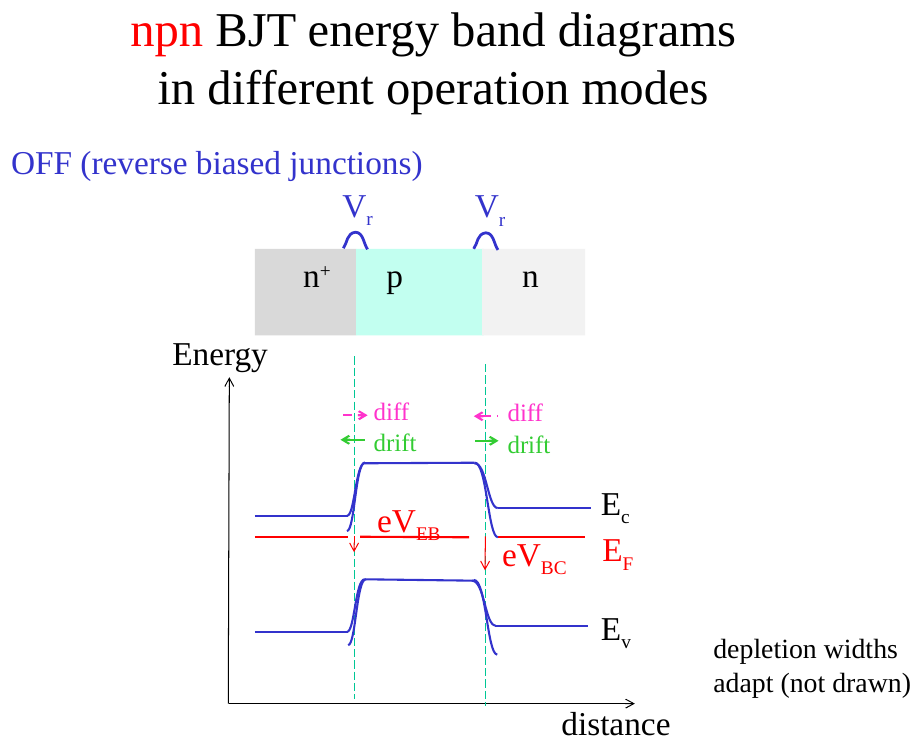

**How to read this diagram:**

- Both junctions reverse. Both outer E_F levels go **down**. Both barriers grow. Nothing gets through.

---

### Official answers: forward active band diagrams

**2018 Q3a** (n⁺pn, forward active, show |V_EB| and |V_CB| and the depletion regions):

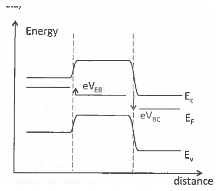

Marks: E_F steps correct [4], voltage shifts correct [2], general diagram [4].

**2015 Q3a** (emitter doping higher than base and collector, which are equal):

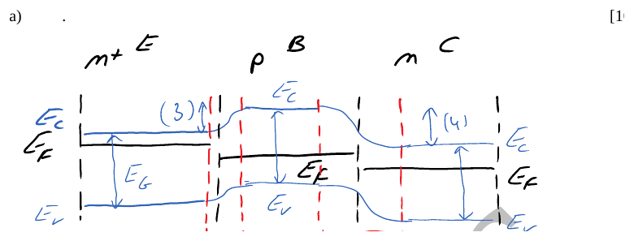

- E_F in the emitter **up**, E_F in the collector **down** (relative to the base). [3]
- E_C is closer to E_F in the emitter than in the collector. E_C − E_F in the collector ≈ E_F − E_V in the base (same doping). [3]
- Depletion widths extend into the **lower doped** side. The **reverse** BC depletion is wider than the forward EB one. [3]
- **No slope in the base**: transport there is diffusion, so the bands are flat. [The most common mistake.]

---

## 4. Output characteristics

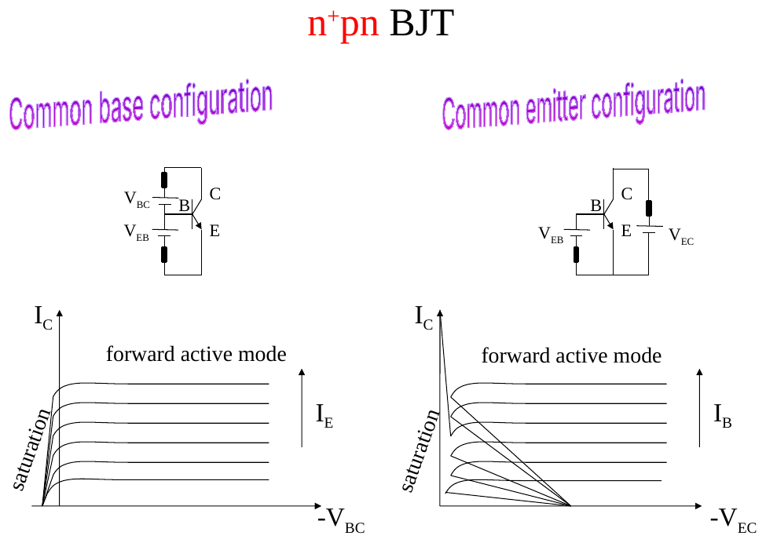

**How to read this diagram:**

- **Common base (left):** I_C against −V_BC, one curve per I_E. Flat curves, I_C ≈ I_E. No real gain.
- **Common emitter (right):** I_C against −V_EC, one curve per **I_B**. Flat in forward active mode, I_C = βI_B. That's current gain.
- The steep part near V_CE = 0 is **saturation**: the BC junction has become forward biased too.
- In saturation, I_C rises **quasi-linearly** with |V_CE| (2018 Q1c x: **yes**).

---

## 5. BJT vs MOSFET

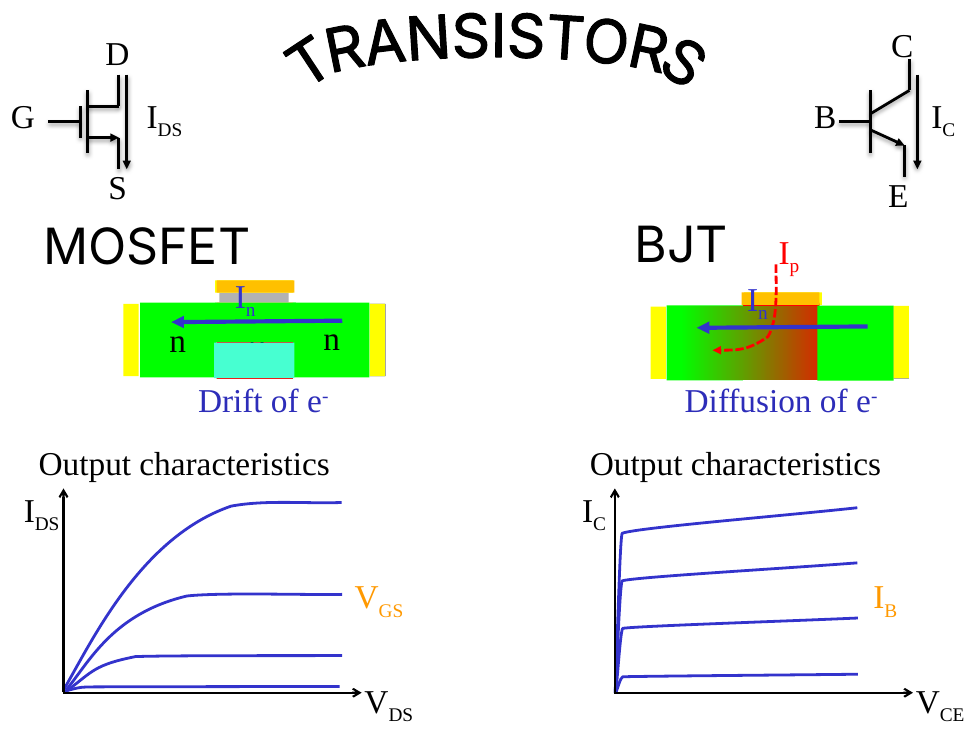

**How to read this diagram:**

- **MOSFET:** the gate (insulated) controls the channel by a field. Current = **drift** of majority carriers. Control: **voltage** V_GS.
- **BJT:** the base contact is **ohmic** and injects carriers. Current = **diffusion** of minority carriers. Control: **current** I_B.
- Both: a family of output curves, one per control value.

---

## 6. Worked example: 2016 Q1c (bias points and β from arrows)

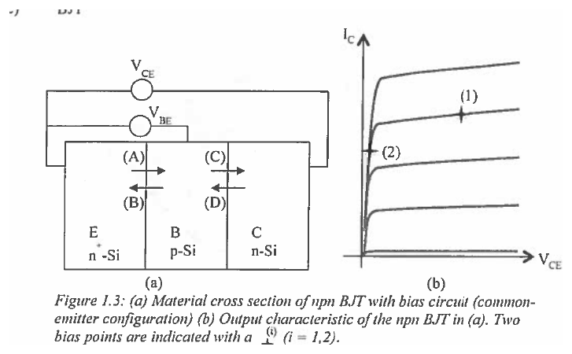

> (i) Give the bias of the EB and BC junctions at points (1) and (2). (ii) Which carriers must the base current inject into the base at (1)? (iii) Give β at (1) in terms of the currents (A) to (D).

**(i)** Point (1) is on the flat part: **forward active**, EB forward, BC reverse. Point (2) is on the steep part: **saturation**, EB forward, **BC forward**. [4]

**(ii)** **Holes.** In an npn, the base current resupplies the holes that are lost into the emitter (and by recombination). [2]

**(iii)** (A): electrons E → B. (B): holes B → E. (C): electrons B → C. (D): holes C → B (the BC leakage).

$$\beta = \frac{I_C}{I_B} = \frac{(C)}{(B) - (D)}$$ [4]

---

## 7. Worked example: 2014 Q1f (nodal voltages)

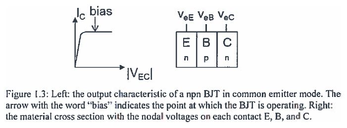

> npn in common emitter, biased on the flat part of its output curve. Give the relation between V_eE and V_eB, and between V_eB and V_eC.

Flat part = forward active.

- EB **forward**: the p base is more positive than the n emitter → **V_eE < V_eB**.
- BC **reverse**: the n collector is more positive than the p base → **V_eB < V_eC**.

---

## Drawing checklist: BJT band diagram

1. Three regions **E | B | C**, label doping (n⁺ p n). Dashed lines for the depletion edges.
2. Draw the **base E_F** flat first (it's the reference).
3. Forward EB: emitter E_F **eV_EB up** (npn). Reverse BC: collector E_F **eV_BC down**.
4. E_C closest to E_F in the **heaviest-doped** region.
5. Bands **flat** inside each region (no slope in the base!). Steps only across the junctions.
6. Depletion widths: wider on the **lightly doped** side, **wider at the reverse-biased** BC junction.
7. pnp: the same but flipped (emitter E_F goes **down** for forward bias, since the emitter is p).

---

## Method: BJT basics

| You're asked for | Use |
|---|---|
| bias of each junction for a point on the output curve | flat = forward active, steep = saturation (⭐ table) |
| drift or diffusion in each region | ⭐ table (only the BC depletion region is drift) |
| band diagram | §3, drawing checklist |
| nodal voltages | forward = p side higher, reverse = n side higher (§7) |
| which carriers the base current supplies | the type **opposite** to the main current (§6) |
| β from labelled currents | I_C ÷ I_B, with I_B = loss − gain (§6) |
| BJT vs MOSFET | §5 |

---

Next: [End-of-topic test](../questions/20-bjt-operation.md)
