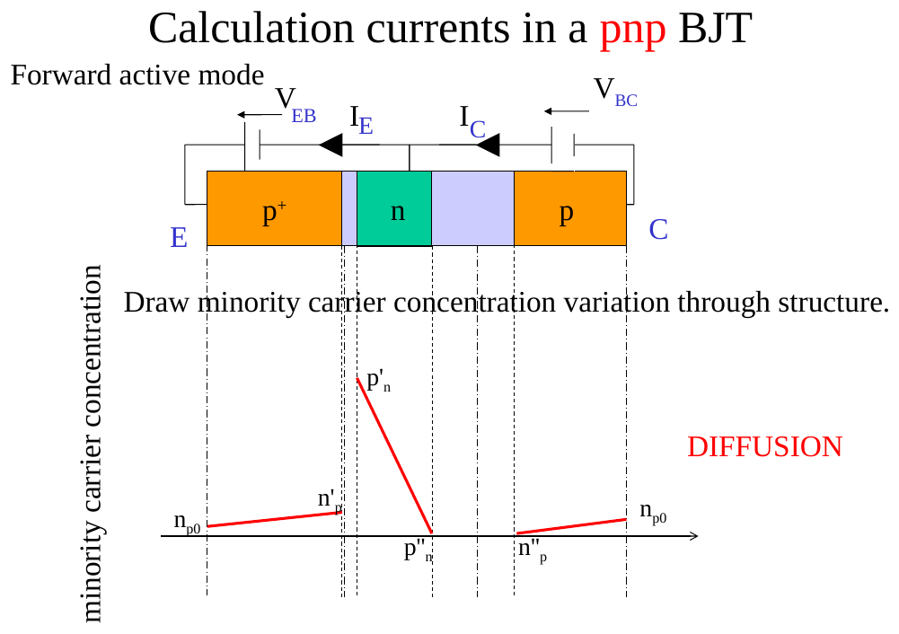
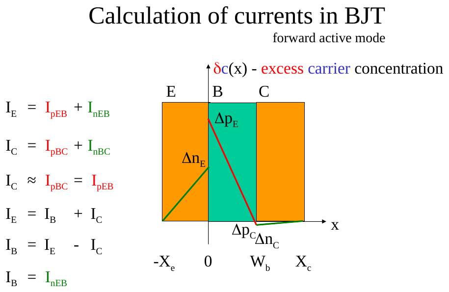
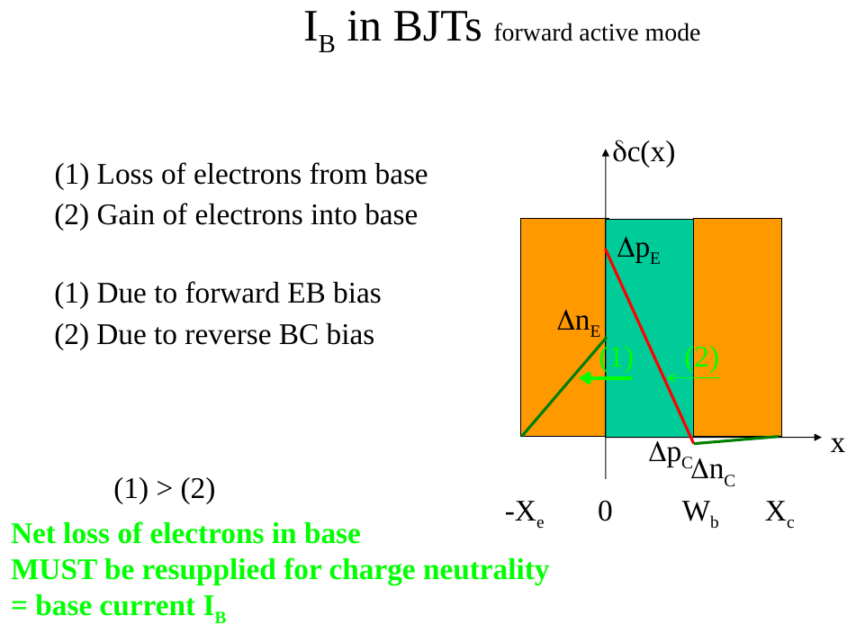
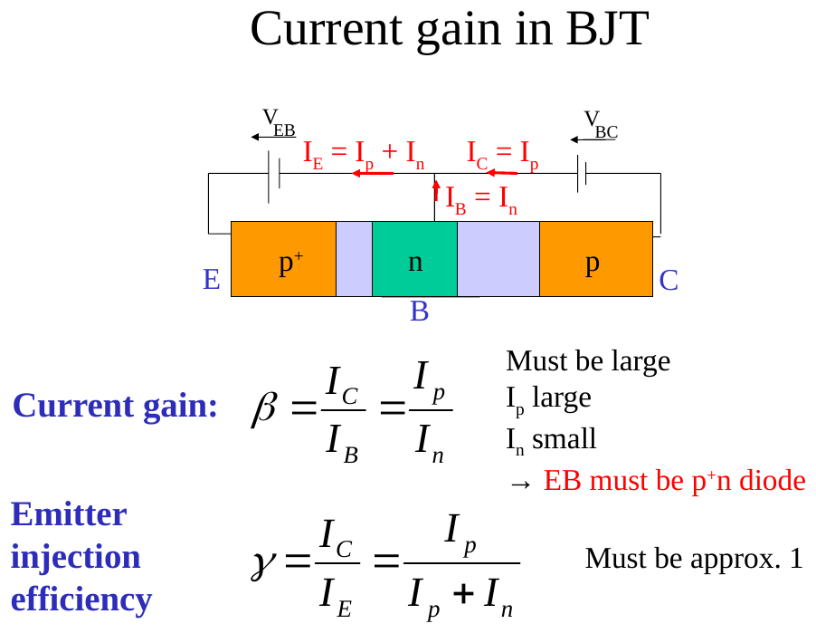
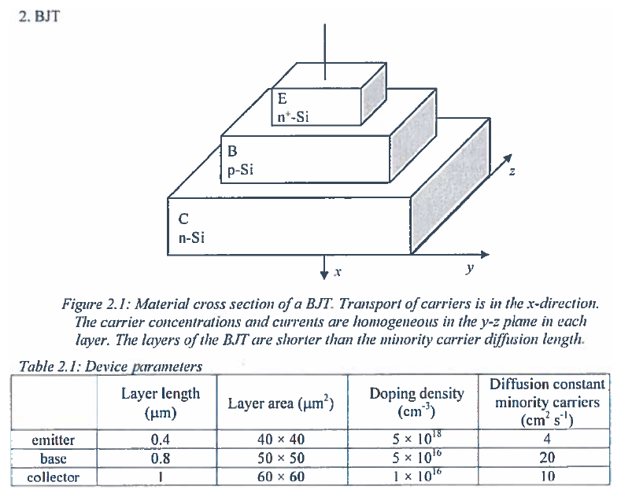
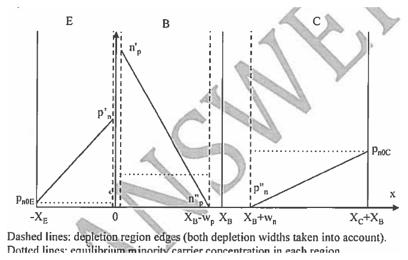
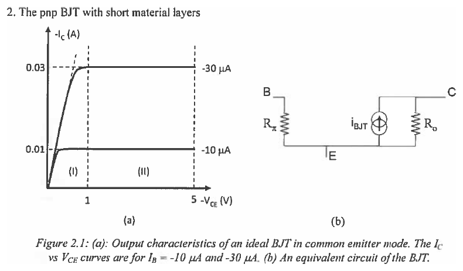
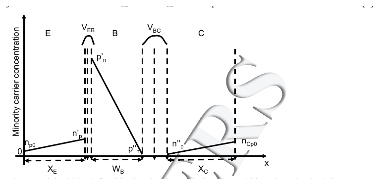

# Topic 21: BJT currents: minority carrier profiles, I_E, I_C, I_B and β

Tutorial questions: none · Past finals: 2016 Q2 (all of it), 2017 Q2a to c, 2015 Q3b and c, 2014 Q1g, 2018 Q1c ix

Slides: SSD_4, pages 10 to 15. Booklet §5.2 and §5.3 (pages 74 to 78), and §5.6 (page 80).

---

## The big idea

A short BJT is just **two short diodes** (Topic 13) sharing the base.

1. Draw the **minority carrier concentration** in each region. At each depletion edge use c = c₀ e^(eV/kT). At each ohmic contact use the equilibrium value c₀. Join with **straight lines** (short layers).
2. Each current is **eD × gradient × area**.
3. Then:
   - **I_C** = the minority carrier current across the **base** (the main flow).
   - **I_B** = the minority carrier current in the **emitter** (what the base loses into the emitter).
   - **I_E = I_B + I_C**.
4. **β = I_C/I_B**. Big when the emitter is heavily doped and the base is thin.

This topic is the **biggest calculation** on BJTs: 2016 Q2 was 25 marks of it.

---

**How to use these notes:**
When you see 🧠, stop.
Answer it on paper first.
Then click to check.

---

## ⭐ Learn by heart from this topic

**Boundary values** (from the formula sheet's c = c₀e^(eV/kT)):

| Place | Minority concentration |
|---|---|
| ohmic contact | c₀ (equilibrium: nᵢ²/N) |
| edge of a **forward** junction (bias V_f) | c₀ e^(eV_f/kT): **huge** |
| edge of a **reverse** junction (bias −V_r) | c₀ e^(−eV_r/kT) ≈ **0** |

**Short pnp in forward active mode** (n base, width W_B; p⁺ emitter, width X_E):

$$I_C \approx \frac{eAD_p\,p_{n0}}{W_B}e^{eV_{EB}/kT} \qquad I_B \approx \frac{eAD_n\,n_{p0}}{X_E}e^{eV_{EB}/kT} \qquad I_E = I_B + I_C$$

$$\beta = \frac{I_C}{I_B} \approx \frac{D_p\,N_{A,E}\,X_E}{D_n\,N_{D,B}\,W_B} \qquad \gamma = \frac{I_C}{I_E} = \frac{1}{1 + 1/\beta} \approx 1$$

**To make β big:** heavy emitter doping, thin base.

**Widths:** use the **undepleted** widths (subtract the depletion widths), not the diffusion lengths.

**Memory hook:**
"I_C lives in the base. I_B lives in the emitter."

---

## 1. Minority carriers through the BJT

**How to read this diagram:**

- A p⁺np in forward active mode. The graph underneath is the **minority carrier concentration** in each region.
- **Emitter (p⁺):** minority = electrons. n_p0 at the contact, rising to **n′_p** at the EB depletion edge (forward bias).
- **Base (n):** minority = holes. **p′_n** (big) at the EB edge, falling in a **straight line** to **p″_n ≈ 0** at the BC edge (reverse bias).
- **Collector (p):** minority = electrons. **n″_p ≈ 0** at the BC edge, rising to n_p0 at the contact.
- Straight lines because the layers are short (no recombination). The currents are **DIFFUSION**.

 

**How to read this diagram:**

- Now the **excess** concentration δc = c − c₀. Zero at the contacts. Negative ("deficit") at the reverse-biased BC junction.
- Δp_E, Δn_E at the EB junction. Δp_C, Δn_C at the BC junction.
- The list on the left:
  - I_E = I_pEB + I_nEB (both gradients at the EB junction)
  - I_C = I_pBC + I_nBC (both gradients at the BC junction)
  - I_C ≈ I_pBC = I_pEB (the hole gradient is the same line across the base)
  - **I_B = I_E − I_C = I_nEB**

 

**How to read this diagram:**

- (1) Electrons **lost** from the base into the emitter, because of the forward EB bias.
- (2) Electrons **gained** by the base from the collector, because of the reverse BC bias (the leakage).
- (1) > (2), so the base **loses** electrons overall. They must be resupplied for charge neutrality. **That's I_B.**

---

### 📐 Equation 35: currents in a short BJT (NOT on the formula sheet)

$$I_E = \frac{eAD_p\,p_{n0}}{W_B}e^{eV_{EB}/kT} + \frac{eAD_n\,n_{p0}}{X_E}e^{eV_{EB}/kT}$$

$$I_C \approx \frac{eAD_p\,p_{n0}}{W_B}e^{eV_{EB}/kT} \qquad I_B \approx \frac{eAD_n\,n_{p0}}{X_E}e^{eV_{EB}/kT}$$

| Symbol | Means (pnp) | Units |
|---|---|---|
| A | junction area | cm² |
| D_p | hole diffusion constant **in the base** | cm²/s |
| p_n0 | equilibrium holes in the base = nᵢ²/N_D,B | cm⁻³ |
| W_B | undepleted base width | cm |
| D_n | electron diffusion constant **in the emitter** | cm²/s |
| n_p0 | equilibrium electrons in the emitter = nᵢ²/N_A,E | cm⁻³ |
| X_E | undepleted emitter width | cm |
| V_EB | emitter–base forward bias | V |

**What it means:**
Each term is eD × (big boundary value − ~0) ÷ width, times area. Exactly the short diode of Topic 13.

**Simplifications** (state them!): the boundary values at the forward junction ≫ the equilibrium values; the reverse-junction values ≈ 0; the BC leakage is neglected.

**npn:** swap n ↔ p: electrons in the base give I_C, holes in the emitter give I_B.

**Use it when:**
"Give the expressions for I_E, I_C, I_B" (2017 Q2b, 2015 Q3c) or "calculate the currents" (2016 Q2d).

---

## 2. Current gain and emitter efficiency

**How to read this diagram:**

- I_E = I_p + I_n, I_C = I_p, I_B = I_n (pnp).
- **β = I_C/I_B = I_p/I_n.** Want I_p big and I_n small → the EB diode must be **p⁺n**: heavy emitter.
- **γ = I_C/I_E = I_p/(I_p + I_n)**: the emitter injection efficiency. Want ≈ 1.

---

### 📐 Equation 36: current gain (NOT on the formula sheet)

$$\beta = \frac{I_C}{I_B} \approx \frac{D_p\,p_{n0}/W_B}{D_n\,n_{p0}/X_E} = \frac{D_p\,N_{A,E}\,X_E}{D_n\,N_{D,B}\,W_B}$$

**What it means:**
The exp terms cancel. p_n0/n_p0 = N_A,E/N_D,B (mass action). So β grows with **emitter doping** and shrinks with **base width**.

**Use it when:**
"Why does a heavily doped emitter help?" (2018 Q1c ix: n⁺pn has more gain than npn → **yes**), or to compare two BJTs.

**⚠️ 2014 Q1g trap:** two BJTs differ only in emitter doping. Does **I_C** change? **No.** I_C is set by the base (its doping, width, D). The emitter doping changes **I_B** and so β, not I_C. Arguing from β "led to the wrong conclusion".

---

### 🧠 Check
Why does a BJT work worse in **reverse active** mode (collector and emitter swapped)?

Answer

The collector is **lightly** doped. Used as the injector, it injects far fewer carriers relative to the base current: N_A,E in Equation 36 is now the small collector doping, so β is low and γ is far from 1.

---

## 3. Including the BC leakage (2015 Q3c)

With the BC reverse leakage I_L kept in (npn, excess concentrations Δ, emitter length L_E, collector length L_C):

$$J_E = -\frac{eD_n\Delta n'_p}{W_B} - \frac{eD_p\Delta p'_n}{L_E} \qquad J_C = -\frac{eD_n\Delta n'_p}{W_B} - \frac{eD_p|\Delta p''_n|}{L_C}$$

$$J_B = J_E - J_C = -\frac{eD_p\Delta p'_n}{L_E} + \frac{eD_p|\Delta p''_n|}{L_C}$$

So the leakage **adds** to I_C and **subtracts** from I_B:

$$\beta_{leak} = \frac{I_C + I_L}{I_B - I_L} > \beta$$

**β goes up** when you include the leakage. (Answer must be consistent with your expressions, or no marks.)

---

## 4. Worked example: Final 2016 Q2 (the full BJT calculation)

n⁺pn, all layers shorter than the diffusion length. Table: emitter 0.4 µm, 40 × 40 µm², 5 × 10¹⁸, D = 4; base 0.8 µm, 50 × 50 µm², 5 × 10¹⁶, D = 20; collector 1 µm, 60 × 60 µm², 10¹⁶, D = 10. Forward 0.26 V on EB, reverse 1 V on BC.

**(a) Diffusion length** [4]: the average distance a minority carrier diffuses before it recombines with a majority carrier.

**(b) Minority concentrations** [6]: c₀ = nᵢ²/N (learn this), then c = c₀ e^(V/V_T). 0.26/0.026 = 10, e¹⁰ = 2.2 × 10⁴.

| Region | c₀ at the contact | at the depletion edge |
|---|---|---|
| emitter (holes) | p_n0E = 2.1 × 10²⁰ ÷ 5 × 10¹⁸ = **42 cm⁻³** | p′_n = 42 × e¹⁰ = **9 × 10⁵ cm⁻³** |
| base (electrons) | n_p0 = 2.1 × 10²⁰ ÷ 5 × 10¹⁶ = **4205 cm⁻³** | EB side n′_p = **9 × 10⁷ cm⁻³**; BC side n″_p = 4205 × e^(−1/0.026) ≈ **8 × 10⁻¹⁴ cm⁻³** |
| collector (holes) | p_n0C = 2.1 × 10²⁰ ÷ 10¹⁶ = **2.1 × 10⁴ cm⁻³** | p″_n ≈ **4 × 10⁻¹³ cm⁻³** |

**(c) Plot** [6]:

Straight lines; the depletion regions (dashed) cut into the base and collector at the BC junction (w_p, w_n). [3] relative sizes, [2] to the depletion edges, [1] linear.

**(d) Currents** [9]. Neglect the BC leakage. First the BC depletion width **in the base**:

V_bi = 0.026 × ln(5 × 10¹⁶ × 10¹⁶ ÷ (1.45 × 10¹⁰)²) = **0.74 V**

w_p = √(2 × 11 × 8.85 × 10⁻¹⁴ × (0.74 + 1) × 10¹⁶ ÷ (1.6 × 10⁻¹⁹ × 6 × 10¹⁶ × 5 × 10¹⁶)) = **8.4 × 10⁻⁶ cm = 0.084 µm**

Undepleted base = 0.8 − 0.084 = 0.716 µm.

**Emitter part (= I_B):** e A_E D_E Δp ÷ X_E = 1.6 × 10⁻¹⁹ × (40 × 10⁻⁴)² × 4 × 9 × 10⁵ ÷ 0.4 × 10⁻⁴ = **2.3 × 10⁻¹³ A**

**Base part (= I_C):** e A_B D_B Δn ÷ (X_B − w_p) = 1.6 × 10⁻¹⁹ × (50 × 10⁻⁴)² × 20 × 9 × 10⁷ ÷ 0.716 × 10⁻⁴ = **1.0 × 10⁻¹⁰ A**

**I_E = 2.3 × 10⁻¹³ + 1.0 × 10⁻¹⁰ ≈ 1.0 × 10⁻¹⁰ A**. **I_C = 1.0 × 10⁻¹⁰ A**. **I_B = 2.3 × 10⁻¹³ A**. (β ≈ 440.)

---

## 5. Worked example: 2017 Q2a to c (pnp, read from the graph)

**(a)** Region II is the flat part: forward active, EB forward, BC reverse.

Define everything: n_p0 (emitter), p′_n, p″_n (base), n″_p, n_Cp0 (collector), widths X_E, W_B, X_C **minus the depletion regions**.

**(b)** Equation 35 for a pnp. "Make appropriate assumptions": n′_p ≫ n_p0, p′_n ≫ p″_n, collector leakage neglected.

**(c)** β from the graph: 0.03 A ÷ 30 µA = **1000**. For I_C = 1 mA: I_B = **1 µA**, I_E = I_C + I_B = **1.001 mA**. (I_E < I_C is a sign error.)

---

## Drawing checklist: minority carriers in a BJT

1. Three regions with **depletion regions** drawn as dashed lines at both junctions.
2. Label the **minority** type in each region (pnp: n, p, n → electrons, holes, electrons).
3. **Contacts:** equilibrium value c₀ (or zero, if you're drawing **excess**).
4. **Forward EB edges:** big values (base side bigger if the emitter is heavier).
5. **Reverse BC edges:** ≈ 0 (excess: slightly negative).
6. **Straight lines** between them.
7. Read the question: **concentration** or **excess** concentration? (Drawing the wrong one is a "classical mistake".)

---

## Method: BJT current questions

| You're asked for | Use |
|---|---|
| minority values at contacts and edges | ⭐ boundary table, c₀ = nᵢ²/N |
| the plot | drawing checklist |
| I_E, I_C, I_B expressions | Equation 35 (state the simplifications) |
| numbers for I_E, I_C, I_B | gradient × eDA in each region; undepleted widths (§4) |
| BC depletion width in the base | formula sheet w_p with V = −V_r |
| β, γ | Equation 36, or I_C/I_B off the graph |
| effect of emitter doping on I_C | none; on β: up (§2 trap) |
| effect of leakage on β | up (§3) |
| definition of diffusion length | §4a |

---

Next: [End-of-topic test](../questions/21-bjt-currents.md)
