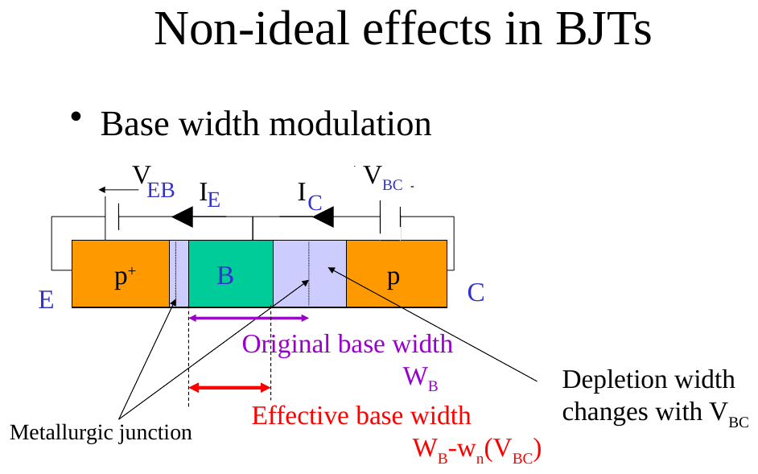
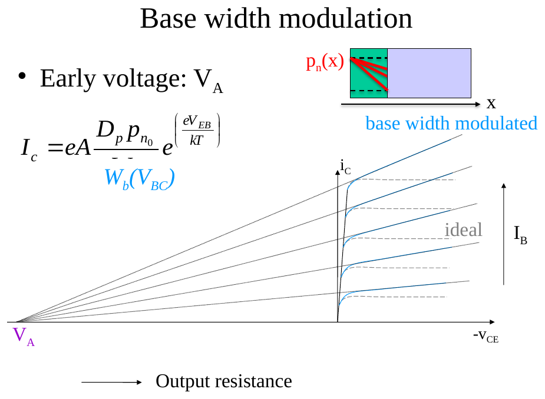
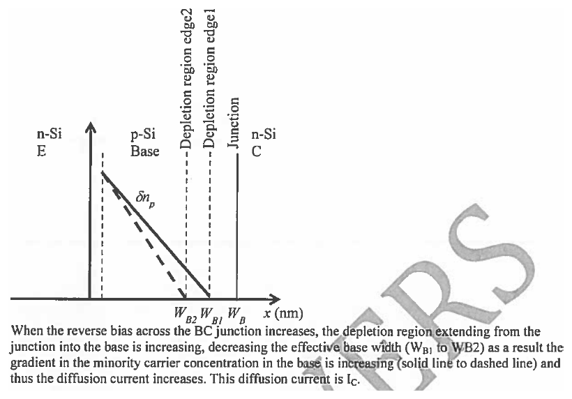
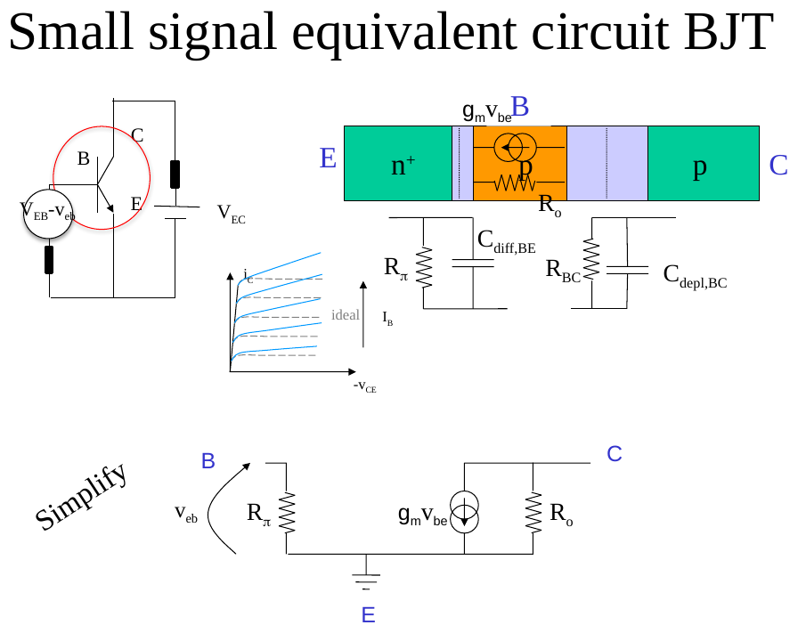
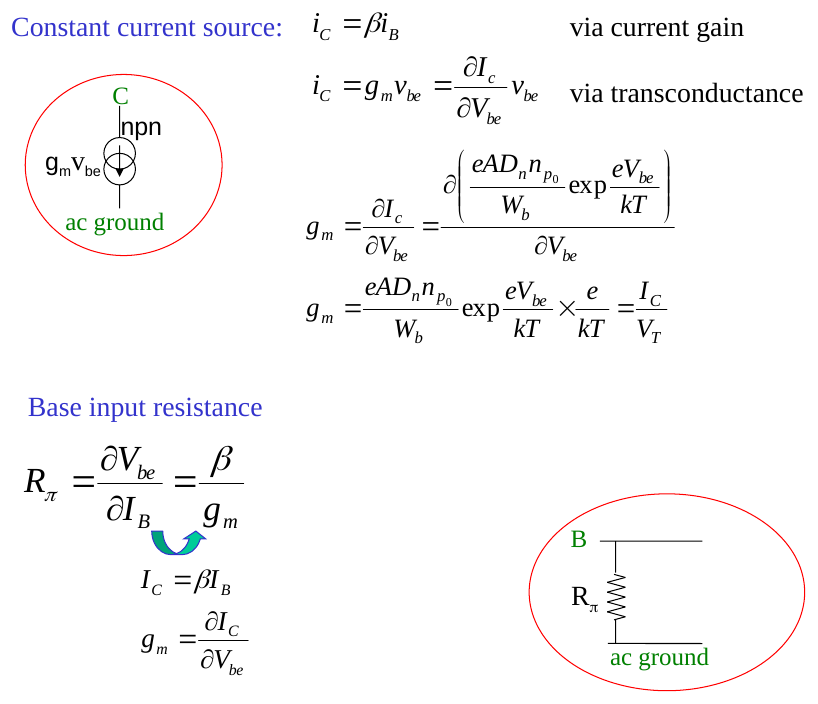
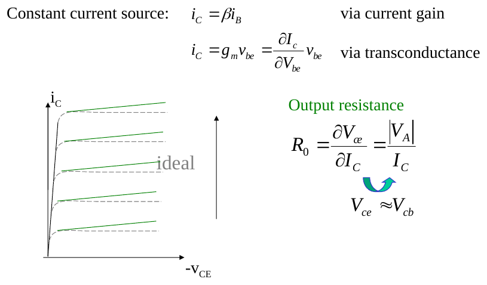
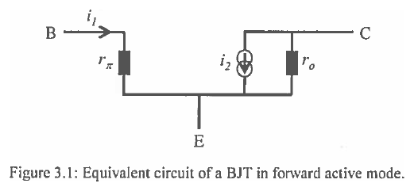
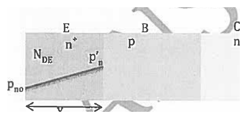
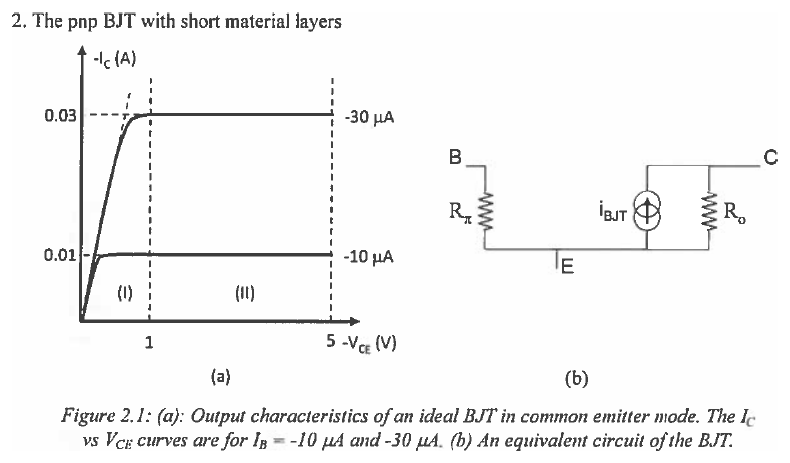
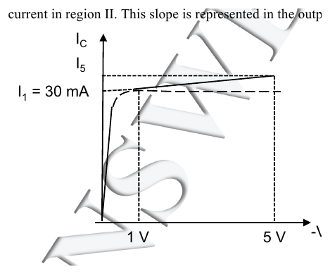

# Topic 22: BJT small signal: base width modulation, g_m, R_π, R_o

Tutorial questions: none · Past finals: 2018 Q3c (all), 2017 Q2d to f

Slides: SSD_4, pages 17 to 21. Booklet §5.5 (page 79).

---

## The big idea

Same idea as the MOSFET (Topic 19): bias the BJT, wiggle the input, see how the output wiggles.

The circuit has three parts:

- **R_π** (input resistance) between B and E. Unlike a MOSFET gate, the base **draws current**, so this is finite.
- A current source **g_m v_be** (or **β i_b**) from C to E.
- **R_o** (output resistance) from C to E. Finite because of **base width modulation**: a bigger reverse bias on the BC junction **thins the base**, so I_C creeps up with V_CE.

All three come from **one** equation, I_C ∝ e^(V_BE/V_T), and β.

---

**How to use these notes:**
When you see 🧠, stop.
Answer it on paper first.
Then click to check.

---

## ⭐ Learn by heart from this topic

$$g_m = \frac{\partial I_C}{\partial V_{BE}} = \frac{I_C}{V_T} \qquad R_\pi = \frac{\partial V_{BE}}{\partial I_B} = \frac{\beta}{g_m} = \frac{V_T}{I_B} \qquad R_o = \frac{\partial V_{CE}}{\partial I_C} = \frac{|V_A|}{I_C}$$

$$i_c = g_m v_{be} = \beta\,i_b \qquad g_o = \frac{1}{R_o}$$

**Valid only when** v_be is **small** (v_be ≪ V_T = 26 mV), so I_C changes **linearly** with it.

**Base width modulation:** |V_CB| ↑ → BC depletion widens **into the base** → effective W_B ↓ → minority gradient ↑ → **I_C ↑**. That's why the curves slope and R_o is finite.

**Memory hook:**
"g_m is I over V_T. R_π is β over g_m. R_o is V_A over I."

---

## 1. Base width modulation

**How to read this diagram:**

- A p⁺np in forward active mode.
- The **metallurgic** junctions are fixed. But the BC **depletion width** changes with V_BC.
- The **effective base width** is the original W_B **minus** the part of the BC depletion region that sits in the base, w_n(V_BC).
- More reverse bias → more depletion → **thinner effective base**.

 

**How to read this diagram:**

- Top right: holes in the base. Thinner base (red lines) = **steeper** gradient = more current.
- I_C = eA D_p p_n0/W_B(V_BC) × e^(eV_EB/kT). W_B shrinks as |V_BC| grows.
- Main graph: so the "ideal" flat curves (dashed) really **slope up** (blue).
- Extend them back: they all meet at **V_A**, the **Early voltage**. Same idea as the MOSFET's channel length modulation.
- The slope sets the **output resistance**.

 

### 🧠 Check
Why is the output conductance g_o = 1/r_o of a BJT larger than zero? (2018 Q3c iv)

Answer

**Base width modulation.** I_C = eD_nB nᵢ²/(X_B N_AB) (e^(v_be/V_T) − 1) A, with X_B the **undepleted** base width.

Raising |V_CE| raises the reverse bias |V_CB|. The BC depletion region extends further into the base, so X_B gets smaller, the minority gradient gets steeper, and I_C grows. dI_C/dV_CE > 0, so g_o > 0.

---

## 2. The small-signal circuit

**How to read this diagram:**

- Top: an npn with its bias (V_EB, V_EC) plus a small signal v_eb.
- Middle: where each element lives. **g_m v_be** in the base region, **R_π** and C_diff,BE across the EB junction, **R_o**, R_BC and C_depl,BC across the BC junction.
- Bottom: **simplified** (low frequency): R_π from B to E, g_m v_be and R_o from C to E.

---

### 📐 Equation 37: BJT small-signal parameters (NOT on the formula sheet)

**How to read this diagram:**

- **g_m:** differentiate I_C = (eAD_n n_p0/W_b) e^(eV_be/kT) with respect to V_be. The derivative of e^(V/V_T) is e^(V/V_T)/V_T. So **g_m = I_C/V_T**.
- **R_π:** V_be ÷ I_B. With I_C = βI_B: R_π = (∂V_be/∂I_C)(∂I_C/∂I_B) = (1/g_m) × β. So **R_π = β/g_m**.

**How to read this diagram:**

- **R_o** = ∂V_ce/∂I_C. The curves extend back to V_A, so the slope is I_C/|V_A|. **R_o = |V_A|/I_C**, taking V_ce ≈ V_cb.

| Symbol | Means | Units |
|---|---|---|
| g_m | transconductance | S |
| R_π | small-signal input resistance B–E | Ω |
| R_o | output resistance C–E | Ω |
| V_T | kT/e = 0.026 V | V |
| V_A | Early voltage | V |
| β | current gain | – |

**Use it when:**
"Derive R_π, R_o and i_BJT" (2017 Q2d). The examiners want them **derived from the definitions**, not just quoted.

---

## 3. Worked example: Final 2018 Q3c

**(i) Condition on the EB AC voltage to use the circuit** [4]

v_be must be **small**, so that the change in I_C stays **linear** in v_be (v_be ≪ V_T).

**(ii) i₁ in terms of material parameters** [5]

i₁ is the base current = the **minority carrier gradient in the emitter**. For an n⁺pn: holes in the n⁺ emitter.

$$i_1 = i_h = \frac{eD_{pE}}{X_E}(p'_n - p_{n0})A = \frac{eD_{pE}\,n_i^2}{X_E\,N_{DE}}\left(e^{v_{be}/V_T} - 1\right)A$$

D_pE: hole diffusion constant in the emitter. N_DE: emitter doping. X_E: undepleted emitter width.

**(iii) i₂ in terms of g_m** [2]

**i₂ = g_m v_be**

**(iv) Why g_o > 0** [4]

See the 🧠 check in §1.

---

## 4. Worked example: Final 2017 Q2d to f

**(d) Derive R_π, R_o and i_BJT in terms of I_E, I_C, I_B** [6]

R_π = (dI_B/dV_EB)⁻¹. With I_B = I_s e^(V_EB/V_T): dI_B/dV_EB = I_B/V_T, so **R_π = V_T/I_B** (= β/g_m).

R_o = ∂V_CE/∂I_C = **V_A/I_C**, taking V_CE ≈ V_BC. (For the ideal curves of Fig. 2.1a the slope is zero, so R_o is infinite.) Or from I_C = I₀(1 + V_CE/V_A).

**i_BJT = g_m v_eb = β i_b**, with g_m = I_C/V_T.

**(e) R_π = 8 kΩ and g_o = 4 mS. Find g_m** [3]

R_π = dV_EB/dI_B = (dV_EB/dI_C)(dI_C/dI_B) = β/g_m

g_m = β/R_π = 1000 ÷ 8000 = **0.125 S**

(β = 1000 from the graph, Topic 21 §5.)

**(f) Plot I_C for I_B = −30 µA with base width modulation. Find I_C at V_CE = −5 V** [6]

Copy the −30 µA curve and give the flat part a **slope** g_o. The flat part starts at 1 V with I₁ = 30 mA.

I₅ = I₁ + g_o ΔV = 0.03 + 4 × 10⁻³ × (5 − 1) = **0.046 A**

"The sketch was actually simple to make and can be made independent of whether the other questions were answered correctly."

---

## Drawing checklist: BJT small-signal circuit

1. Nodes **B**, **C**, **E** (E at the bottom, common).
2. **R_π** from B to E (the input draws current).
3. Current source **g_m v_be** (or β i_b) from C to E.
4. **R_o** in parallel with the source.
5. Label i₁ (base current) into B, i₂ (the source current).

**Output characteristic with base width modulation:** same shape as ideal, but the active-region lines **slope up**; extended back they meet at −V_A.

---

## Method: BJT small-signal questions

| You're asked for | Use |
|---|---|
| when the circuit is valid | v_be small, I_C linear in v_be |
| g_m | I_C/V_T, or β/R_π |
| R_π | β/g_m = V_T/I_B |
| R_o | V_A/I_C, or 1/g_o |
| i₁ in material parameters | minority gradient in the **emitter** (§3 ii) |
| i₂ | g_m v_be |
| why the output curves slope / why g_o > 0 | base width modulation (§1) |
| I_C at another V_CE | I₁ + g_o ΔV (§4 f) |
| BJT vs MOSFET input resistance | BJT: R_π finite. MOSFET: infinite |

---

Next: [End-of-topic test](../questions/22-bjt-small-signal.md)
