# Final 2014

**The real 2014 paper**, with the official answers and the examiners' comments.

**How to use it:**
- Do it on paper, closed book, with only the [formula sheet](../formula-sheet.md).
- 2 hours. Answer **all** questions. Q1 = 40 marks, Q2 = 30, Q3 = 30.
- Mark yourself with the answers at the bottom. Each one says which topic to go back to.

**Constants on this paper:** as 2018 (ε_Si = 11, ε_ox = 4). Note the 2014 sheet prints $W_{depl}^{max}$ with $eN$ in the bottom instead of $e^2N$.

---

## Questions

### Q1. Silicon, a pn diode and the BJT — 40 marks

**a)** At room temperature, pure undoped Si has a certain density of electrons and holes. Give the concentration of holes and electrons. (2)

**b)** Si is doped with boron at 10¹⁷ cm⁻³. Calculate the position of E_F with respect to the conduction band. (5)

**c)** Sketch the band diagram (E_C, E_V, E_F, E_i, E_G) of the material in (b). (5)

**d)** Calculate the resistance of the block in Fig. 1.1 (material as in (b)). µ_e = 300 cm²/Vs, µ_h = 200 cm²/Vs. (5)

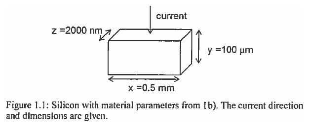

**e)** Fig. 1.2 shows a Si pn junction under bias, with N_D > N_A.

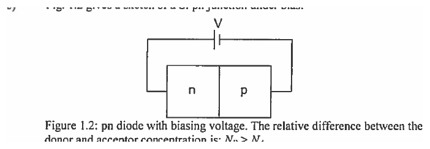

i) Sketch the current–voltage characteristic for 0 V < |V| < 1 V. (4)
ii) Sketch the material cross section and include the depletion width in each region. Make the relative sizes correct. (4)
iii) Add the minority carrier concentration to the sketch in (ii). Make the relative sizes correct. Label the axes. (5)

**f)** Give the relationship between V_eE and V_eB, and between V_eB and V_eC, for the BJT in Fig. 1.3 biased as shown by the arrow. (4)

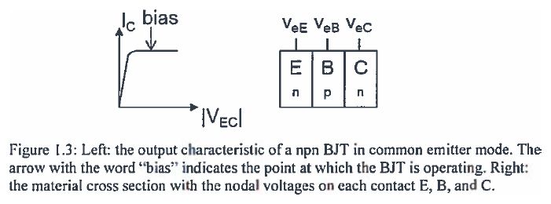

**g)** Two npn BJTs have exactly the same dimensions and material parameters, except the emitter doping: N_E1 > N_E2. Under the same bias, is I_C1 >, < or = I_C2? Verify your answer. (6)

---

### Q2. The pn junction: fields and carriers — 30 marks

**a)** A pn diode with homogeneous doping N_A = 10¹⁶ cm⁻³ and N_D = 10¹⁹ cm⁻³. The depletion widths (not shown) are w_n and w_p. The section lengths are X_n = X_p = 0.035 cm.

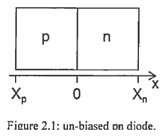

i) At which position x is the absolute value of the electric field maximum? (2)
ii) Write the total charge ρ(x) in the depletion region of the p-type material. Use the depletion approximation; the majority carrier concentration equals the doping. (2)
iii) Using the Poisson equation, derive the electric field in the p-side depletion region as a function of the doping. w_n and w_p must not appear in the final expression. Simplify but don't fill in values. (6)

**b)** The n-type doping is not uniform but varies slowly: N(x) = 10¹⁷ − 5 × 10¹⁸x.
i) Sketch the electron and hole concentrations in this layer with no bias. (4)
ii) Derive the internal electric field. Eliminate all material parameters so the equation only has constants and x. (4)
iii) Draw the direction of the field on the graph in (b i). (2)

**c)** Using charge neutrality in the homogeneously doped p region and the law of mass action, show that p ≈ N_A if N_A ≫ nᵢ. (10)

---

### Q3. Enhancement mode MOSFET and its C–V — 30 marks

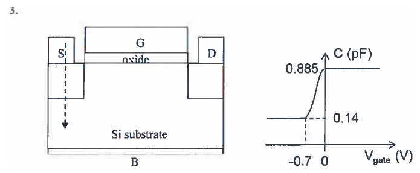

*Left: cross section of an enhancement mode MOSFET. Right: its C–V characteristic (V_gate between gate and bulk, bulk grounded). W_G = 100 µm, L_G = 5 µm.*

**a)**
i) Is it a p-channel or an n-channel MOSFET? (2)
ii) Give the doping type of the source, drain and substrate. (2)
iii) Sketch the band diagram (E_C, E_V, E_F, E_G) along the dashed line, making the contact characteristics clear. (6)

**b)**
i) Extract the oxide thickness from the C–V measurement. (2)
ii) At V_GS = 0 V the flat band condition holds. φ_m = 4.259 eV and E_vac − E_C = 4.050 eV in the semiconductor. Calculate the substrate doping. (4)
iii) Give the expression for the maximum depletion width in terms of the measured capacitances (C_min, C_max, C_depl,max). Don't fill in values. (4)

**c)**
i) Give the threshold voltage. (2)
ii) Estimate the mobility of the carriers in the channel from Fig. 3.2, with substrate doping 10¹⁶ cm⁻³. (2)
iii) Sketch the output characteristic for V_GS = −1 V and 0 V < |V_DS| < 1 V. Give the voltage and current at saturation. (6)

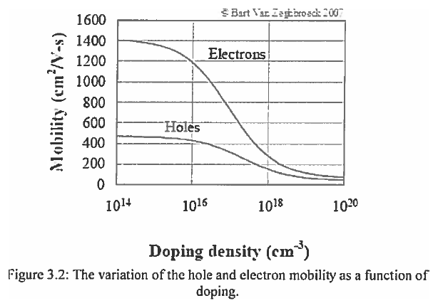

---

## Answers

Q1 answers

**a)** **p = n = nᵢ = 1.45 × 10¹⁰ cm⁻³.** (2) · Topic 1

**b)** Two ways.

1) p = N_V e^((E_V − E_F)/kT) with p = N_A: E_F − E_V = kT ln(N_V/p) = 0.026 × ln(1.8 × 10¹⁹ ÷ 10¹⁷) = 0.135 eV, so **E_C − E_F = 1.12 − 0.135 = 0.985 eV**.

2) n = N_C e^(−(E_C − E_F)/kT) with n = nᵢ²/N_A: E_C − E_F = kT ln(N_C N_A/nᵢ²) = **0.969 eV**.

(The two differ because nᵢ = 1.45 × 10¹⁰ doesn't exactly match N_C, N_V.) (5) · Topic 5

**c)** p-type: E_F close to E_V (0.135 eV above it), E_i near midgap above E_F. (5) "Really easy, answered correctly even when (b) was wrong." · Topic 5

**d)** Know this by heart (A-level physics): R = L/(σA), σ = e(nµ_n + pµ_p) ≈ e p µ_p.

The current flows along **y** (100 µm = 10⁻² cm). The cross section is x × z = 0.05 cm × 2 × 10⁻⁴ cm.

R = 10⁻² ÷ (1.6 × 10⁻¹⁹ × 10¹⁷ × 200 × 2 × 10⁻⁴ × 0.05) = **312.5 Ω** (5)

"All about unit conversions." · Topic 3

**e)**

i)

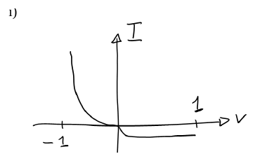

In this circuit the diode is **reverse biased for V > 0**, so the curve is flipped: current flows for V < 0. "Most graphs were flipped around the I axis." (4)

ii)

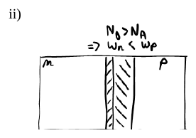

N_D > N_A → **w_n < w_p**. The key parts are where the depletion region sits and w_n < w_p. (4)

iii)

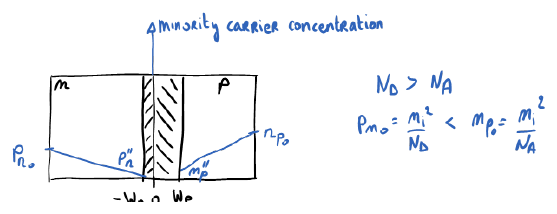

p_n0 = nᵢ²/N_D < n_p0 = nᵢ²/N_A: the minority carriers are **fewer on the heavily doped n side**. Any bias was accepted: it's about relative sizes. (5)

· Topic 11, Topic 12, Topic 14

**f)** **V_eE < V_eB** (EB forward biased) and **V_eB < V_eC** (BC reverse biased). (4) · Topic 20 §7

**g)** **I_C1 = I_C2.**

$$J_{tot} = J_n + J_p = \frac{eD_n n_i^2}{N_A W_B}\left(e^{eV/kT} - 1\right) + \frac{eD_p n_i^2}{N_D X_n}\left(e^{eV/kT} - 1\right)$$

In an npn, I_C is set by the minority carrier (electron) diffusion in the **base**, J_n. The base doping doesn't change, so I_C doesn't. What changes is I_B, and so β. (6)

"Arguments based on β all led to the wrong conclusion." · Topic 21 §2

Q2 answers

**a)**

i) **x = 0** (the metallurgic junction). (2)

ii) Depletion approximation: no free carriers, only ionised acceptors. **ρ(x) = −eN_A** (Q = −eN_A w_p A also accepted). (2)

iii) Poisson: dℰ/dx = ρ/ε = −eN_A/ε. Integrate: ℰ = −(eN_A/ε)x + C₁. Boundary: ℰ(−w_p) = 0 → C₁ = −(eN_A/ε)w_p. So

$$\mathcal{E}(x) = -\frac{eN_A}{\varepsilon}(x + w_p)$$

N_D ≫ N_A, so the sheet's w_p simplifies to w_p = √(2εV_bi/(eN_A)) (V = 0):

$$\mathcal{E}(x) = -\frac{eN_A}{\varepsilon}\left(x + \sqrt{\frac{2\varepsilon V_{bi}}{eN_A}}\right)$$ (6)

Mistakes: integrating between limits (a value, not a function); forgetting that V = 0. · Topic 14

**b)**

i)

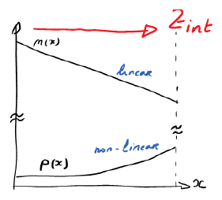

n(x) = 10¹⁷ − 5 × 10¹⁸x: **linear**, reaching 0 at x = 0.02 cm. p(x) = nᵢ²/n(x): **non-linear** (2100 cm⁻³ at x = 0, 4.2 × 10⁴ at x = 0.019 cm). Mistakes: drawing p(x) linear; drawing the doping instead of n(x). (4)

ii) No bias → J_n = 0:

0 = eµ_n nℰ + eD_n dn/dx → ℰ = −(D_n/µ_n)(1/n)(dn/dx) = −(kT/e)(1/n)(dn/dx)

$$\mathcal{E}(x) = \frac{0.026 \times 5\times10^{18}}{10^{17} - 5\times10^{18}x} = \frac{13}{10 - 500x}\ \text{V/cm}$$ (4)

This region is charge-neutral, so Poisson can't be used here. · Topic 4 §7

iii) ℰ points **+x** (towards the low doping), so that drift opposes diffusion. (2) · Topic 4

**c)** Charge in the p region: ρ = e(p − n − N_A) (2). Neutral: p − n − N_A = 0 (1). Mass action: n = nᵢ²/p (2). So

p − nᵢ²/p − N_A = 0 → p² − N_A p − nᵢ² = 0 → p = [N_A + √(N_A² + 4nᵢ²)]/2

For N_A ≫ nᵢ: √(N_A² + 4nᵢ²) ≈ N_A, so **p ≈ N_A**. (5)

Major error: starting from n = nᵢ²/N_A, which is what you're meant to prove. N_D = 0 here. · Topic 2

Q3 answers

"Marks were lost by forgetting the units."

**a)** i) **p-channel (pMOS)** (2) ii) source & drain **p-type (heavily doped)**, substrate **n-type** (2)

iii) An **ohmic** contact on heavily doped p-type: bands bend **up** towards the metal (accumulation), then the p⁺/n junction. Mistakes: ignoring the metal–p⁺ contact, or drawing it in depletion / calling it Schottky. (6) · Topic 18 §6

**b)** i) C_max = C_ox W_G L_G → C_ox = 0.885 × 10⁻¹² ÷ (100 × 10⁻⁴ × 5 × 10⁻⁴) = 1.77 × 10⁻⁷ F/cm². t_ox = ε₀ε_ox/C_ox = 8.85 × 10⁻¹⁴ × 4 ÷ 1.77 × 10⁻⁷ = **2 × 10⁻⁶ cm = 20 nm** (2)

Common mistake: forgetting C_ox is per area and the graph is in F. · Topic 16

ii)

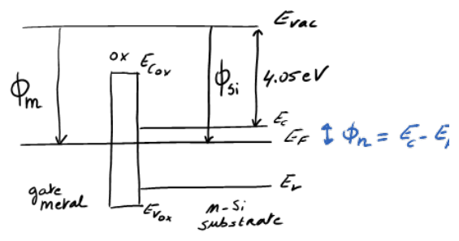

Flat band: E_C − E_F = φ_m − 4.05 = 0.209 eV. N_D = 3.2 × 10¹⁹ × e^(−0.209/0.026) = **1.03 × 10¹⁶ cm⁻³** (4) · Topic 15 §7

iii) At minimum capacitance the depletion width is maximum: two capacitors in series.

$$\frac{1}{C_{depl}^{max}} = \frac{1}{C_{min}} - \frac{1}{C_{max}}, \qquad W_{depl}^{max} = \frac{\varepsilon_0\varepsilon_r L_G W_G}{C_{depl}^{max}} = \frac{\varepsilon_0\varepsilon_r L_G W_G (C_{max} - C_{min})}{C_{max}C_{min}}$$ (4)

Main problem: the area in the final expression. · Topic 16

**c)** i) **V_th = −0.7 V** (2)

ii) Channel carriers are **holes**: **µ_p ≈ 410 cm²/Vs**. (Giving both µ_n and µ_p lost a mark.) (2)

iii) I_DS vs V_DS, both negative for a pMOS [1, 1]. Pinch-off at **V_DS = V_GS − V_th = −1 − (−0.7) = −0.3 V** [1]. Linear up to ~−0.3 V, then flat.

I_DS^sat = µC_ox W/(2L) × (V_GS − V_th)² = 410 × 1.77 × 10⁻⁷ × 100 ÷ (2 × 5) × 0.3² = **6.53 × 10⁻⁵ A** (6) · Topic 17 §8

