# Final 2015

**The real 2015 paper**, with the official answers and the examiners' comments.

**How to use it:**
- Do it on paper, closed book, with only the [formula sheet](../formula-sheet.md).
- 2 hours. Answer **all** questions. Q1 = 40 marks, Q2 = 30, Q3 = 30.
- Mark yourself with the answers at the bottom. Each one says which topic to go back to.

**Constants on this paper:** as 2018 (ε_Si = 11, ε_ox = 4). χ is given in Q1e.

---

## Questions

### Q1. Carriers, fields, contacts — 40 marks

**a)** Give expressions for the majority and minority carrier density as a function of donor doping N_D. (4)

**b)**
i) What is the probability of finding an electron at the Fermi energy E_F? (2)
ii) What is the density of electrons at E = E_F in an n-doped material? Explain briefly. (4)

**c)** The doping density in Si is given in Fig. 1.1. Give the direction of the electric field ℰ when no bias is applied. Explain briefly. (4)

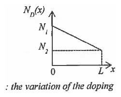

**d)** Draw the band diagram (E_C, E_V, E_F, E_i, E_G) of the material in Fig. 1.1. (6)

**e)** Choose a metal from Table 1.1 that gives an ohmic contact on p-Si with N_A = 3.6 × 10¹⁸ cm⁻³. The electron affinity of Si is χ = E_vac − E_C = 4.05 eV. Prove your answer. (10)

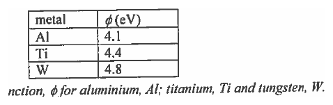

**f)** An unbiased Si pn junction has N_A = N_D, a built-in potential V_bi = 0.7 V and a depletion layer in the p-type region of 2.06 × 10⁻⁵ cm. Find the maximum absolute value of the electric field in the depletion region. (6)

**g)** The material cross section of a MOSFET is given in Fig. 1.2. Sketch the depletion regions for this MOSFET when 0 < V_GS < V_th and V_DS > 0 V. (4)

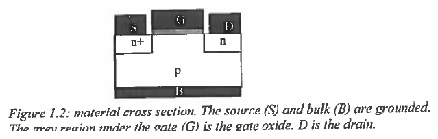

---

### Q2. MOSFET — 30 marks

**a)** Explain why the diffusion component of the current in the channel of an n-channel enhancement mode MOSFET with V_DS ≪ V_GS − V_th and V_GS ≫ V_th is negligible. Use equations as well as band diagrams and/or cross sections. (10)

**b)** Draw the band diagrams (E_C, E_V, E_F, E_G) that explain that a carrier **diffusion** process controls the size of the source–drain current I_DS at constant V_DS for different V_GS > V_th. (10)

**c)**
i) Derive the expression for the inversion charge density Q(x) in the channel when V_GS > V_th and V_DS is in the triode (linear) region. Explain each step briefly. (6)
ii) Calculate the inversion surface charge density Q halfway between source and drain when t_ox = 10 nm, W = 5 µm, L = 1 µm, V_th = 1 V, V_GS = 1.5 V and V_DS = 0.1 V. (4)

---

### Q3. BJT — 30 marks

**a)** Sketch the band diagram (E_C, E_V, E_F, E_G) of an n⁺pn BJT in forward active mode. The emitter doping is higher than the base and collector doping, which are the same. Include the depletion regions and make sure all relative distances are correct. (10)

**b)** Sketch the **excess** minority carrier concentration against distance in each region in forward active mode. Show the minority carrier type in each region and give the expression for the excess minority carrier concentration at each junction. Include the depletion regions; make sure relative distances are correct. (10)

**c)** For the BJT in (a), take an emitter width L_E, base width W_B and collector width L_C.
i) Derive simplified expressions for I_E, I_B and I_C as functions of the excess carrier concentrations and material parameters. Do not neglect the leakage current from collector into base. Use distinct symbols for each region. (6)
ii) Show that β increases when the leakage current from collector into base is taken into account, compared with when it's neglected. (4)

---

## Answers

Q1 answers

**a)** **n_n = N_D, p_n = nᵢ²/N_D.** (4) Bookwork. · Topic 2

**b)** i) Fermi function at E = E_F: **f(E_F) = 1/(1 + e⁰) = ½**. (2)

ii) **Zero.** To have an electron at E_F there must be an available state. E_F is in the bandgap, which has no states. (Only if the doping is degenerate is E_F in the band.) (4) · Topic 5

**c)**

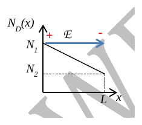

The doping gradient gives an electron gradient: electrons **diffuse** from x = 0 to x = L. With no bias there is no net current, so an internal field must make electrons **drift** the other way. ℰ points from + to −: **along +x** (towards the lower doping). (4)

Some missed that the current is zero (drift and diffusion cancel). · Topic 4

**d)**

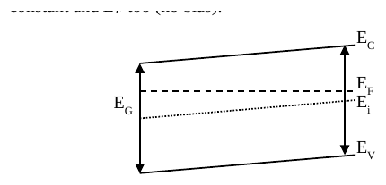

n-type everywhere, so E_F is above E_i along the whole length. **E_F flat** (no bias), E_G constant. E_C rises towards x = L (less doping, E_C further from E_F). The slope must be consistent with the field in (c). (6)

Major error: a slope in E_F. · Topic 5, Topic 7

**e)** An ohmic contact needs **accumulation of majority carriers** at the junction:

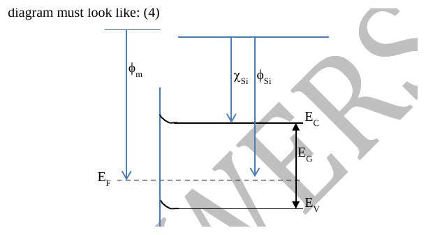

Electrons must flow from the semiconductor to the metal, so **φ_m > φ_s**. (4)

Workfunction of the p-Si:

E_V − E_F = kT ln(N_A/N_V) = 0.026 × ln(3.6 × 10¹⁸ ÷ 1.8 × 10¹⁹) = −0.042 eV

E_C − E_F = 1.12 − 0.042 = 1.078 eV

φ_Si = χ + (E_C − E_F) = 4.05 + 1.078 = **5.13 eV** (4)

**No metal in the table works**: all three workfunctions (4.1, 4.4, 4.8 eV) are smaller than 5.13 eV. W (closest) was accepted if critically argued. (2)

"A common question with a twist to check critical analysis." · Topic 9, Topic 6

**f)** In the p-side depletion region dℰ/dx = −eN_A/ε. With N_A = N_D:

w_p = √(εV_bi/(eN_A)) → N_A = εV_bi/(e w_p²) = 11 × 8.85 × 10⁻¹⁴ × 0.7 ÷ (1.6 × 10⁻¹⁹ × (2.06 × 10⁻⁵)²) = **10¹⁶ cm⁻³**

ℰ(x) = −(eN_A/ε)(x + w_p), maximum size at **x = 0**:

|ℰ(0)| = eN_A w_p/ε = 1.6 × 10⁻¹⁹ × 10¹⁶ × 2.06 × 10⁻⁵ ÷ (11 × 8.85 × 10⁻¹⁴) = **3.4 × 10⁴ V/cm** (6)

Shortcut: |ℰ(0)| = V_bi/w_p = 0.7 ÷ 2.06 × 10⁻⁵ = 3.4 × 10⁴ V/cm. Common problems: ε = ε₀ε_r, and mixing cm and m. · Topic 14

**g)**

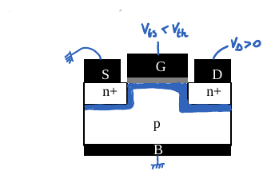

Depletion under the gate and around the source and drain; **slightly larger at the drain side**. No inversion layer! (4) · Topic 17

Q2 answers

"Perceived as the most difficult question in the exam."

**a)** nMOS: J_n = eµ_n n ℰ + eD_n dn/dx. (2)

**Drift** (3): ℰ is set by V_DS. n(x) ∝ V_GS − V_th − V(x) ≈ V_GS − V_th: large in strong inversion. Only a few holes in the channel, so hole drift is negligible.

**Diffusion** (5): compare n near the source and near the drain. It is set by the oxide voltage: V_GS at the source, V_GD = V_GS − V_DS ≈ V_GS at the drain (V_DS small). So the band bending and E_C − E_F at the interface are almost the same at both ends:

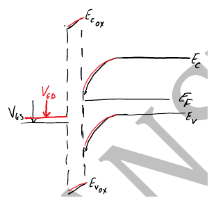

Tiny gradient → small diffusion. Drift ≫ diffusion. "Diffusion is neglected" without explanation got no marks. · Topic 17 §7

**b)** Diffusion **across the source–channel junction** is how the gate controls I_DS. (2) S → D band diagrams for three V_GS (V_DS = 0): the barrier **lowers** with V_GS. (4)

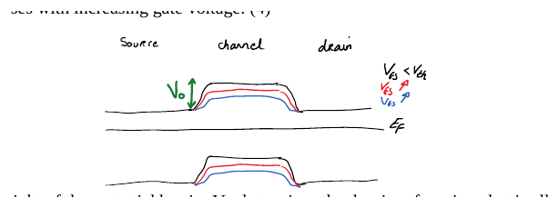

The barrier height V₀ sets how many electrons can diffuse from the source into the channel. Only those above the barrier (from the Fermi distribution) get across. Lowering V₀ lets more across. (4)

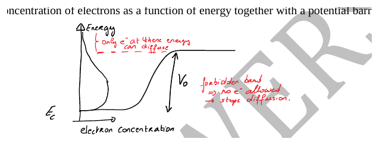

· Topic 17 §7

**c)** i) Q = CV. For a MOSFET Q_channel = C_ox V_across oxide (2). The oxide voltage is the gate potential minus the channel potential V(x), which changes along the channel because of V_DS. No inversion charge below V_th. So **Q_c(x) = −C_ox(V_GS − V_th − V(x))**: minus V(x) because there is less inversion at higher channel voltage. (4)

ii) C_ox = 8.85 × 10⁻¹² × 4 ÷ 10 × 10⁻⁹ = **0.00354 F/m²**. Halfway, V(x) ≈ V_DS/2 = 0.05 V (linear variation).

Q = −0.00354 × (1.5 − 1 − 0.05) = **−0.0016 C/m²** (4) · Topic 17 §9

Q3 answers

**a)**

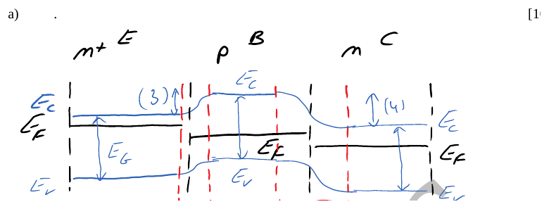

E_F in the emitter goes **up** relative to the base (forward); E_F in the collector goes **down** (reverse). (3) E_C closer to E_F in the emitter than in the collector; E_C − E_F in the collector ≈ E_F − E_V in the base. (3) Depletion in the lower-doped regions; forward EB depletion narrower than reverse BC. (3) All symbols. (1)

Main error: a slope in the base. · Topic 20 §3

**b)**

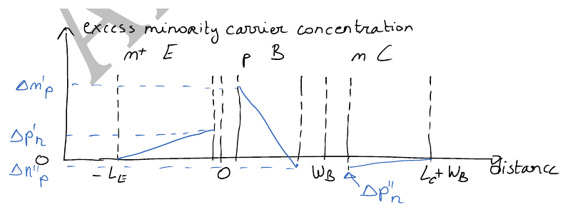

Excess → **zero at the ohmic contacts** (2). EB: Δp′_n = p′_n − p_n0 (emitter), Δn′_p = n′_p − n_p0 (base) (2). BC: Δp″_n = p″_n − p_n0 (collector), Δn″_p = n″_p − n_p0 (base) (2), from c = c₀e^(eV/kT) (′ forward, ″ reverse). All linear (1). Δp′_n < Δn′_p (heavy emitter). Δp″_n = Δn″_p, both **negative** (reverse) (2). Start at the depletion edges (1).

Classic mistake: drawing the concentration, not the excess. · Topic 21

**c)** i)

J_E = −eD_nΔn′_p/W_B − eD_pΔp′_n/L_E

J_C = −eD_nΔn′_p/W_B − eD_p|Δp″_n|/L_C

J_B = J_E − J_C = −eD_pΔp′_n/L_E + eD_p|Δp″_n|/L_C

(Δn″_p ignored: negligible next to Δn′_p.) (6)

ii) Without leakage β = (D_nΔn′_p/W_B)/(D_pΔp′_n/L_E). With leakage β = (I_C + I_L)/(I_B − I_L): I_C up, I_B down, so **β increases**. (4)

Weakness: going back to the formula-sheet diode equations. · Topic 21 §3

