# Final 2016

**The real 2016 paper**, with the official answers.

**How to use it:**
- Do it on paper, closed book, with only the [formula sheet](../formula-sheet.md).
- 2 hours. Answer **all** questions. Q1 = 40 marks, Q2 = 30, Q3 = 30.
- Mark yourself with the answers at the bottom. Each one says which topic to go back to.

**Constants on this paper:** as 2018 (ε_Si = 11, ε_ox = 4, no χ).

---

## Questions

### Q1. Bands, the pn diode, the BJT and the MOSFET — 40 marks

**a) Energy band diagrams**

i) Sketch the band diagram, including E_C, E_V, E_F, E_i and E_G, of n-type Si. (4)
ii) Give the values of E_C, E_V and E_i with respect to E_F for the Si in (i) when the doping is 2 × 10¹⁷ cm⁻³. (6)
iii) Draw the band diagram (E_C, E_V, E_i) of the Si in (ii) when 0.5 V is applied as in Fig. 1.1. Give the values of E_C and E_i at x = 0 and 1 µm with respect to E_F. (6)
iv) Add the electric field vector to the drawing in (iii) and give its size. (4)

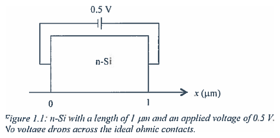

**b) pn diode**

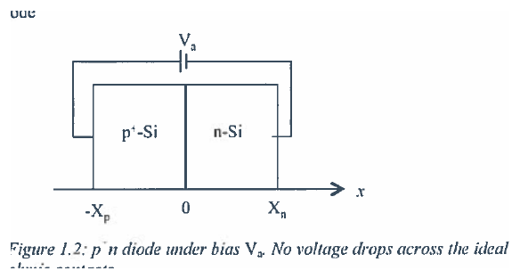

i) Sketch the band diagram (E_C, E_V, E_F) of the diode in Fig. 1.2 when N_A = 2 × N_D. Make your sketch consistent with the relative doping. (6)
ii) Fill in the blanks with one of: forward, reverse, diffuse, drift, left-to-right, right-to-left, 1, 2, 4, larger, smaller. (4)
- ii1) The pn diode in Fig. 1.2 is ......... biased.
- ii2) Electrons ......... from ......... across the depletion region.
- ii3) Holes ......... from ......... across the n-type region.
- ii4) The depletion width in the n-type region is ...... × ......... than that in the p-type region.

**c) BJT**

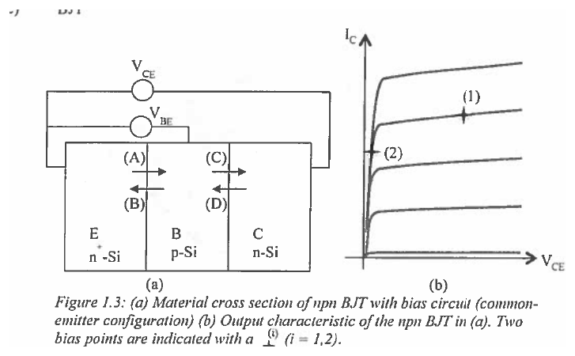

i) Give the bias condition (forward or reverse) across the EB and BC junctions for bias points (1) and (2). (4)
ii) Which type of carriers (electrons, holes or both) must be injected into the base by the base current at bias point (1)? (2)
iii) Give β in terms of (A), (B), (C), (D) for the BJT at bias point (1). (A) to (D) are the currents of the injected carriers shown by the arrows. (4)

**d) MOSFET**

i) Sketch the band diagram (E_C, E_i, E_F) of an n-channel enhancement mode MOSFET from the gate, through the oxide, into the substrate, in the middle of the channel, at V_GS = V_th and V_DS = 0 V. Show V_GS. (6)
ii) Derive the transconductance of an n-channel enhancement mode MOSFET for V_GS > V_th and V_DS > V_GS − V_th. (4)

---

### Q2. BJT — 30 marks

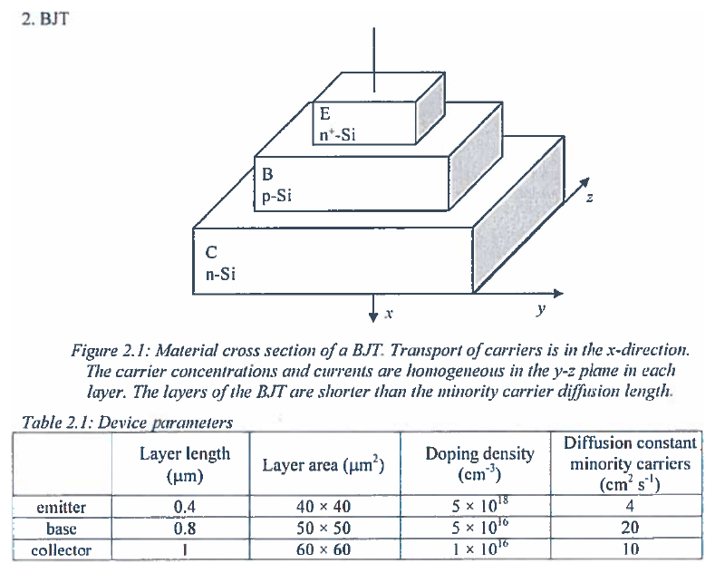

*Transport is in the x-direction. The concentrations and currents are uniform in the y–z plane in each layer. The layers are shorter than the minority carrier diffusion length.*

**a)** What is the meaning of "diffusion length of the minority carriers"? At most 30 words. (4)

**b)** Calculate the minority carrier concentration at the contacts and at the edges of the depletion regions for a forward bias of 0.26 V across the EB junction and a reverse bias of 1 V across the BC junction. The contacts are ideal. (6)

**c)** Plot the minority carrier concentration along x in each layer. Take the BC depletion region into account. Label the axes. (6)

**d)** Calculate the emitter, base and collector currents for the bias in (b), taking the BC depletion region into account. (9)

---

### Q3. MOSFET — 30 marks

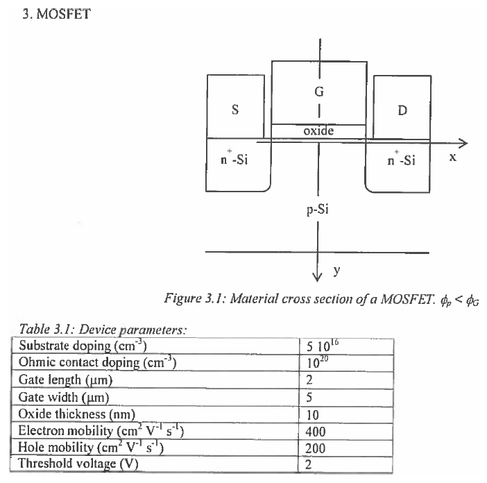

*φ_p < φ_G.*

**a)** Why is the electron mobility higher than the hole mobility in Si? At most 30 words. (4)

**b)** Sketch the band diagram (E_C, E_V, E_F) along y in Fig. 3.1. φ_G − φ_p = 1 V and all contacts are at zero bias. (6)

**c)** Plot C_GS(V_GS) for V_GS < 0 to V_GS > V_th, with V_DS in the triode region. Comment on each voltage where C_GS changes from a constant value. (9)

**d)** Calculate the maximum and minimum value of C_GS. Use Table 3.1. (6)

---

## Answers

Q1 answers

**a)** (bookwork)

i)

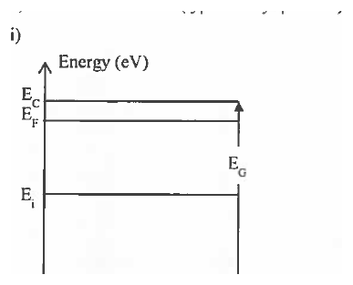

E_F close to E_C (n-type), E_i near the middle, E_G = E_C − E_V. (4)

ii) n = N_C e^(−(E_C − E_F)/kT) → E_C − E_F = kT ln(N_C/N_D) = 0.026 × ln(3.2 × 10¹⁹ ÷ 2 × 10¹⁷) ≈ **0.13 eV** [2]

E_C − E_i = kT ln(N_C/nᵢ) = 0.026 × ln(3.2 × 10¹⁹ ÷ 1.45 × 10¹⁰) ≈ **0.56 eV** (midgap, as expected for Si) [2]

With E_V = 0: **E_C = 1.12 eV, E_F = 0.99 eV, E_i = 0.56 eV**. [2]

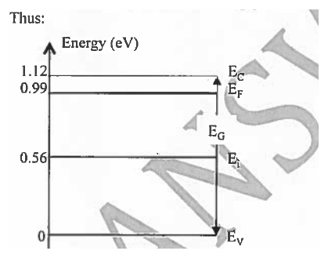

iii) PE = qV (by heart). 1 V of electrostatic potential = 1 eV of potential energy. So E_C(1 µm) = E_C(0) − 0.5 eV:

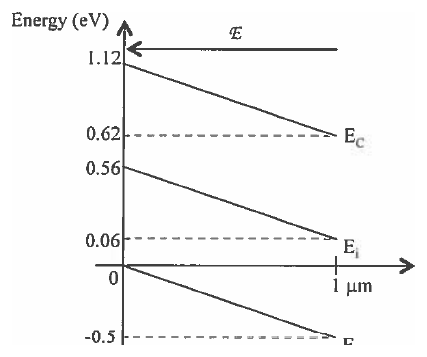

**E_C: 1.12 → 0.62 eV, E_i: 0.56 → 0.06 eV, E_V: 0 → −0.5 eV.** (6)

iv) The field points from + to −, "uphill": electrons lose potential energy as they drift. |ℰ| = ΔV/Δx = 0.5 V ÷ 1 µm = **5 × 10⁵ V/m**. (4)

From: Topic 5, Topic 7

 

**b)** (bookwork)

i)

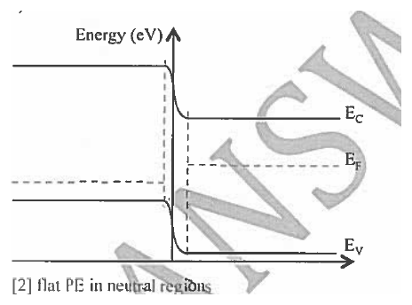

[2] flat potential energy in the neutral regions; [3] correct E_F positions + ΔE_F; [1] non-linear in the depletion region.

ii)
- ii1) The diode is **FORWARD** biased.
- ii2) Electrons **DIFFUSE** from **RIGHT TO LEFT** across the depletion region.
- ii3) Holes **DIFFUSE** from **LEFT TO RIGHT** across the n-type region.
- ii4) The depletion width in the n-type region is **2 × LARGER** than in the p-type region (N_A = 2N_D). (4)

From: Topic 11, Topic 14

 

**c)** (bookwork)

i) (1): **EB forward, BC reverse.** (2): **EB forward, BC forward.** (4)
ii) **Holes.** (2)
iii) **β = (C) ÷ ((B) − (D))** (4)

From: Topic 20 §6

 

**d)** (bookwork)

i)

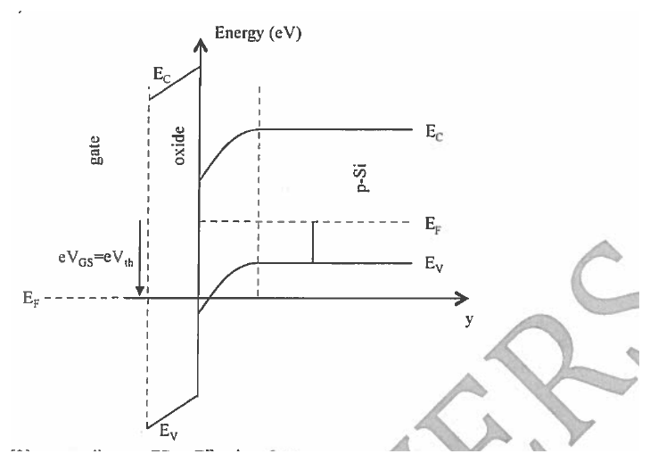

[2] correct distance E_C to E_F at the interface; [2] correct bending; [2] correct E_F shift. (6)

ii) The conditions mean saturation: I_DS = µC_ox W_g/(2L_g) × (V_GS − V_th)². **g_m = dI_DS/dV_GS = µC_ox W_g/L_g × (V_GS − V_th).** (4)

From: Topic 15, Topic 19

Q2 answers

Different from lectures because the layers have different areas. Thanks to the "uniform in the y–z plane" statement, it only matters for the currents.

**a)** The average distance a minority carrier diffuses before it **recombines** with a majority carrier. (4)

**b)** c = c₀ e^(V/V_T), c₀ = nᵢ²/N (by heart).

- Emitter: p_n0E = (1.45 × 10¹⁰)² ÷ 5 × 10¹⁸ = **42 cm⁻³**, p′_n = 42 × e^(0.26/0.026) ≈ **9 × 10⁵ cm⁻³** [2]
- Base: n_p0 = **4205 cm⁻³**, n′_p ≈ **9 × 10⁷ cm⁻³**, n″_p = 4205 × e^(−1/0.026) ≈ **8 × 10⁻¹⁴ cm⁻³** [2]
- Collector: p_n0C ≈ **2.1 × 10⁴ cm⁻³**, p″_n ≈ **4 × 10⁻¹³ cm⁻³** [2]

**c)**

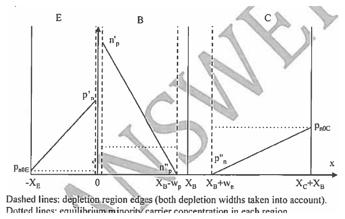

Dashed: depletion edges (both BC depletion widths). Dotted: equilibrium values. [3] correct differences in concentration; [2] to the depletion edges; [1] linear.

**d)** Neglect the BC leakage (forward active). I_E = EB diode current; I_C = its electron part. Units: cm.

V_bi = 0.026 ln(5 × 10¹⁶ × 10¹⁶ ÷ (1.45 × 10¹⁰)²) = **0.74 V** [1]

w_p(V) = [2ε₀ε_Si(V_bi − V)N_D ÷ (e(N_A + N_D)N_A)]^½ = [2 × 8.85 × 10⁻¹⁴ × 11 × 1.74 × 10¹⁶ ÷ (1.6 × 10⁻¹⁹ × 6 × 10¹⁶ × 5 × 10¹⁶)]^½ = **8.4 × 10⁻⁶ cm** [2]

I_E = eA_E D_E Δp_nE/X_E + eA_B D_B Δn_pB/(X_B − w_p) [4]

= 1.6 × 10⁻¹⁹ × (40 × 10⁻⁴)² × 4 × 9 × 10⁵ ÷ 0.4 × 10⁻⁴ + 1.6 × 10⁻¹⁹ × (50 × 10⁻⁴)² × 20 × 9 × 10⁷ ÷ (0.8 − 0.084) × 10⁻⁴

**I_E = 2.3 × 10⁻¹³ A + 10⁻¹⁰ A**, **I_C = 10⁻¹⁰ A**, **I_B = 2.3 × 10⁻¹³ A** [2]

From: Topic 21 §4

Q3 answers

Different from lectures: there is a workfunction difference, which changes the C–V curve.

**a)** Mobility is inversely proportional to the carrier mass. Electrons in Si are lighter than holes, so their mobility is higher. (4) · Topic 3

**b)** φ_G > φ_p → the MOSFET is in **accumulation** at zero bias.

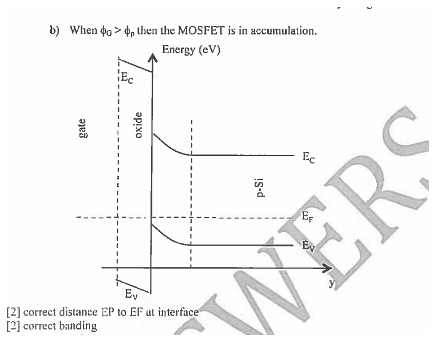

[2] correct distance E_C to E_F at the interface; [2] correct bending; [2] correct E_F. (6) · Topic 15 §1

**c)**

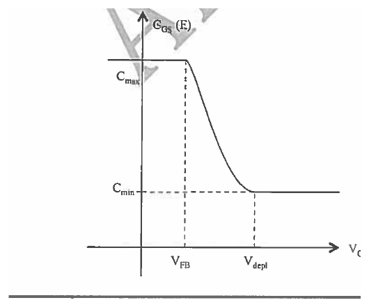

- V_GS < 0: accumulation (more holes under the oxide). C_GS is maximum, set by the oxide thickness. [2]
- 0 < V_GS < V_FB: still accumulation until the bands flatten at V_FB = φ_G − φ_p. [2]
- V_FB < V_GS < V_th: a depletion region builds up, C_GS decreases until the depletion width is maximum at V_th and an inversion channel forms. C_GS is minimum for V_GS ≥ V_th. [2]
- Plot [3]. · Topic 16 §3

**d)** C_max = ½C_ox L_g W_g = ½ε_ox ε₀ L_g W_g/t_ox = ½ × 4 × 8.85 × 10⁻¹⁴ × 2 × 10⁻⁴ × 5 × 10⁻⁴ ÷ 10⁻⁶ = **1.77 × 10⁻¹⁴ F** [2]

C_min: series of C_max and C_depl. W_depl^max (formula sheet) = 2[11 × 8.85 × 10⁻¹⁴ × 0.026 × ln(5 × 10¹⁶ ÷ 1.45 × 10¹⁰) ÷ (1.6 × 10⁻¹⁹ × 5 × 10¹⁶)]^½ = **1.38 × 10⁻⁵ cm** [2]

C_depl = ε₀ε_Si A/W = 11 × 8.85 × 10⁻¹⁴ × 10⁻⁷ ÷ 1.38 × 10⁻⁵. C_min = C_max C_depl ÷ (C_max + C_depl). [2]

Official numbers: C_depl = 5 × 10⁻¹⁵ F, **C_min = 3.9 × 10⁻¹⁵ F**. ⚠️ Recomputing gives C_depl = 7.1 × 10⁻¹⁵ F and C_min = 5.0 × 10⁻¹⁵ F (see Topic 16 §5). Same method either way.

