# Final 2017

**The real 2017 paper**, with the official answers and the examiners' comments on common mistakes.

**How to use it:**
- Do it on paper, closed book, with only the [formula sheet](../formula-sheet.md).
- 2 hours. Answer **all** questions. Q1 = 40 marks, Q2 = 30, Q3 = 30.
- Mark yourself with the answers at the bottom. Each one says which topic to go back to.

**Constants on this paper:** as 2018, plus **χ = 4.05 eV** (electron affinity of Si).

---

## Questions

### Q1. Basic principles of semiconductors — 40 marks

**a)** Give all correct statements to describe a **hole** from the list: (2)
i) an antielectron in a semiconductor; ii) a positive mobile charge in a semiconductor; iii) a positive ionised atom in a semiconductor; iv) a positron in a semiconductor; v) a proton in a semiconductor; vi) a void in a semiconductor.

**b)** Why is the drift velocity of electrons higher than that of holes in intrinsic Si? (2)

**c)** Prove that n × p = nᵢ² in equilibrium. (4)

**d)** The hole diffusion current is $I_p = -eD_pA\,\dfrac{dp}{dx}$. Explain, using appropriate graphs, the reason for the "−" sign. (4)

**e)** Fig. 1.1 gives a band diagram of Si with two free carriers (black dots).

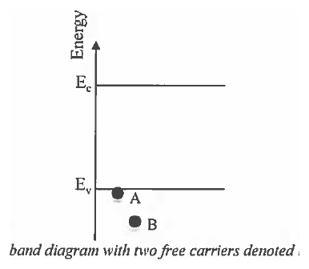

i) Do the dots represent electrons or holes? (2)
ii) Which carrier, A or B, has the highest potential energy? (2)

**f)** The workfunction of Si is 5.035 V. Determine the doping type and the doping concentration. (6)

**g)** The forward bias current density of a p⁺n junction is 6.11 × 10⁻¹¹ A/cm². The widths of the p and n regions equal their minority carrier diffusion lengths, L_p = 5 × 10⁻⁴ cm and L_n = 4 × 10⁻⁴ cm. D_p = 2 cm²/s and D_n = 3 cm²/s. Calculate the excess minority carrier concentration at the edge of the depletion region in the n-region. State any assumption you make. (6)

**h)** A Si substrate with acceptor doping 10¹⁷ cm⁻³ is implanted with a donor doping of 10¹⁸ cm⁻³. Calculate the hole and electron concentrations in the implanted region. (8)

**i)** Is the threshold voltage V_th of an enhancement mode p-channel MOSFET >, < or = 0? (2)

**j)** Which region in the short BJT determines the size of the collector current? (2)

---

### Q2. The pnp BJT with short material layers — 30 marks

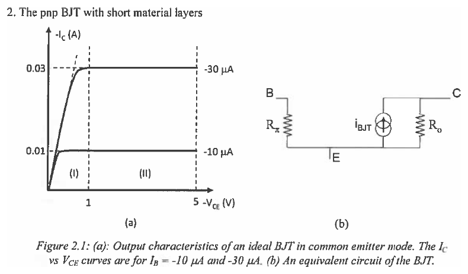

*Fig. 2.1: (a) output characteristics of an ideal BJT in common emitter mode, I_C vs V_CE for I_B = −10 µA and −30 µA. (b) an equivalent circuit of the BJT.*

**a)** Sketch the minority carrier concentration in the emitter, base and collector for the BJT biased in region (II). Show the depletion widths, define all material parameters and give symbols for the junction voltages. (6)

**b)** Give the expressions for I_E, I_C and I_B in region (II) in terms of material parameters and the junction voltages from (a). Make appropriate assumptions to simplify them. (6)

**c)** Calculate I_E and I_B for I_C = 1 mA (in region II), ignoring base width modulation. (3)

**d)** Derive expressions for the equivalent circuit components R_π, R_o and i_BJT as functions of I_E, I_C and I_B. (6)

**e)** The BJT has an input resistance R_π = 8 kΩ and an output conductance g_o = 4 mS. Calculate the transconductance g_m. (3)

**f)** Using (e), plot the output characteristic for I_B = −30 µA with base width modulation. Give I_C at V_CE = −5 V. (6)

---

### Q3. The p-channel depletion mode MOSFET — 30 marks

**a)** Describe briefly the key characteristics of a p-channel depletion mode MOSFET and give two possible fabrication methods. (6)

**b)** Choose one method from (a) and draw the material cross section. Define all regions. (6)

**c)** For the MOSFET in (b), sketch the band diagram (E_F, E_C, E_V) from the gate into the substrate for V_DS = V_GS = V_BS = 0 V. State any assumptions. (6)

**d)** Sketch the transfer characteristic (I_DS vs V_GS) for one drain voltage in saturation. Show V_th. (6)

**e)** Sketch the high-frequency C–V characteristic (C_GS vs V_GS). Give the expression of the maximum capacitance as a function of t_ox and show V_th on the plot. (6)

---

## Answers

Q1 answers

**a)** **ii)** only: a positive mobile charge in a semiconductor. "A void" is wrong: an empty space can't have a mass or a charge. (2) · Topic 1

**b)** Because the **electron mass is smaller** than the hole mass (µ ∝ 1/m). (2) · Topic 3

**c)** n = N_C e^(−(E_C − E_F)/kT) and p = N_V e^(−(E_F − E_V)/kT) give n × p = N_C N_V e^(−E_G/kT) (1). By the definition of the intrinsic level E_i: nᵢ = N_C e^(−(E_C − E_i)/kT), pᵢ = N_V e^(−(E_i − E_V)/kT), so nᵢ × pᵢ = nᵢ² = N_C N_V e^(−E_G/kT) (2). (1) = (2). (4) · Topic 5

**d)**

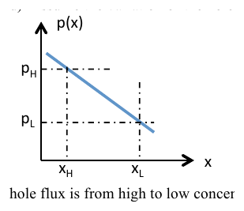

Holes flow from high to low concentration: **+x**. Hole charge is positive, so the current is also in **+x**. But dp/dx = (p_L − p_H)/(x_L − x_H) < 0 (negative gradient), so it must be multiplied by −1 to get the right direction. (4)

Don't start from the drift-diffusion equation: it already contains the sign, so that's circular. · Topic 4

**e)** i) **Holes** (free carriers in the valence band). (2) ii) **B**: potential energy for holes increases going **deeper** into the valence band. (2) · Topic 5

**f)** Sketch the band diagram with all values:

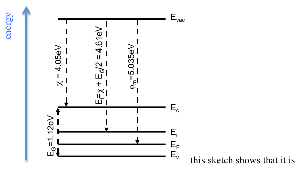

E_i is χ + E_G/2 = 4.05 + 0.56 = 4.61 eV below E_vac. φ = 5.035 eV > 4.61 eV, so E_F is **below E_i**: **p-type**.

E_F − E_V = χ + E_G − φ = 4.05 + 1.12 − 5.035 = 0.135 eV

p = N_V e^(−0.135/0.026) = 1.8 × 10¹⁹ × 5.5 × 10⁻³ ≈ **1.0 × 10¹⁷ cm⁻³**

(Or p = nᵢ e^((E_i − E_F)/kT) = 1.45 × 10¹⁰ × e^(0.425/0.026) ≈ 1.8 × 10¹⁷: the gap comes from nᵢ = 1.45 × 10¹⁰ not matching N_C, N_V. All accepted if the approach is right.) (6)

Many sign errors: E_V − E_F < 0 was often taken positive. · Topic 6

**g)** p⁺n junction, so assume **J ≈ J_p** (hole current dominates). (3)

J_p = eD_p (p′_n − p_n0)/L_p, so the excess holes at the n-side depletion edge:

Δp = J L_p ÷ (eD_p) = 6.11 × 10⁻¹¹ × 5 × 10⁻⁴ ÷ (1.6 × 10⁻¹⁹ × 2) = **9.5 × 10⁴ cm⁻³** (3)

Mistakes: not using J ≈ J_p (then there aren't enough numbers); using L_n instead of L_p (L_p is the hole diffusion length **in the n region**). · Topic 13

**h)** Two dopings of similar size: **compensation doping**. Use charge neutrality and mass action (4):

−N_A + N_D − n + p = 0 and n × p = nᵢ² → n² − (N_D − N_A)n − nᵢ² = 0

n = [(10¹⁸ − 10¹⁷) + √((10¹⁸ − 10¹⁷)² + 4 × (1.45 × 10¹⁰)²)] ÷ 2 = **9 × 10¹⁷ cm⁻³**

p = nᵢ²/n ≈ **234 cm⁻³** (4)

n = 1.1 × 10¹⁸ is wrong: you can't have more electrons than the net doping. · Topic 2

**i)** **V_th < 0** (2) · Topic 18

**j)** **The base region.** Its minority carrier gradient sets I_C when all layers are short. (2) · Topic 20, Topic 21

Q2 answers

**a)** Region II = forward active: EB forward, BC reverse (V_EB > 0, V_CB < 0).

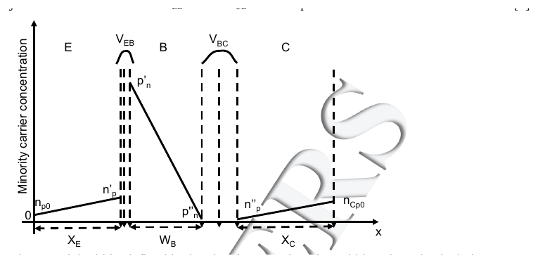

X_E, W_B, X_C are the junction widths **minus** the depletion regions (the effective widths). The main error was not defining all the parameters. (6) · Topic 21

**b)** I_E = A eD_n^E(n′_p − n_p0)/X_E + A eD_p^B(p′_n − p″_n)/W_B. Since n′_p ≫ n_p0 and p′_n ≫ p″_n:

$$I_E \approx A\frac{eD_n^E n_{p0}}{X_E}e^{V_{EB}/V_T} + A\frac{eD_p^B p_{n0}}{W_B}e^{V_{EB}/V_T}$$

Neglecting the collector leakage: I_C ≈ A eD_p^B p_n0 e^(V_EB/V_T)/W_B and I_B ≈ A eD_n^E n_p0 e^(V_EB/V_T)/X_E. (6) · Topic 21

**c)** β from Fig. 2.1a region II: β = I_C/I_B = 10⁻² A ÷ 10⁻⁵ A = **1000**. For I_C = 1 mA: **I_B = 1 µA**, **I_E = I_C + I_B ≈ 1.001 mA**. (3)

Mistake: signs wrong in I_E = I_C + I_B, giving I_E < I_C. · Topic 21

**d)** R_π = (dI_B/dV_EB)⁻¹ = **V_T/I_B** (= β/g_m). R_o = ∂V_CE/∂I_C = **V_A/I_C** (V_CE ≈ V_BC; for the ideal Fig. 2.1a, R_o is infinite). i_BJT = I_C = A eD_p^B p_n0 e^(V_EB/V_T)/W_B, small signal **g_m v**. (6)

They must be **derived** from the definitions. · Topic 22

**e)** R_π = (dV_EB/dI_C)(dI_C/dI_B) = β/g_m, so **g_m = β/R_π = 1000 ÷ 8000 = 0.125 S**. (3) · Topic 22

**f)**

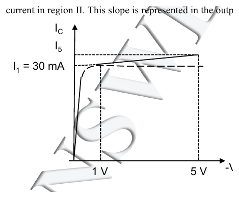

Give the flat part a slope g_o. I₅ = g_o ΔV + I₁ = 4 × 10⁻³ × 4 + 0.03 = **0.046 A**. (6) · Topic 22

Q3 answers

"This was an easy question, therefore accuracy and consistency were of utmost importance."

**a)** p-type source and drain, n-type bulk, **holes in the channel at V_GS = 0 V**. A positive voltage depletes the channel and switches it off: **V_th > 0**.

Method 1: implant the top surface with acceptors so N_A > N_D (compensation). Method 2: a gate whose workfunction difference with the n-substrate creates a hole inversion layer: φ_Si < φ_gate. (6)

Very often only one method was given. · Topic 18

**b)**

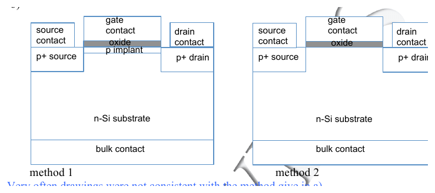

Drawings were often not consistent with the method in (a). (6) · Topic 18

**c)**

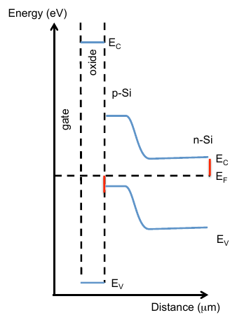 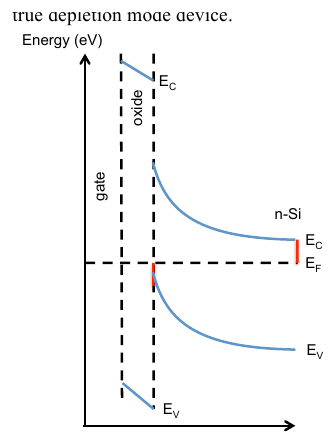

Method 1 assumptions: no workfunction difference (flat oxide bands); a graded junction between the p implant and the n substrate. Method 2: no assumptions. Both: the bands bend further than threshold needs. (6) · Topic 18, Topic 15

**d)**

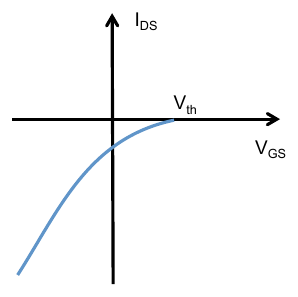

Quadratic in saturation [2], V_th positive [2], currents negative for the pMOS [2]. (6) · Topic 18

**e)**

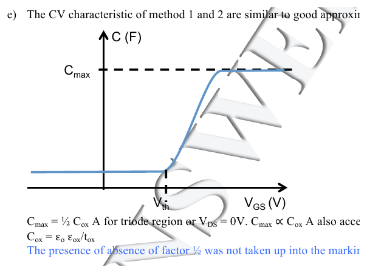

**C_max = ½ C_ox A** (triode, or V_DS = 0). C_max ∝ C_ox A also accepted. **C_ox = ε₀ε_ox/t_ox**. (6) · Topic 16

