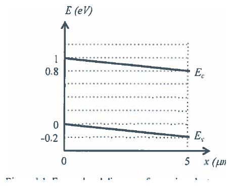
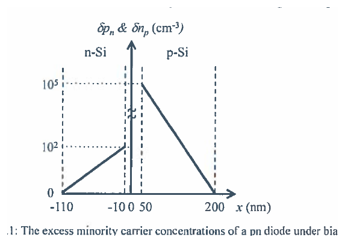
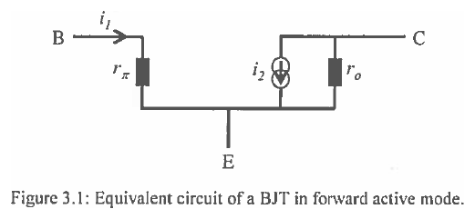
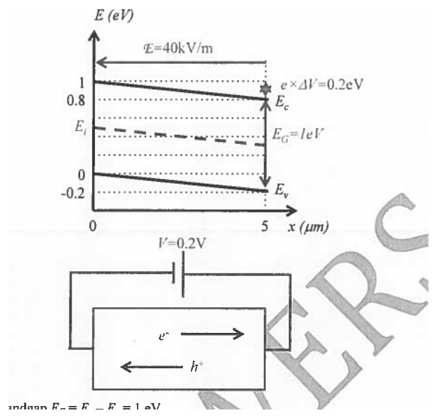
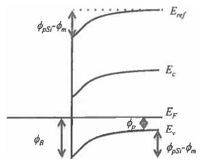
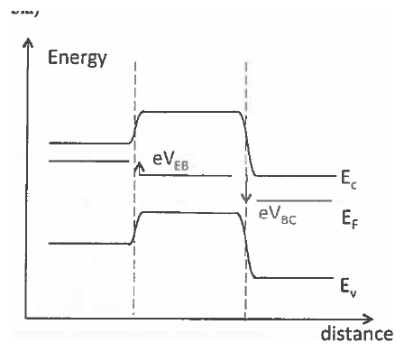
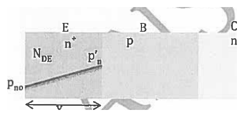
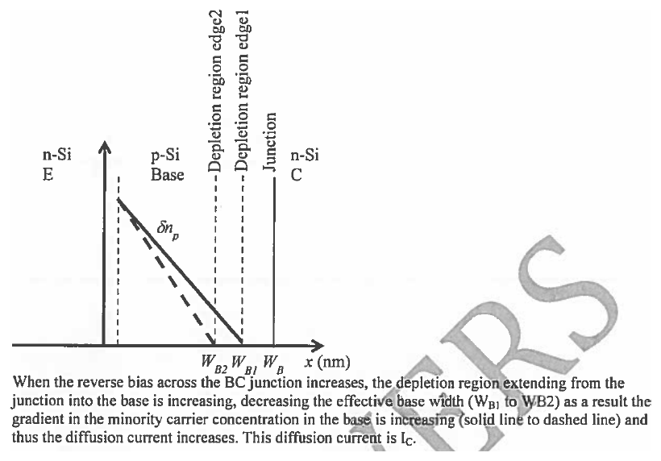

# Final 2018

**The real 2018 paper**, with the official answers (and the official marking notes where there were any).

**How to use it:**
- Do it on paper, closed book, with only the [formula sheet](../formula-sheet.md).
- 2 hours. Answer **all** questions. Q1 = 40 marks, Q2 = 30, Q3 = 30.
- Mark yourself with the answers at the bottom. Each one says which topic to go back to.

**Constants on this paper:** ε₀ = 8.85 × 10⁻¹² F/m, nᵢ = 1.45 × 10¹⁰ cm⁻³, ε_Si = 11, ε_ox = 4, V_T = 0.026 V, e = 1.6 × 10⁻¹⁹ C, E_G = 1.12 eV, N_C = 3.2 × 10¹⁹ cm⁻³, N_V = 1.8 × 10¹⁹ cm⁻³.

---

## Questions

### Q1. Bands, contacts and quick checks — 40 marks

*Figure 1.1: energy band diagram of a semiconductor with N_V = N_C.*

**a)** Redraw the energy band diagram of Fig. 1.1 and add:

i) The bandgap E_G and its value. (2)
ii) The intrinsic level E_i. (2)
iii) The electrostatic potential difference ΔV between x = 0 and 5 µm, and its size. (4)
iv) The electric field vector ℰ and its size. (4)
v) Draw the material cross section and add a battery with a value and polarity consistent with Fig. 1.1. Assume no voltage drop at the contacts. (4)
vi) The semiconductor is doped with acceptors N_A. Draw the electron and hole flow (flux) through the material. (4)

**b)**

i) Give the relationship between the workfunction of a metal contact and the workfunction of p-type Si to obtain a Schottky contact. (2)
ii) The p-type Si in (b i) has N_A = 10¹⁶ cm⁻³. The Schottky barrier height is φ_B = 0.395 eV (φ_B = |E_F − E_vs|, with E_vs the top of the valence band at the metal–semiconductor junction). Give the absolute value of the workfunction difference between the metal and the p-type Si. (4)
iii) Give the relationship between the on-voltage V_ON of the Schottky diode in (b ii) and that of an n⁺p diode with the same p doping and an n-type doping 100 times larger. Justify your answer. (4)

**c)** Answer yes or no. (1 each)

i) At room temperature, the valence band is almost completely filled with electrons covalently bound to the atoms.
ii) If the mass of holes is smaller than the mass of electrons, the hole mobility will be larger than the electron mobility.
iii) Current through the depletion region of a pn diode is mainly determined by drift.
iv) The reverse bias current through a pn diode is limited by the electric field across the diode.
v) The substrate doping in an n-channel enhancement mode MOSFET is n-type.
vi) Increasing the substrate doping of a MOSFET will decrease the threshold voltage.
vii) The transconductance g_m of a MOSFET in the triode region (low V_DS) will increase when the doping density in the substrate increases.
viii) The gate–drain capacitance C_GD of a MOSFET can be neglected for the MOSFET in saturation.
ix) The current gain of an n⁺pn BJT is larger than that of an npn BJT.
x) The output current I_C of a BJT in saturation, in common-emitter configuration, increases quasi-linearly with increasing bias across the emitter–collector junction |V_CE|.

---

### Q2. Carriers and a pn diode — 30 marks

**a)** Give the general charge neutrality expression for a semiconductor. Define all parameters. (4)

**b)** Prove the law of mass action n × p = nᵢ² for a semiconductor in equilibrium. (4)

**c)** A p-type Si substrate is doped with 10¹⁷ cm⁻³ boron atoms. To make a pn junction, arsenic atoms are implanted into this substrate, creating a final homogeneous doping density of 10¹⁸ cm⁻³. Calculate the exact electron and hole densities in both the p-type substrate and the implanted region. (10)

**d)** The excess carrier concentration of a pn diode under bias is given in Fig. 2.1.

i) Is the diode in forward or reverse bias? (2)
ii) Which region has the highest majority carrier concentration? Give two features in Fig. 2.1 that support your answer. (4)
iii) Calculate the total current density through the diode. D_n = 50 cm²/s and D_p = 20 cm²/s for electrons and holes. Take the depletion regions into account. (6)

---

### Q3. The n⁺pn BJT — 30 marks

**a)** Draw the energy band diagram (E_C, E_F, E_V) from the emitter, through the base, into the collector of an n⁺pn BJT in forward active mode. Show the voltage drops |V_EB| and |V_CB| and include the depletion regions. (10)

**b)** Give the main carrier transport process (drift or diffusion) through each region of the "short" BJT in forward active mode: i) emitter ii) EB depletion region iii) base iv) BC depletion region v) collector. (1 each)

**c)** The equivalent circuit of a BJT is given in Fig. 3.1.

i) What is the condition on the emitter–base AC voltage to allow use of this circuit? (4)
ii) Give the expression for i₁ in terms of the BJT material parameters. Use X_E, X_B and X_C as the undepleted lengths of the emitter, base and collector. Identify clearly the doping type and region in the expression of i₁. (5)
iii) Give the expression of i₂ in terms of the transconductance g_m. (2)
iv) Why is the output conductance g_o = r_o⁻¹ larger than zero? Give a physical reason and illustrate with an equation or a sketch. (4)

---

## Answers

Q1 answers

**a)**

i) E_G = E_C − E_V = **1 eV** (it's not Si!). (2)

ii) N_C = N_V, so **E_i is exactly midgap**: a dashed line halfway between E_C and E_V, tilted the same way. (2)

iii) ΔV = (1 eV − 0.8 eV) ÷ e = **0.2 V**. On an energy plot it's drawn in eV, so ΔV is multiplied by e. (4)

iv) ℰ = 0.2 V ÷ 5 µm = 0.2 ÷ 5 × 10⁻⁶ = **4 × 10⁴ V/m = 40 kV/m**. It points "uphill", towards x = 0 (the bands are higher there). (4)

v) A positive voltage lowers the potential energy. The bands are lower at x = 5 µm, so the battery's **+ terminal is at the x = 5 µm end**, **0.2 V**. (4)

vi) Electrons flow "down the hill": towards **+x** (opposite to ℰ). Holes the opposite way, towards −x. (4)

From: Topic 7 (bands under a field), Topic 5 (E_i)

 

**b)**

i) **φ_m < φ_pSi.** (2)

ii)

φ_p = E_F − E_V in the bulk. p = N_A = N_V e^(−φ_p/kT), so φ_p = kT ln(N_V/N_A) = 0.026 × ln(1.8 × 10¹⁹ ÷ 10¹⁶) = **0.195 eV**.

|φ_pSi − φ_m| = φ_B − φ_p = 0.395 − 0.195 = **0.2 eV** (4)

iii) Built-in voltage of the n⁺p junction: V_bi = 0.026 ln(10¹⁶ × 10¹⁸ ÷ (1.45 × 10¹⁰)²) = **0.82 V**.

V_bi of the Schottky contact = φ_pSi − φ_m = 0.2 V.

A smaller barrier needs a smaller forward voltage before carriers diffuse across. So **V_ON(Schottky) < V_ON(pn)**. (4)

From: Topic 9 (Schottky vs ohmic), Topic 10 (V_bi)

 

**c)**

i) **yes** ii) **yes** iii) **no** iv) **no** v) **no** vi) **no** vii) **no** viii) **yes** ix) **yes** x) **yes**

Why, briefly:
- iii) Through the depletion region the current is carried by carriers diffusing across (drift and diffusion nearly cancel). Topic 13.
- iv) It's limited by the **supply of minority carriers**, not the field. Topic 11, Topic 20 §2.
- v) p-type. vi) V_th **increases** with doping. Topics 15, 18.
- vii) g_m^triode = (µC_ox W/L)V_DS: no doping in it. viii) pinched off at the drain. Topic 19.
- ix) heavier emitter → larger β. Topic 21. x) the steep part of the curve. Topic 20.

Q2 answers

**a)** **p − n + N_D − N_A = 0** (4)

p: free hole concentration. n: free electron concentration. N_D: ionised donor atoms. N_A: ionised acceptor atoms.

From: Topic 2

 

**b)** From the formula sheet, n = N_C e^((E_F − E_C)/kT) and p = N_V e^((E_V − E_F)/kT). Multiply:

n × p = N_C N_V e^((E_V − E_C)/kT) = N_C N_V e^(−E_G/kT)

The sheet also gives nᵢ = √(N_C N_V) e^(−E_G/2kT), so nᵢ² = N_C N_V e^(−E_G/kT). Therefore **n × p = nᵢ²**. (4)

From: Topic 5, Topic 1

 

**c)** **Implanted region (compensated n-doping):** both dopants are present: N_A = 10¹⁷, N_D = 10¹⁸.

Put p = nᵢ²/n into charge neutrality:

$$-n^2 + (N_D - N_A)n + n_i^2 = 0$$

$$n = \frac{(N_D - N_A) + \sqrt{(N_D - N_A)^2 + 4n_i^2}}{2} = 9 \times 10^{17}\ \text{cm}^{-3}$$ (4)

p = nᵢ²/n = (1.45 × 10¹⁰)² ÷ 9 × 10¹⁷ = **2.34 × 10² cm⁻³** (2)

**Substrate (no compensation):** p = N_A = **10¹⁷ cm⁻³** (2), n = nᵢ²/p = **2.1 × 10³ cm⁻³** (2)

[Just writing n = N_D − N_A with no calculation or explanation got 1 mark.]

From: Topic 2

 

**d)**

i) **Forward** biased (excess minority carriers are positive: injection). (2)

ii) The **n-region**: (a) its depletion region is the **smallest**, and (b) its minority carrier concentration is the **lowest**, which by mass action means the highest majority concentration. (4)

iii) Lengths in cm: the n side runs from −110 to −10 nm (100 nm), the p side from 50 to 200 nm (150 nm).

$$J = e\left(D_n\frac{\Delta n_p}{X_n} + D_p\frac{\Delta p_n}{X_p}\right) = 1.6\times10^{-19}\left(50\times\frac{10^5}{150\times10^{-7}} + 20\times\frac{10^2}{100\times10^{-7}}\right)$$

**J = 5.33 × 10⁻⁸ A/cm²** (4 marks equation, 2 marks solution)

From: Topic 12, Topic 13

Q3 answers

**a)**

Emitter E_F raised by eV_EB (forward), collector E_F lowered by eV_BC (reverse), base E_F the reference. Depletion regions dashed.

Marking: ΔE_F correct [4]; voltage shifts correct [2]; general band diagram correct [4].

From: Topic 20 §3

 

**b)** i) **diffusion** ii) **diffusion** iii) **diffusion** iv) **drift** v) **diffusion**

From: Topic 20

 

**c)**

i) v_be **small**, so that the variation of I_C is **linear** within that range. (4)

ii) The base current i₁ is due to the minority carrier gradient in the **emitter** (holes in the n⁺ emitter):

$$i_1 = i_h = \frac{eD_{pE}}{X_E}(p'_n - p_{n0})A = \frac{eD_{pE}n_i^2}{X_E N_{DE}}\left(e^{v_{be}/V_T} - 1\right)A$$ (5)

iii) **i₂ = g_m v_be** (2)

iv) **Base width modulation.** The output current is the diffusion current of electrons in the base:

$$I_C = \frac{eD_{nB}n_i^2}{X_B N_{AB}}\left(e^{v_{be}/V_T} - 1\right)A$$

X_B is the undepleted base width. When |V_CE| increases, |V_CB| increases, the depletion width extending into the base increases, so X_B decreases, the gradient increases, and I_C increases. (4)

From: Topic 22

