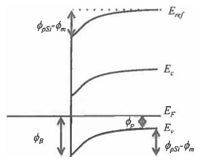
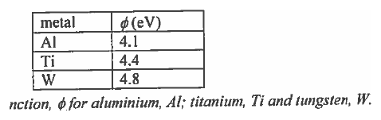
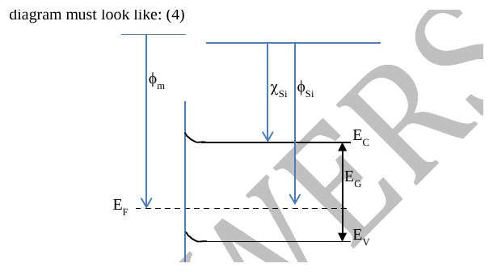

# Topic 9 — End-of-topic test

Try each question first.
Then click to check.

Each answer says which notes section (§) it comes from.

---

## Part A: Tutorial and past-final questions

### Q6 (Tutorial Ch2 Q6)

A metal sits on p-Si, with φₘ > φ_Si. A voltage V can be applied, − on the metal, + on the Si.

a. Draw the band diagram (E_C, E_V, E_F, E_G) through the junction for V = 0.
b. Draw it for V as given.
c. Draw it for the opposite polarity.
d. What type of contact is this?
e. What happens to the I–V curve if the Si is changed to n-type, same φₘ > φ_Si?

Answer

**a.** φₘ > φ_Si, so metal E_F is lower. Electrons flow Si → metal. p-Si loses electrons = gains holes at the junction. Bands bend **up** towards the metal. E_F flat.

**b.** ℰ_ext adds to ℰ₀. More bending. Holes float up into the metal. Current flows.

**c.** ℰ_ext opposes ℰ₀. Less bending. Holes flow the other way. Current flows.

**d.** **Ohmic.** The metal was chosen so the contact potential **increases** the majority carrier concentration at the interface.

**e.** **Schottky.** Electrons still leave the Si, but now they're the majority, so a barrier forms. Current one way only.

From: §4, §5, §6

---

### F2018-1b (Final 2018 Q1b)

(i) Relationship between φ_m and φ_pSi for a Schottky contact. [2] (ii) N_A = 10¹⁶ cm⁻³, φ_B = |E_F − E_vs| = 0.395 eV: give |φ_pSi − φ_m|. [4] (iii) Compare V_ON of this Schottky diode with an n⁺p diode with N_D 100× larger. [4]

Answer

(i) **φ_m < φ_pSi.**

(ii) 

φ_p = E_F − E_V = 0.026 ln(1.8 × 10¹⁹/10¹⁶) = 0.195 eV → |φ_pSi − φ_m| = 0.395 − 0.195 = **0.2 eV**.

(iii) V_bi(n⁺p) = 0.026 ln(10¹⁶ × 10¹⁸/nᵢ²) = **0.82 V** vs 0.2 V for the Schottky: **V_ON(Schottky) < V_ON(pn)**.

From: ⭐ table, Topic 10

---

### F2015-1e (Final 2015 Q1e)

Choose a metal from Table 1.1 that gives an ohmic contact on p-Si with N_A = 3.6 × 10¹⁸ cm⁻³. χ = 4.05 eV. Prove your answer. [10]

Answer

Ohmic on p-type = hole accumulation → **φ_m > φ_s**.

E_V − E_F = 0.026 ln(3.6 × 10¹⁸ / 1.8 × 10¹⁹) = −0.042 eV → E_C − E_F = 1.078 eV → φ_s = 4.05 + 1.078 = **5.13 eV**.

**No metal in the table works** (all < 5.13 eV). W, the closest, was accepted with a critical argument.

From: ⭐ table

---

## Part B: Exam-style questions

---

### M1: True or false

1. An ohmic contact has a straight-line I–V curve.
2. A Schottky contact on n-Si forms when φₘ < φ_Si.
3. In a metal–semiconductor junction, the bands bend on the metal side.
4. At V = 0, E_F is flat across a metal–semiconductor junction.
5. An ohmic contact accumulates majority carriers at the junction.

Answer

1. **True.** (§1)
2. **False.** For n-Si, Schottky needs φₘ **>** φ_Si. (§2)
3. **False.** The metal is a perfect conductor. All bending is on the Si side. (§3)
4. **True.** Same rule as any junction at equilibrium. (§3, Topic 8)
5. **True.** (big idea)

---

### M2: Multiple choice

Metal φₘ = 4.1 eV on n-Si with φ_Si = 4.3 eV. The contact is:

- A. Schottky, bands bend up
- B. Schottky, bands bend down
- C. Ohmic, bands bend up
- D. Ohmic, bands bend down

Answer

**D.**

φₘ < φ_Si, so metal E_F is higher. Electrons flow metal → Si. n-Si gains majority carriers. **Ohmic.**

Gained electrons, so bands bend **down** towards the metal (E_C comes closer to E_F).

From: §2, §3

---

### M3: Explain

Why does a Schottky contact on n-Si block current for one polarity but not the other?

Answer

At V = 0 the bands bend up towards the metal. That's a hill for electrons.

**+ on the metal:** the external field lowers the hill. Electrons roll over. Current.

**− on the metal:** the hill gets taller. The electrons in the metal face the forbidden gap. No current, just leakage.

From: §6

---

### M4: Table

Fill in: ohmic or Schottky?

| Si type | φₘ vs φ_Si | Contact |
|---|---|---|
| n | φₘ > φ_Si | ? |
| n | φₘ < φ_Si | ? |
| p | φₘ > φ_Si | ? |
| p | φₘ < φ_Si | ? |

Answer

| Si type | φₘ vs φ_Si | Contact |
|---|---|---|
| n | φₘ > φ_Si | **Schottky** |
| n | φₘ < φ_Si | **Ohmic** |
| p | φₘ > φ_Si | **Ohmic** |
| p | φₘ < φ_Si | **Schottky** |

From: §2

---

### M5: Sketch

Sketch the band diagram at V = 0 for a metal on n-Si with φₘ > φ_Si. Then sketch it with + on the metal. Say whether current flows.

Answer

V = 0: E_F flat. Si bands bend **up** towards the metal (Si lost electrons). This is a Schottky barrier.

+ on the metal: the metal's E_F drops by eV. Hill is lower. Electrons from the Si roll into the metal. **Current flows.**

Compare the left and middle diagrams in the Q6e official answer.

From: §6, drawing checklist

