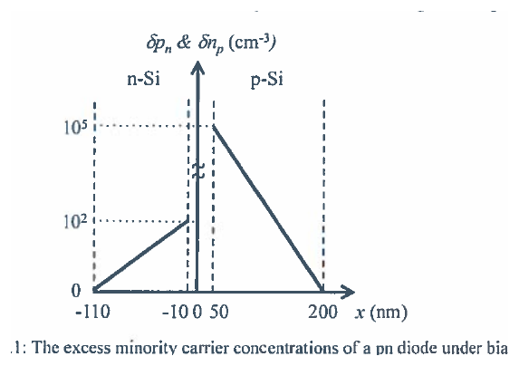

# Topic 13 — End-of-topic test

Try each question first.
Then click to check.

Each answer says which notes section (§) it comes from.

V_T = 0.026 V. nᵢ² ≈ 2.1 × 10²⁰ cm⁻⁶. e = 1.6 × 10⁻¹⁹ C.

---

## Part A: Tutorial and past-final questions

### Q12 (Tutorial Ch2 Q12)

The Q9 diode: N_A = 10¹⁵, N_D = 10¹⁸ cm⁻³. p-region length L_n = 5 × 10⁻³ cm, n-region length L_p = 8 × 10⁻³ cm. Bias 0.5 V forward. D_n = 35 cm²/s, D_p = 12.5 cm²/s.

Find the hole and electron currents. Why is the electron current larger? Give the total.

Answer

From Q9b: n'_p = 4.7 × 10¹³, p'_n = 4.7 × 10¹⁰.

J_n ≈ e D_n n'_p / L_n = 1.6 × 10⁻¹⁹ × 35 × 4.7 × 10¹³ ÷ 5 × 10⁻³ = **5.3 × 10⁻² A/cm²**

J_p ≈ e D_p p'_n / L_p = 1.6 × 10⁻¹⁹ × 12.5 × 4.7 × 10¹⁰ ÷ 8 × 10⁻³ = **1.2 × 10⁻⁵ A/cm²**

**Why J_n > J_p:** N_A < N_D, so n'_p > p'_n. The lightly doped side gets more injection.

**Total:** J ≈ J_n = **5.3 × 10⁻² A/cm²**

From: §5

---

### Q13 (Tutorial Ch2 Q13)

The n-region in Q12 is halved in length. What happens to the total current?

Answer

The n-region carries the **hole** current. Half the length = double the gradient. J_p doubles to **2.4 × 10⁻⁵ A/cm²**.

J_n is unchanged. Total ≈ J_n, so **no real change**.

From: §6

---

### F2018-2diii (Final 2018 Q2d iii)

For the 2018 Fig. 2.1 diode, calculate the total current density. D_n = 50, D_p = 20 cm²/s. Take the depletion regions into account. [6]

Answer

n side −110 to −10 nm = 100 nm (holes, Δp = 10²); p side 50 to 200 nm = 150 nm (electrons, Δn = 10⁵).

J = e(D_n Δn/X_n + D_p Δp/X_p) = 1.6 × 10⁻¹⁹ (50 × 10⁵/150 × 10⁻⁷ + 20 × 10²/100 × 10⁻⁷) = **5.33 × 10⁻⁸ A/cm²**

From: ⭐ formula, §5

---

### F2017-1g (Final 2017 Q1g)

A p⁺n junction carries 6.11 × 10⁻¹¹ A/cm² forward. The p and n widths equal the diffusion lengths, L_p = 5 × 10⁻⁴ cm, L_n = 4 × 10⁻⁴ cm. D_p = 2, D_n = 3 cm²/s. Find the excess minority carrier concentration at the n-side depletion edge. State your assumption. [6]

Answer

**Assume J ≈ J_p** (p⁺n). [3]

Δp = J L_p/(eD_p) = 6.11 × 10⁻¹¹ × 5 × 10⁻⁴ ÷ (1.6 × 10⁻¹⁹ × 2) = **9.5 × 10⁴ cm⁻³** [3]

Mistakes: not using J ≈ J_p; using L_n instead of L_p.

From: ⭐ list, §5

---

### F2018-1ciii (Final 2018 Q1c iii)

Yes or no: current through the depletion region of a pn diode is mainly determined by drift. [1]

Answer

**No.** The current is set by carriers **diffusing** across (drift and diffusion nearly cancel in there).

From: ⭐ list

---

## Part B: Exam-style questions

---

### M1: True or false

1. Diode current is mainly drift of minority carriers in the neutral regions.
2. In a short diode the current is the same at every x.
3. The reverse current grows with reverse voltage.
4. J_n and J_p are on the formula sheet.
5. In a p⁺n diode (N_A ≫ N_D), the hole current dominates.

Answer

1. **False.** It's **diffusion**. The field in the neutral regions is ≈ 0. (§1)
2. **True.** No recombination. (§1)
3. **False.** It's flat at −I₀. (§3, §4)
4. **True.** (§2)
5. **True.** The n-side is lightly doped, so p_n0 = nᵢ²/N_D is the big one. Holes injected into n dominate. (§2 check)

---

### M2: Multiple choice

A diode carries 1 mA at 0.6 V forward. Roughly what does it carry at 0.66 V?

- A. 1.1 mA
- B. 2 mA
- C. 10 mA
- D. 100 mA

Answer

**C.**

e^(0.06/0.026) = e^2.3 ≈ **10**. So 10 mA.

Rule of thumb: every 60 mV forward = ×10 current.

From: §3, Equation 22

---

### M3: Calculate

N_A = 10¹⁸, N_D = 10¹⁶. n-region length 5 × 10⁻³ cm, p-region length 2 × 10⁻³ cm. D_p = 12 cm²/s, D_n = 36 cm²/s. Forward bias 0.6 V. (e^(0.6/0.026) ≈ 1.05 × 10¹⁰.)

1. Find p'_n and n'_p.
2. Find J_p and J_n.
3. Which dominates, and why?

Answer

**1.** p_n0 = 2.1 × 10²⁰ ÷ 10¹⁶ = 2.1 × 10⁴. n_p0 = 2.1 × 10²⁰ ÷ 10¹⁸ = 210.

p'_n = 2.1 × 10⁴ × 1.05 × 10¹⁰ = **2.2 × 10¹⁴ cm⁻³**

n'_p = 210 × 1.05 × 10¹⁰ = **2.2 × 10¹² cm⁻³**

**2.** J_p = 1.6 × 10⁻¹⁹ × 12 × 2.2 × 10¹⁴ ÷ 5 × 10⁻³ = **8.5 × 10⁻² A/cm²**

J_n = 1.6 × 10⁻¹⁹ × 36 × 2.2 × 10¹² ÷ 2 × 10⁻³ = **6.4 × 10⁻³ A/cm²**

**3.** **J_p**, about 13× bigger. The n-side is the lightly doped side, so it gets the bigger minority injection (holes).

From: Topic 12 Equation 19, then §2 Equation 21

---

### M4: Sketch and explain

Sketch the I–V curve of a Si pn diode. Mark I₀ and roughly where it "turns on". Explain why the reverse current is flat.

Answer

- Reverse: flat line just below zero, at −I₀.
- Forward: near zero until about 0.7 V, then shoots up exponentially.

Flat reverse current: the minority at the junction edge is ≈ 0 for any reverse voltage, so the triangle (and its slope) can't get any bigger. The current is set by n_p0 and p_n0, which are fixed by the doping.

From: §3, §4

---

### M5: Explain

Why do we calculate diode current from the **minority** carriers, when there are far more majority carriers?

Answer

In the neutral regions there's no field, so no drift. The minority carriers can only diffuse, and their diffusion is the bottleneck: the smallest flux in the chain.

The majority carriers just supply whatever the minority carriers carry away. The current is the same at every x, so calculating it from the minority side gives the total.

From: §1

