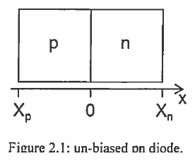
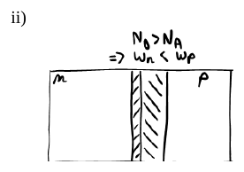

# Topic 14 — End-of-topic test

Try each question first.
Then click to check.

Each answer says which notes section (§) it comes from.

e = 1.6 × 10⁻¹⁹ C. ε₀ = 8.85 × 10⁻¹⁴ F/cm. ε_r = 11.9. V_T = 0.026 V. nᵢ² ≈ 2.1 × 10²⁰ cm⁻⁶.

---

## Part A: Tutorial and past-final questions

### Q11 (Tutorial Ch2 Q11)

pn diode, diameter 100 µm. N_A = 10¹⁹, N_D = 10¹⁶ cm⁻³. T = 300 K. Find:

a. V₀
b. the depletion width in the n and p material
c. a reason why the n-side width is bigger
d. the charge Q on each side
e. the minimum electric field

Answer

**a.** V₀ = **0.88 V**

**b.** w_n = **3.4 × 10⁻⁵ cm**. w_p = **3.4 × 10⁻⁸ cm**.

**c.** Charge balance: N_A w_p = N_D w_n. N_A ≫ N_D, so w_p ≪ w_n.

**d.** A = π(50 × 10⁻⁴)² = 7.85 × 10⁻⁵ cm². Q_n = eN_D w_n A = **+4.3 × 10⁻¹² C**. Q_p = **−4.3 × 10⁻¹² C**.

**e.** ℰ₀ = −eN_D w_n / ε = **−5.2 × 10⁴ V/cm**

From: §6

---

### F2015-1f (Final 2015 Q1f)

An unbiased pn junction has N_A = N_D, V_bi = 0.7 V and a p-side depletion width of 2.06 × 10⁻⁵ cm. Find the maximum absolute field. [6]

Answer

N_A = N_D → w_p = √(εV_bi/(eN_A)) → N_A = εV_bi/(e w_p²) = **10¹⁶ cm⁻³**.

ℰ(x) = −(eN_A/ε)(x + w_p), maximum at x = 0: |ℰ| = eN_A w_p/ε = **3.4 × 10⁴ V/cm**. (Shortcut: V_bi/w_p.)

Common problems: ε = ε₀ε_r, and mixing cm and m.

From: ⭐ list, §3

---

### F2014-2a (Final 2014 Q2a)

pn diode N_A = 10¹⁶, N_D = 10¹⁹ cm⁻³, unbiased.

(i) Where is |ℰ| maximum? [2] (ii) Write ρ(x) in the p-side depletion region. [2] (iii) Derive ℰ(x) there from Poisson, without w_n or w_p in the answer. [6]

Answer

(i) **x = 0.** (ii) **ρ = −eN_A.**

(iii) dℰ/dx = −eN_A/ε → ℰ = −(eN_A/ε)(x + w_p) (using ℰ(−w_p) = 0). N_D ≫ N_A → w_p = √(2εV_bi/(eN_A)):

$$\mathcal{E}(x) = -\frac{eN_A}{\varepsilon}\left(x + \sqrt{\frac{2\varepsilon V_{bi}}{eN_A}}\right)$$

Mistakes: integrating to a number instead of a function; forgetting V = 0.

From: §3, §4

---

### F2014-1eii (Final 2014 Q1e ii)

For the 2014 diode with N_D > N_A, sketch the cross section with the depletion width in each region, with the right relative sizes. [4]

Answer

N_D > N_A → **w_n < w_p** (N_A w_p = N_D w_n). True for any bias.

From: ⭐ list

---

## Part B: Exam-style questions

---

### M1: True or false

1. The depletion region extends further into the heavily doped side.
2. Reverse bias makes the depletion region wider.
3. The electric field is biggest at the edges of the depletion region.
4. The charge on the p-side equals minus the charge on the n-side.
5. Doubling the reverse voltage doubles the depletion width.

Answer

1. **False.** Into the **lightly** doped side. (§2)
2. **True.** V₀ − V gets bigger. (§3)
3. **False.** Biggest at the junction, x = 0. Zero at the edges. (§4)
4. **True.** Charge balance. (§5)
5. **False.** W goes as √(V₀ − V). Doubling gives about ×1.4. (§3)

---

### M2: Multiple choice

A symmetric diode, N_A = N_D. Which is true?

- A. w_n = w_p
- B. w_n = 2w_p
- C. w_p = 0
- D. The field is zero at x = 0.

Answer

**A.** N_A w_p = N_D w_n with N_A = N_D gives w_p = w_n.

From: §2, Equation 23

---

### M3: Calculate

N_A = N_D = 10¹⁶ cm⁻³.

1. Find V₀.
2. Find w_n, w_p and W at zero bias.
3. Find W at 5 V reverse bias.

Answer

**1.** V₀ = 0.026 × ln(10³² ÷ 2.1 × 10²⁰) = **0.70 V**

**2.** N_A/(N_D(N_A + N_D)) = 10¹⁶ ÷ (10¹⁶ × 2 × 10¹⁶) = 5 × 10⁻¹⁷.

w_n = √(2 × 8.85 × 10⁻¹⁴ × 11.9 × 0.70 ÷ 1.6 × 10⁻¹⁹ × 5 × 10⁻¹⁷) = **2.1 × 10⁻⁵ cm**

w_p = w_n (symmetric) = **2.1 × 10⁻⁵ cm**. W = **4.3 × 10⁻⁵ cm** (0.43 µm)

**3.** V₀ − V = 0.70 + 5 = 5.70 V. Scale by √(5.70 ÷ 0.70) = 2.85.

W = 4.3 × 10⁻⁵ × 2.85 = **1.2 × 10⁻⁴ cm** (1.2 µm)

From: Topic 10 Equation 18, Equation 24

---

### M4: Sketch

For a p⁺n diode (N_A ≫ N_D), sketch on aligned axes:
1. ρ(x)
2. ℰ(x)
3. V(x)

Answer

1. **ρ(x):** a thin, tall negative block on the p-side (−eN_A, tiny w_p). A wide, short positive block on the n-side (+eN_D, big w_n). Equal areas.
2. **ℰ(x):** zero outside. Drops very steeply on the p-side to ℰ₀ at x = 0, then climbs slowly back to zero at w_n. A lopsided V.
3. **V(x):** S-curve rising by V₀ from p to n. Almost all the rise happens on the n-side.

From: §2, §4, drawing checklist

---

### M5: Explain

Why does the depletion region get wider under reverse bias? Answer using the charge and the field.

Answer

Reverse bias raises the barrier to V₀ + |V|. That needs a bigger field across the junction.

A bigger field needs more charge (Poisson: field comes from the ion charge).

The only way to get more charge is to uncover more ions, so the depletion region widens on both sides.

From: §3, §4, Topic 11 §5

