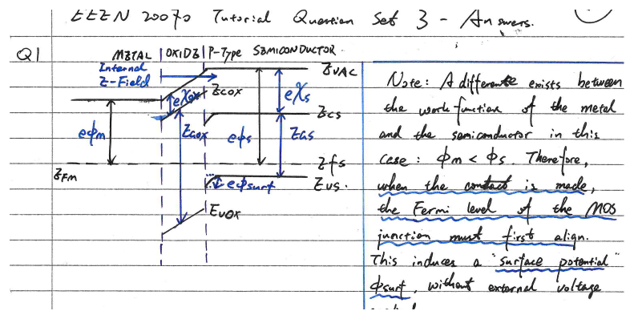
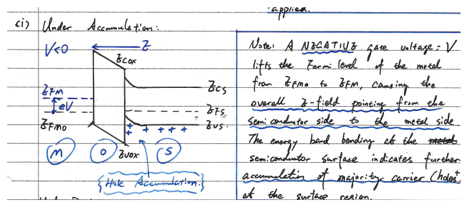
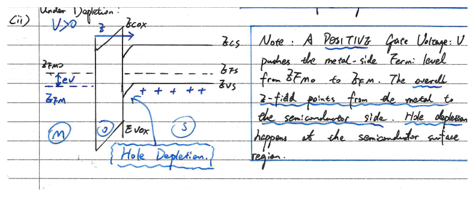
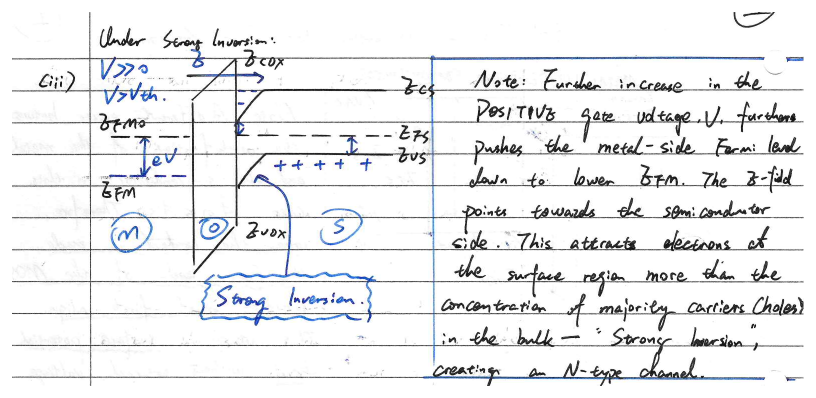
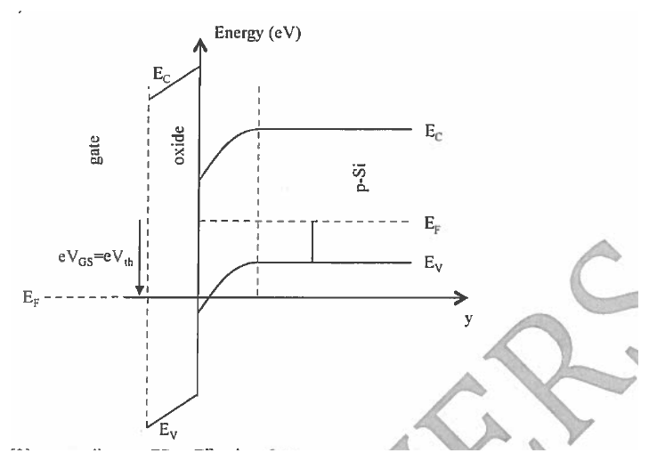
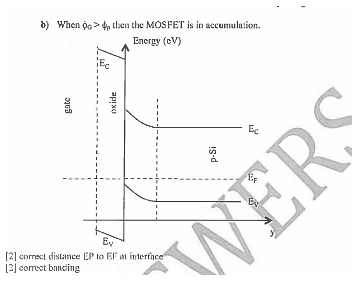

# Topic 15: End-of-topic test

Try each question first.
Then click to check.

Each answer says which notes section (§) it comes from.

kT/e = 0.026 V. nᵢ = 1.45 × 10¹⁰ cm⁻³. χ = 4.05 eV. N_C = 3.2 × 10¹⁹ cm⁻³.

---

## Part A: Tutorial and past-final questions

### Q1 (Tutorial Ch3 Q1)

Fig. 1 shows a metal, an oxide and a p-type semiconductor before contact, with φ_m < φ_s.

Draw the band diagram of the MOS under **accumulation**, **depletion** and **strong inversion**. Give the sign and relative size of the applied voltage in each case. Show the direction of the electric field.

Answer

**At contact (no bias):** the Fermi levels line up. φ_m < φ_s, so electrons go from the metal to the Si and the Si bands already bend a little at the surface.

**Accumulation, V < 0:** E_Fm moves **up** by e|V|. ℰ points from the Si to the metal. Si bands bend **up**. Holes accumulate at the surface.

**Depletion, V > 0:** E_Fm moves **down** by eV. ℰ points from the metal to the Si. Bands bend **down**. Holes are pushed away.

**Strong inversion, V > V_th:** E_Fm drops further. Bands bend down so far that electrons collect at the surface: an n-type channel.

**Sizes:** V_acc < 0 < V_depl < V_th < V_inv.

From: §2, §3, §4, §6

---

### Q2 (Final 2016 Q1d i)

Sketch the band diagram (E_C, E_i, E_F) of an **n-channel enhancement mode MOSFET** from the gate, through the oxide, into the substrate, in the middle of the channel, at V_GS = V_th and V_DS = 0 V. Show V_GS on the sketch. [6]

Answer

- The gate's E_F is **eV_GS = eV_th below** the Si E_F.
- The Si bands bend **down** at the oxide.
- At the interface, the distance E_C − E_F equals the distance E_F − E_V in the bulk. That **is** threshold.
- Marks: [2] correct distance E_C to E_F at the interface, [2] correct bending, [2] correct E_F shift.

From: §4, §5

---

### Q3 (Final 2016 Q3b)

A MOSFET has n⁺ source and drain on p-Si. The gate and substrate workfunctions satisfy φ_G − φ_p = 1 V. All contacts are at zero bias.

Sketch the band diagram (E_C, E_V, E_F) along y, from the gate down into the substrate. [6]

Answer

φ_G > φ_p, so the Si's E_F starts higher. Electrons move from the Si to the gate. The Si surface goes positive: **accumulation**.

- E_F flat everywhere (zero bias).
- Si bands bend **up** at the oxide (E_V closer to E_F = more holes).
- The oxide bands tilt.
- The total band bending (oxide + Si) adds up to the 1 eV workfunction difference.

From: §1

---

### Q4 (Final 2014 Q3b ii)

A pMOS is built on n-type Si. At V_GS = 0 V the flat band condition is found (no band bending between gate and substrate). The workfunction of the metal is φ_m = 4.259 eV and E_vac − E_C = 4.050 eV.

Calculate the substrate doping. [4]

Answer

Flat band at 0 V means **φ_m = φ_s**.

E_C − E_F = φ_m − χ = 4.259 − 4.050 = 0.209 eV

N_D = N_C × exp(−0.209 ÷ 0.026) = 3.2 × 10¹⁹ × 3.2 × 10⁻⁴ = **1.03 × 10¹⁶ cm⁻³**

From: §7

---

## Part B: Exam-style questions

---

### M1: True or false

1. In a MOS capacitor on p-type Si, a negative gate voltage depletes the surface of holes.
2. The oxide in a MOS structure carries no current.
3. At threshold, the electron density at the surface equals the hole density in the bulk.
4. In depletion, the negative charge in the Si is carried by free electrons.
5. If φ_m = φ_s, the bands are flat at zero bias.
6. A larger substrate doping means the bands must bend more to reach threshold.

Answer

1. **False.** Negative gate attracts holes: accumulation. (§2)
2. **True.** SiO₂ is treated as a perfect insulator. (§1)
3. **True.** That's the definition of threshold. (§4)
4. **False.** It's the fixed N_A⁻ ions. (§3)
5. **True.** That's the flat band condition. (§1)
6. **True.** 2φ_F = 2(kT/e) ln(N_A/nᵢ) grows with N_A. So V_th goes **up** with doping (2018 Q1c vi: "decreases" is **no**). (§4)

---

### M2: Multiple choice

A MOS capacitor on **n-type** Si. Which gate voltage puts the surface into inversion?

- A. A large negative voltage
- B. A small negative voltage
- C. Zero
- D. A large positive voltage

Answer

**A.** For n-type Si, swap all the signs. A negative gate pushes the electrons (majority) away first, then pulls holes to the surface. Large negative = hole inversion layer, a p-channel.

From: §4, the ⭐ table

---

### M3: Calculate

p-type Si, N_A = 5 × 10¹⁶ cm⁻³.

(a) How far is E_i above E_F in the bulk?
(b) How far does E_i bend down at the surface at threshold?
(c) At threshold, what is the electron density at the surface?

Answer

**(a)** eφ_F = 0.026 × ln(5 × 10¹⁶ ÷ 1.45 × 10¹⁰) = 0.026 × 15.05 = **0.39 eV**

**(b)** 2eφ_F = **0.78 eV**

**(c)** By the definition, n_s = p_bulk = N_A = **5 × 10¹⁶ cm⁻³**

From: §4, Equation 27

---

### M4: Sketch

Draw the band diagram from the gate into an **n-type** substrate for:
(i) V > 0 (ii) V < 0, small (iii) V < V_th < 0.

Name each condition.

Answer

Flip the p-type rules.

- **(i) V > 0: accumulation of electrons.** E_Fm moves down. Si bands bend **down** at the surface, E_C comes closer to E_F.
- **(ii) small V < 0: depletion.** E_Fm moves up. Si bands bend **up**, electrons pushed away, a layer of N_D⁺ ions.
- **(iii) V < V_th: inversion.** Bands bend up so far that E_V at the surface is as close to E_F as E_C is in the bulk. A layer of holes.

Field arrow in each: from + to −.

From: the drawing checklist, the ⭐ table

---

### M5: Explain

Why is a MOS structure called a capacitor? What are its "plates" in accumulation and in inversion?

Answer

The oxide is an insulator between two conductors, so charge can only build up on either side of it.

- **Accumulation:** plates = the metal and the layer of holes at the Si surface. Gap = t_ox.
- **Inversion:** plates = the metal and the electron inversion layer, with the depletion layer behind it. That's **two capacitors in series** (oxide + depletion).

From: §2, §4

---

### M6: Link

Why is the threshold voltage of an **enhancement mode** nMOS positive?

Answer

At zero gate voltage the surface is p-type (no channel). You need a **positive** gate to push the holes away and pull electrons in until the surface inverts.

So V_th > 0. (Topic 18 does the other three types.)

From: §4

