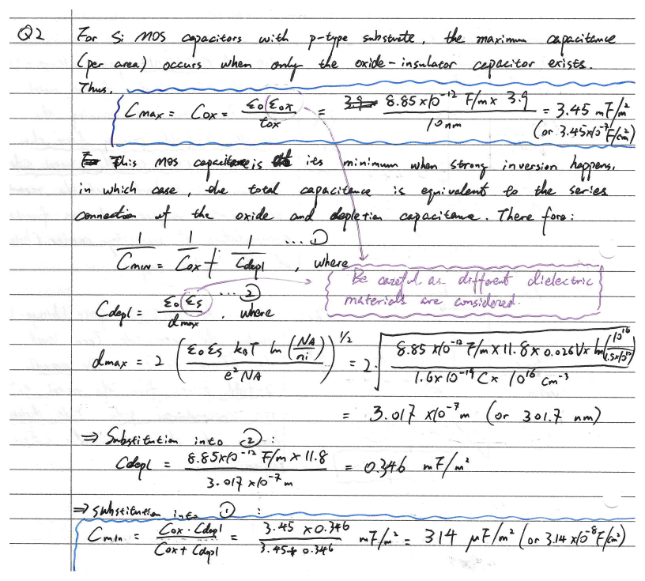
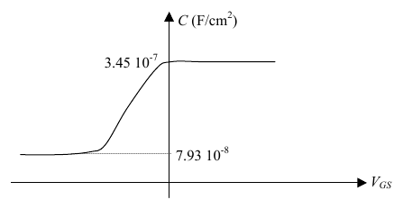
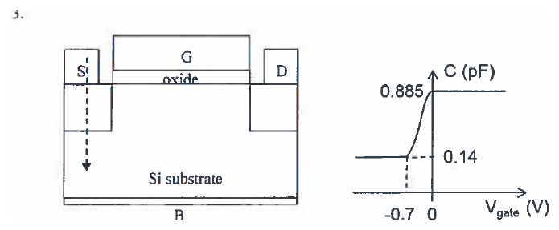
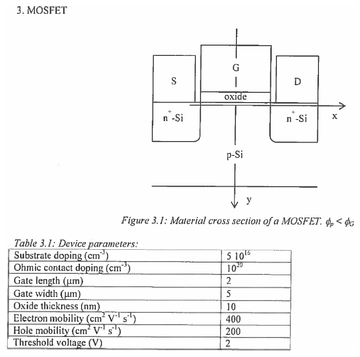
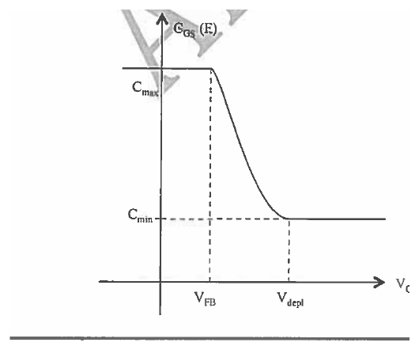
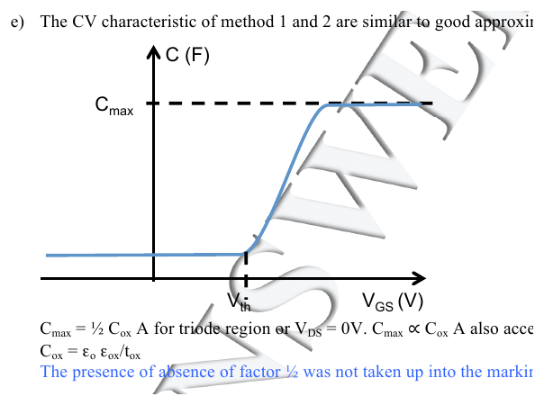

# Topic 16: End-of-topic test

Try each question first.
Then click to check.

Each answer says which notes section (§) it comes from.

ε₀ = 8.85 × 10⁻¹⁴ F/cm. Exam sheet: ε_Si = 11, ε_ox = 4. kT/e = 0.026 V. nᵢ = 1.45 × 10¹⁰ cm⁻³.

---

## Part A: Tutorial and past-final questions

### Q2 (Tutorial Ch3 Q2)

A depletion region of width d forms when a positive voltage is applied to a Si MOS capacitor with a p-type substrate, N_A = 10¹⁶ cm⁻³, nᵢ ≈ 1.5 × 10¹⁰ cm⁻³. The maximum depletion width d_max occurs at threshold:

$$d_{max} = 2\left[\frac{\varepsilon_s\varepsilon_0 k_BT\ln(N_A/n_i)}{e^2N_A}\right]^{1/2}$$

ε_s = 11.8, ε_ox = 3.9, kT/e = 0.026 V.

Calculate the maximum and minimum capacitance per area when t_ox = 10 nm.

Answer

**C_max = C_ox** = 8.85 × 10⁻¹⁴ × 3.9 ÷ 10⁻⁶ = **3.45 × 10⁻⁷ F/cm²**

**d_max** = 2 × √(11.8 × 8.85 × 10⁻¹⁴ × 0.026 × ln(6.67 × 10⁵) ÷ (1.6 × 10⁻¹⁹ × 10¹⁶)) = **3.02 × 10⁻⁵ cm** (302 nm)

**C_depl** = ε₀ε_s ÷ d_max = 1.04 × 10⁻¹² ÷ 3.02 × 10⁻⁵ = 3.46 × 10⁻⁸ F/cm²

**C_min** = C_ox C_depl ÷ (C_ox + C_depl) = **3.14 × 10⁻⁸ F/cm²**

From: §4, Equations 28, 29, 30

---

### Q7 (Tutorial Ch3 Q7)

The C–V characteristic of a MOSFET is given. Give the type of the MOSFET (n or p-channel) and determine the oxide thickness and the maximum depletion width in the substrate. ε_Si = 11.8, ε_SiO₂ = 3.9.

Answer

**Type:** C is maximum at V_GS ≥ 0 and falls for negative V_GS. Accumulation at positive gate = electrons are the majority = n-substrate = **p-channel**.

**t_ox** = 8.85 × 10⁻¹⁴ × 3.9 ÷ 3.45 × 10⁻⁷ = **1.0 × 10⁻⁶ cm = 10 nm**

**C_depl** = C_min C_ox ÷ (C_ox − C_min) = 7.93 × 10⁻⁸ × 3.45 × 10⁻⁷ ÷ 2.66 × 10⁻⁷ = 1.03 × 10⁻⁷ F/cm²

**W_depl,max** = 8.85 × 10⁻¹⁴ × 11.8 ÷ 1.03 × 10⁻⁷ = **1.01 × 10⁻⁵ cm** (101 nm)

From: §2, Equations 28, 29

---

### F2014-3ab (Final 2014 Q3a i, ii and b i)

Enhancement mode MOSFET. C–V measured between gate and bulk (bulk grounded). W_G = 100 µm, L_G = 5 µm.

(a i) Is it p-channel or n-channel? [2]
(a ii) Give the doping type of the source, drain and substrate. [2]
(b i) Extract the oxide thickness from the C–V measurement. [2]

Answer

**(a i)** C is high at positive gate (electron accumulation), so the substrate is n-type: **p-channel**.

**(a ii)** Source and drain **p-type (heavily doped, p⁺)**. Substrate **n-type**.

**(b i)** C_max = 0.885 pF is a whole capacitance. Divide by the area:

C_ox = 0.885 × 10⁻¹² ÷ (100 × 10⁻⁴ × 5 × 10⁻⁴) = 1.77 × 10⁻⁷ F/cm²

t_ox = 8.85 × 10⁻¹⁴ × 4 ÷ 1.77 × 10⁻⁷ = **2 × 10⁻⁶ cm = 20 nm**

Common mistake in the official notes: forgetting that the graph is in F, not F/cm².

From: §2, Equation 28, the unit trap in ⭐

---

### F2014-3biii (Final 2014 Q3b iii)

Give the expression for the maximum depletion width in terms of the measured capacitances in the 2014 C–V curve. Use C_min, C_max, C_depl,max. Do not fill in the values. [4]

Answer

At minimum capacitance the depletion width is maximum, and the oxide and depletion layer are two capacitors in series:

$$\frac{1}{C_{min}} = \frac{1}{C_{max}} + \frac{1}{C_{depl,max}} \;\Rightarrow\; \frac{1}{C_{depl,max}} = \frac{1}{C_{min}} - \frac{1}{C_{max}}$$

$$C_{depl,max} = \frac{\varepsilon_0\varepsilon_r A}{W_{depl,max}} \;\Rightarrow\; W_{depl,max} = \frac{\varepsilon_0\varepsilon_{Si}L_GW_G\,(C_{max} - C_{min})}{C_{max}\,C_{min}}$$

The examiners' note: the area in the final expression was the main problem. Here C are whole capacitances, so the area L_G W_G must be there.

From: Equation 29

---

### F2014-3ci (Final 2014 Q3c i)

Give the threshold voltage for the MOSFET in the 2014 C–V curve. [2]

Answer

**V_th = −0.7 V.** The curve reaches its minimum (inversion) at −0.7 V. Negative, as expected for an enhancement pMOS.

From: §2

---

### F2016-3c (Final 2016 Q3c)

Plot the gate capacitance C_GS(V_GS) for V_GS < 0 to V_GS > V_th of this MOSFET, with V_DS in the triode region. φ_G − φ_p = 1 V. Comment on each voltage where C_GS changes from a constant value. [9]

Answer

- **V_GS < 0:** accumulation (extra holes under the oxide). C_GS is maximum, set by the oxide thickness. [2]
- **0 < V_GS < V_FB:** still accumulation, until the bands are flat at **V_FB = φ_G − φ_p = 1 V**. [2]
- **V_FB < V_GS < V_th:** a depletion region builds up under the oxide. C_GS falls. [2]
- **V_GS ≥ V_th:** the depletion width is maximum, an inversion channel forms. C_GS is minimum. [2]
- Plot [3].

From: §3

---

### F2016-3d (Final 2016 Q3d)

Calculate the maximum and minimum value of C_GS. Use the 2016 Table 3.1 (N_sub = 5 × 10¹⁶ cm⁻³, L = 2 µm, W = 5 µm, t_ox = 10 nm). [6]

Answer

**C_max** = ½ C_ox L W (triode: shared between source and drain)

= ½ × 4 × 8.85 × 10⁻¹⁴ × 2 × 10⁻⁴ × 5 × 10⁻⁴ ÷ 10⁻⁶ = **1.77 × 10⁻¹⁴ F**

**W_depl^max** = 2 × √(11 × 8.85 × 10⁻¹⁴ × 0.026 × ln(5 × 10¹⁶ ÷ 1.45 × 10¹⁰) ÷ (1.6 × 10⁻¹⁹ × 5 × 10¹⁶)) = **1.38 × 10⁻⁵ cm**

**C_depl** = 11 × 8.85 × 10⁻¹⁴ × 10⁻⁷ ÷ 1.38 × 10⁻⁵ = 7.1 × 10⁻¹⁵ F

**C_min** = C_max C_depl ÷ (C_max + C_depl) = **5.0 × 10⁻¹⁵ F**

(The official sheet has C_depl = 5 × 10⁻¹⁵ F and C_min = 3.9 × 10⁻¹⁵ F. Their own inputs give 7.1 × 10⁻¹⁵ F, so that looks like a slip. Same method.)

From: §5, Equations 28 to 30

---

### F2017-3e (Final 2017 Q3e)

A **p-channel depletion mode** MOSFET. Sketch the high-frequency C_GS–V_GS characteristic. Give the expression for the maximum capacitance as a function of t_ox and show V_th on the plot. [6]

Answer

- A depletion-mode pMOS **already has a hole channel at V_GS = 0**. V_th > 0 (Topic 18).
- For V_GS < V_th the channel is there: C_GS is at C_max.
- At V_th the channel is gone and the surface is depleted: C_GS drops to its low value.
- C_max = ½ C_ox A (triode or V_DS = 0). "C_max ∝ C_ox A" also accepted. C_ox = ε₀ε_ox ÷ t_ox.

From: §1, Equation 28, Topic 18

---

## Part B: Exam-style questions

---

### M1: True or false

1. A thicker oxide gives a larger C_max.
2. In inversion, the oxide and depletion capacitances are in series.
3. A C–V graph in pF gives C_ox in F/cm² directly.
4. A heavier substrate doping gives a smaller W_depl^max and so a larger C_min.
5. For a p-substrate MOS, C is high at negative gate voltage.

Answer

1. **False.** C_ox = ε₀ε_ox ÷ t_ox. Thicker = smaller. (Equation 28)
2. **True.** (§1)
3. **False.** Divide by the gate area W L first. (⭐)
4. **True.** W ∝ √(ln N ÷ N) shrinks with N, so C_depl and C_min grow. (Equation 30)
5. **True.** Holes accumulate. (§1)

---

### M2: Multiple choice

A C–V curve is flat at 2.0 pF for V_GS > 0.5 V and flat at 0.5 pF for V_GS < −1.2 V. Which is it?

- A. nMOS, V_th = −1.2 V
- B. pMOS, V_th = −1.2 V
- C. nMOS, V_th = 0.5 V
- D. pMOS, V_th = 0.5 V

Answer

**B.** High on the positive side → n-substrate → **pMOS**. C reaches its minimum at −1.2 V, so V_th = −1.2 V.

From: §2

---

### M3: Calculate

The curve in M2 belongs to a gate with W = 50 µm and L = 4 µm.

(a) Find t_ox (ε_ox = 4).
(b) Find W_depl,max (ε_Si = 11).

Answer

**(a)** Area = 50 × 10⁻⁴ × 4 × 10⁻⁴ = 2 × 10⁻⁶ cm².

C_ox = 2.0 × 10⁻¹² ÷ 2 × 10⁻⁶ = 1.0 × 10⁻⁶ F/cm²

t_ox = 8.85 × 10⁻¹⁴ × 4 ÷ 1.0 × 10⁻⁶ = **3.54 × 10⁻⁷ cm ≈ 3.5 nm**

**(b)** W = ε₀ε_Si A (C_max − C_min) ÷ (C_max C_min)

= 8.85 × 10⁻¹⁴ × 11 × 2 × 10⁻⁶ × 1.5 × 10⁻¹² ÷ (2.0 × 10⁻¹² × 0.5 × 10⁻¹²)

= **2.9 × 10⁻⁶ cm ≈ 29 nm**

From: Equations 28 and 29

---

### M4: Sketch

Draw the C–V curves of two MOS capacitors on the same axes. Same area, same oxide, both p-type, but one has 10× the substrate doping. Point out what is different. (Booklet §4.2 exercise.)

Answer

- **Same C_max** (same oxide). Both flat at the left.
- The heavier-doped one has a **smaller W_depl^max**, so a **higher C_min**.
- It also needs more band bending (2φ_F is larger) and more depletion charge, so its **V_th is higher**: its drop sits further right.

From: §1, Equation 30

---

### M5: Explain

Why does C stop falling once V_GS passes V_th?

Answer

At V_th an inversion layer forms at the surface. Any extra gate charge is now matched by **more electrons in that layer**, right against the oxide.

The depletion layer behind it no longer grows. Its width stays at W_depl^max, so the series capacitance stays at C_min.

From: §1

