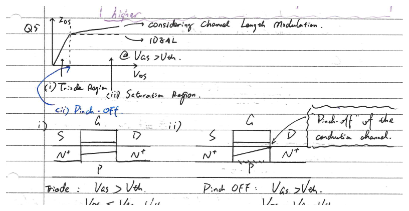
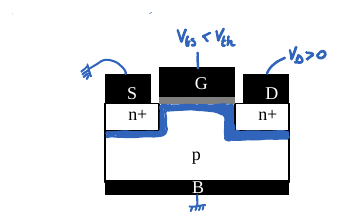
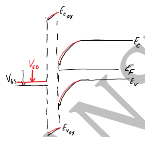
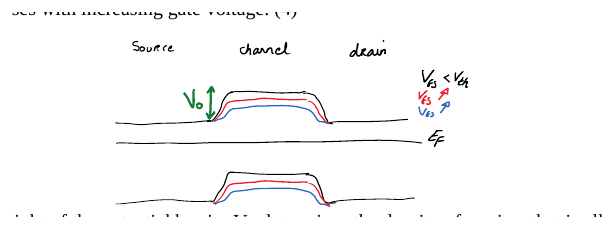
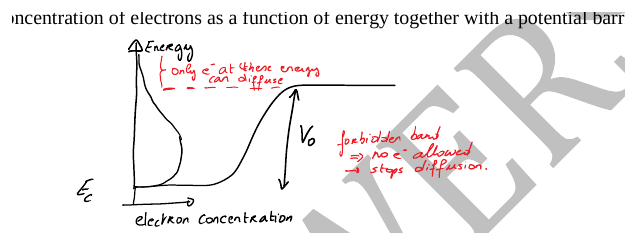
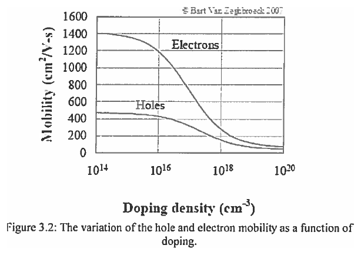

# Topic 17: End-of-topic test

Try each question first.
Then click to check.

Each answer says which notes section (§) it comes from.

ε₀ = 8.85 × 10⁻¹² F/m = 8.85 × 10⁻¹⁴ F/cm. ε_ox = 4.

---

## Part A: Tutorial and past-final questions

### Q5 (Tutorial Ch3 Q5)

Draw the I_DS–V_DS curve of an n-channel MOSFET for one gate voltage (V_GS > V_th). Sketch the cross section including the inversion layer for (i) the triode region and (ii) pinch-off. Show regions (i) and (ii) on the curve.

Answer

- **Curve:** rises from 0 (triode), bends over, flat after V_DS = V_GS − V_th (saturation). With channel length modulation it keeps a small slope (Topic 19).
- **(i) Triode, V_DS < V_GS − V_th:** an inversion layer joins S to D, thinner at the drain.
- **(ii) Pinch-off, V_DS = V_GS − V_th:** the inversion layer goes to zero thickness at the drain end.

From: §5, §6, drawing checklist

---

### F2015-1g (Final 2015 Q1g)

A MOSFET has an n⁺ source, n drain, p substrate. S and B are grounded. Sketch the depletion regions for 0 < V_GS < V_th and V_DS > 0. [4]

Answer

- A depletion layer under the gate (0 < V_GS < V_th pushes the holes away, but **no inversion layer**).
- Depletion around the source and drain junctions.
- **Slightly larger at the drain side**, because that junction is reverse biased by V_DS.

Most common mistake (examiners): drawing an inversion layer.

From: Method table, Topic 15 §3

---

### F2015-2a (Final 2015 Q2a)

Explain why the diffusion component of the current in the channel of an n-channel enhancement mode MOSFET with V_DS ≪ V_GS − V_th and V_GS ≫ V_th is negligible. Use equations and band diagrams or cross sections. [10]

Answer

**Start from:** J_n = eµ_n n(x) ℰ(x) + eD_n dn/dx. (2)

**Drift is large** (3): n(x) ∝ V_GS − V_th − V(x) ≈ V_GS − V_th, which is big in strong inversion. Holes are few in the channel, so hole drift is negligible.

**Diffusion is small** (5): n near the source is set by the oxide voltage V_GS; near the drain by V_GD = V_GS − V_DS. With V_DS small, V_GD ≈ V_GS. The band bending at the two ends is almost the same, so E_C − E_F at the surface is almost the same, and n = N_C e^−(E_C−E_F)/kT is almost the same.

Tiny gradient → tiny diffusion. Drift ≫ diffusion.

"Diffusion is neglected" with no reason got **no marks**.

From: §7

---

### F2015-2b (Final 2015 Q2b)

Draw the band diagrams (E_C, E_V, E_F, E_G) that show that a **diffusion** process controls the size of I_DS at constant V_DS for different V_GS > V_th. [10]

Answer

Diffusion in the channel is negligible, but **diffusion across the source–channel junction** is how the gate controls I_DS. (2)

Band diagram from source through the channel to the drain, three gate voltages, V_DS = 0: the source–channel barrier **drops** as V_GS goes up. (4)

The barrier height V₀ sets how many electrons can diffuse from the source into the channel. Only the electrons in the Fermi tail with energy above eV₀ get over. Lower barrier = more electrons = more current. (4)

From: §2, §7

---

### F2015-2c (Final 2015 Q2c)

(i) Derive the expression for the inversion charge density Q(x) in the channel when V_GS > V_th and V_DS is in the triode region. Explain each step. [6]

(ii) Calculate Q halfway between source and drain: t_ox = 10 nm, W = 5 µm, L = 1 µm, V_th = 1 V, V_GS = 1.5 V, V_DS = 0.1 V. [4]

Answer

**(i)**
- A capacitor: Q = CV. For the MOSFET, Q_channel = C_ox × V_across oxide. (2)
- The oxide voltage is gate potential minus channel potential. The channel potential V(x) changes along the channel because of V_DS.
- No inversion charge below V_th, so only V_GS − V_th counts.
- So **Q(x) = −C_ox(V_GS − V_th − V(x))**. The minus on V(x): less inversion where the channel voltage is higher. (4)

**(ii)** C_ox = 8.85 × 10⁻¹² × 4 ÷ 10 × 10⁻⁹ = 3.54 × 10⁻³ F/m².

V(L/2) ≈ V_DS/2 = 0.05 V (linear in triode).

Q = −3.54 × 10⁻³ × (1.5 − 1 − 0.05) = **−1.6 × 10⁻³ C/m²**

W and L aren't needed: Q is per area.

From: §3, §9, Equation 31

---

### F2014-3c (Final 2014 Q3c ii and iii)

The 2014 MOSFET (Topic 16): p-channel, V_th = −0.7 V, C_ox = 1.77 × 10⁻⁷ F/cm², W_G = 100 µm, L_G = 5 µm, substrate doping 10¹⁶ cm⁻³.

(ii) Estimate the mobility of the carriers in the channel from the mobility graph. [2]
(iii) Sketch the output characteristic for V_GS = −1 V and 0 < |V_DS| < 1 V. Show the voltage and current at saturation. [6]

Answer

**(ii)** Channel carriers are **holes** (pMOS). At 10¹⁶ cm⁻³: **µ_p ≈ 410 cm²/Vs**. Giving both µ_n and µ_p lost a mark.

**(iii)** I_DS against V_DS, both negative for a pMOS. [1]

Pinch-off at V_DS = V_GS − V_th = −1 − (−0.7) = **−0.3 V**. [1] Linear-ish up to −0.3 V, then flat.

I_sat = µC_ox W ÷ (2L) × (V_GS − V_th)² = 410 × 1.77 × 10⁻⁷ × 100 ÷ (2 × 5) × 0.09 = **6.5 × 10⁻⁵ A** (i.e. −65 µA).

(W/L = 100/5: the µm cancel.)

From: §4 mobility trap, §8, Equation 33

---

## Part B: Exam-style questions

---

### M1: True or false

1. With V_GS = 0 and V_DS > 0, an enhancement nMOS conducts through the reverse-biased drain diode.
2. In strong inversion, the channel current is mainly drift.
3. I_DS increases if the gate length L is made shorter.
4. In saturation, extra V_DS drops mostly across the channel–drain depletion region.
5. An nMOS and a pMOS with the same size and bias carry the same current.
6. Past pinch-off, the inversion layer at the drain end has zero thickness.

Answer

1. **False.** A reverse-biased diode blocks it. (§1)
2. **True.** Majority carrier device. (§7)
3. **True.** I_DS ∝ W/L. (Equation 32)
4. **True.** That's why the current saturates. (§5)
5. **False.** Hole mobility is lower, so the pMOS carries less. (Equation 32)
6. **True.** Q_n^D = 0 at V_DS = V_GS − V_th. (§5)

---

### M2: Multiple choice

An nMOS has V_th = 0.8 V. At V_GS = 2.0 V, where does saturation begin?

- A. V_DS = 0.8 V
- B. V_DS = 1.2 V
- C. V_DS = 2.0 V
- D. V_DS = 2.8 V

Answer

**B.** V_DS^sat = V_GS − V_th = 2.0 − 0.8 = 1.2 V.

From: §5

---

### M3: Calculate

nMOS: µ_n = 500 cm²/Vs, t_ox = 20 nm (ε_ox = 4), W = 20 µm, L = 2 µm, V_th = 1 V, V_GS = 3 V.

(a) Find C_ox.
(b) Find I_DS at V_DS = 0.5 V.
(c) Find I_DS at V_DS = 4 V.

Answer

**(a)** C_ox = 8.85 × 10⁻¹⁴ × 4 ÷ 2 × 10⁻⁶ = **1.77 × 10⁻⁷ F/cm²**

µC_ox W/L = 500 × 1.77 × 10⁻⁷ × 10 = 8.85 × 10⁻⁴ A/V²

**(b)** V_DS = 0.5 < 2 V: triode.

I_DS = 8.85 × 10⁻⁴ × (2 × 0.5 − 0.125) = 8.85 × 10⁻⁴ × 0.875 = **7.7 × 10⁻⁴ A**

**(c)** V_DS = 4 > 2 V: saturation.

I_DS = ½ × 8.85 × 10⁻⁴ × 2² = **1.77 × 10⁻³ A**

From: Equations 32, 33

---

### M4: Sketch

Sketch the S → D band diagram of an nMOS for (i) V_GS = 0, V_DS = 0 (ii) V_GS > V_th, V_DS = 0 (iii) V_GS > V_th, V_DS > 0 in triode.

Answer

- **(i)** n⁺ | p | n⁺. Flat E_F. A big hump eV₀ in the p region.
- **(ii)** Same, but the hump is **lower** (gate pulled the channel bands down).
- **(iii)** Lowered hump, and the drain side **eV_DS lower**. The channel bands tilt down towards the drain. Electrons roll down.

From: §2

---

### M5: Explain

Why is the MOSFET called a voltage-controlled resistor in the triode region and a voltage-controlled current source in saturation?

Answer

- **Triode:** for small V_DS, I_DS ≈ (µC_ox W/L)(V_GS − V_th)V_DS. Current ∝ voltage, so it's a resistor, R = L ÷ (µC_ox W(V_GS − V_th)). The gate sets R.
- **Saturation:** I_DS = (µC_ox W/2L)(V_GS − V_th)², independent of V_DS. A current source whose size the gate sets.

From: §6

