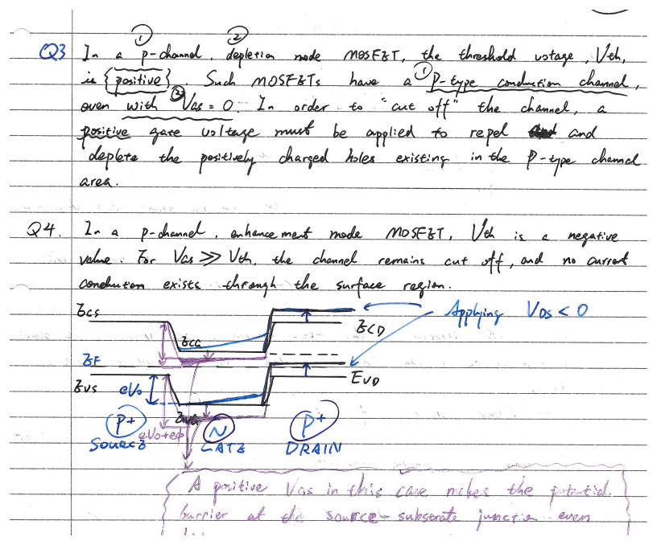
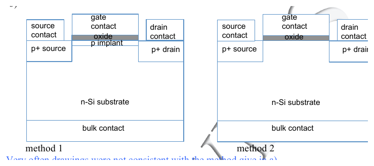
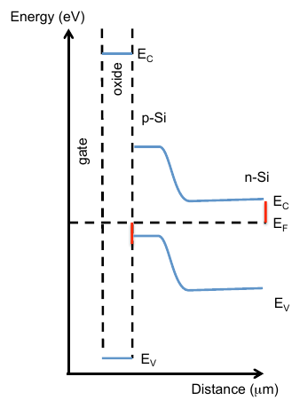
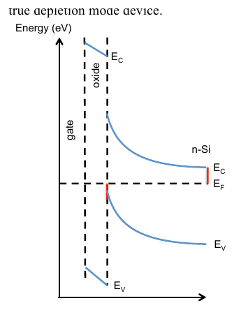
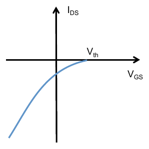

# Topic 18: End-of-topic test

Try each question first.
Then click to check.

Each answer says which notes section (§) it comes from.

---

## Part A: Tutorial and past-final questions

### Q3 (Tutorial Ch3 Q3)

What is the sign of the threshold voltage V_GS = V_th for a p-channel depletion mode MOSFET? Explain briefly why.

Answer

**Positive.**

A depletion-mode pMOS already has a **p-type (hole) channel** at V_GS = 0. To cut it off, you apply a **positive** gate voltage that repels the positively charged holes and depletes the channel.

From: §4, ⭐ table

---

### Q4 (Tutorial Ch3 Q4)

Sketch the band diagram from source to drain through the Si channel of a p-channel enhancement mode MOSFET, when V_GS ≫ V_th and V_DS is small (triode region). Include the source and drain regions.

Answer

- Regions: **p⁺ source | n region under the gate | p⁺ drain**.
- V_th is negative. The official answer takes V_GS ≫ V_th as "more positive than V_th", so the channel stays **cut off**: the barrier for holes (dip in E_V) stays high.
- V_DS < 0 lifts the drain bands. A positive V_GS here makes the source–substrate barrier even higher.

If the question meant the **on** state (V_GS more negative than V_th): the n region is inverted, the hole barrier is **small**, and the channel bands tilt so holes drift from source to drain.

From: §4

---

### F2017-1i (Final 2017 Q1i)

Is the threshold voltage V_th of an enhancement mode p-channel MOSFET >, < or = 0? [2]

Answer

**V_th < 0.** No channel at 0 V. A negative gate is needed to pull holes to the surface and create one.

From: ⭐ table

---

### F2017-3a (Final 2017 Q3a)

Describe briefly the key characteristics of a p-channel depletion mode MOSFET and give two possible fabrication methods. [6]

Answer

**Characteristics:** p-type source and drain, n-type bulk, **holes in the channel at V_GS = 0 V**. A positive voltage is needed to deplete the channel and switch the MOSFET off: **V_th > 0**.

**Method 1:** implant the top surface of the Si under the gate with acceptors so N_A > N_D there (compensation doping). That region's majority carriers are holes.

**Method 2:** choose a gate material whose workfunction difference with the n-substrate creates a hole inversion layer: **φ_Si < φ_gate**.

Examiners: the important part is two methods related to the **gate or substrate choice**. Very often only one was given.

From: §5

---

### F2017-3b (Final 2017 Q3b)

Choose one method from (a) and draw the material cross section. Define all regions. [6]

Answer

p⁺ source and p⁺ drain in an n-Si substrate, gate oxide and gate contact between them, bulk contact underneath. Method 1 adds a **p implant** strip under the oxide.

"Very often drawings were not consistent with the method given in a)."

From: §5, drawing checklist

---

### F2017-3c (Final 2017 Q3c)

For the MOSFET in (b), sketch the band diagram (E_F, E_C, E_V) from the gate into the substrate for V_DS = V_GS = V_BS = 0 V. State any assumptions. [6]

Answer

 

**Method 1 (left).** Assumptions: (1) no workfunction difference between gate and Si, so the oxide bands are **flat**; (2) a graded junction between the p implant and the n substrate. E_V near E_F in the p layer, E_C near E_F deep in the n-Si.

**Method 2 (right).** No assumptions needed. The Si bands bend **up** at the surface until E_V is close to E_F there.

Both: the bands bend **further than needed for threshold**, so it really is a depletion-mode device.

From: §5

---

### F2017-3d (Final 2017 Q3d)

For the MOSFET in (b), sketch the transfer characteristic (I_DS vs V_GS) for one drain voltage in saturation. Show V_th. [6]

Answer

- **Quadratic** in saturation [2].
- **V_th positive** [2].
- **Currents negative** for a pMOS [2]. (Positive for an nMOS, by convention.)

From: §5, Topic 17 Equation 33

---

### F2014-3aiii (Final 2014 Q3a iii)

For the 2014 pMOS (Topic 16), sketch the band diagram (E_C, E_V, E_F, E_G) along the dashed line from the source contact down through the source into the substrate. Make the specific characteristics of the contact clear. [6]

Answer

- **Metal → p⁺ source: an ohmic contact.** On p-type, ohmic means **hole accumulation**: the p⁺ bands bend **up** towards the metal.
- **p⁺ source → n substrate:** a p⁺n junction at zero bias. E_F flat. Bands step **down** from p⁺ to n. The depletion region sits mostly in the lightly doped n side.

Mistakes (examiners): leaving out the metal–p⁺ contact; drawing it in depletion or calling it Schottky. Source and drain contacts in ordinary MOSFETs are ohmic.

From: §6, Topic 9, Topic 10

---

## Part B: Exam-style questions

---

### M1: True or false

1. A depletion-mode nMOS conducts at V_GS = 0.
2. An enhancement-mode pMOS has a positive threshold voltage.
3. In a pMOS, the substrate is n-type.
4. In a CMOS inverter, both transistors are on when the input is high.
5. A depletion-mode device can be made with a gate metal whose workfunction inverts the surface at 0 V.

Answer

1. **True.** (§2)
2. **False.** Negative. (⭐)
3. **True.** (§1)
4. **False.** nMOS on, pMOS off. (§3)
5. **True.** Method 2. (§5)

---

### M2: Multiple choice

A MOSFET's transfer curve is zero for V_GS ≥ +1.5 V and its current grows (negative) as V_GS goes below +1.5 V. What is it?

- A. n-channel enhancement
- B. n-channel depletion
- C. p-channel enhancement
- D. p-channel depletion

Answer

**D.** Negative current → pMOS. It conducts at V_GS = 0 and V_th = +1.5 V > 0 → depletion mode.

From: ⭐ table

---

### M3: Calculate

A depletion-mode nMOS has V_th = −2 V, µC_ox W/(2L) = 0.5 mA/V². Find the saturation current at V_GS = 0 V and at V_GS = +1 V.

Answer

I_sat = 0.5 mA/V² × (V_GS − V_th)²

- V_GS = 0: (0 + 2)² = 4 → **2 mA**. It conducts with no gate voltage.
- V_GS = +1: (1 + 2)² = 9 → **4.5 mA**.

From: Topic 17 Equation 33, §2

---

### M4: Sketch

Draw the cross sections of an n-channel enhancement and an n-channel depletion MOSFET side by side, at V_GS = 0.

Answer

- Both: n⁺ source and drain in p-Si, oxide and gate between them, bulk contact underneath.
- **Enhancement:** nothing under the gate.
- **Depletion:** an **n-type layer** under the gate joining source and drain (donor implant, or from the gate workfunction).

From: §2, booklet Fig. 15

---

### M5: Explain

Explain, using threshold voltages, why a CMOS inverter draws almost no current when it isn't switching.

Answer

The nMOS has V_th > 0, the pMOS has V_th < 0. With the gates joined:

- Input high: nMOS above its V_th (on), pMOS not below its V_th (off).
- Input low: the opposite.

There's always one transistor **off** in the path from V_DD to ground, so only a tiny leakage flows. Current flows only while switching (charging the gate capacitance).

From: §3

