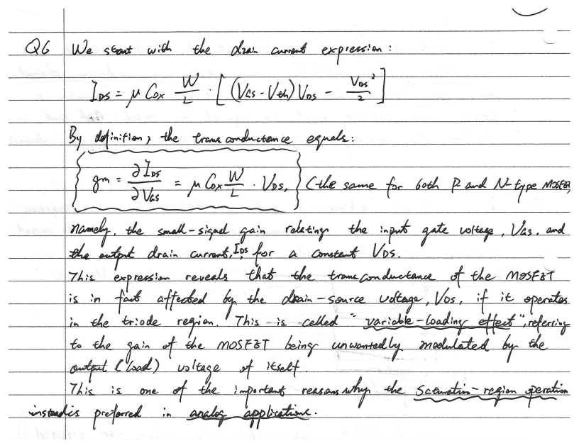
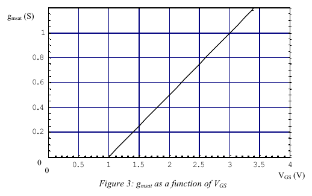
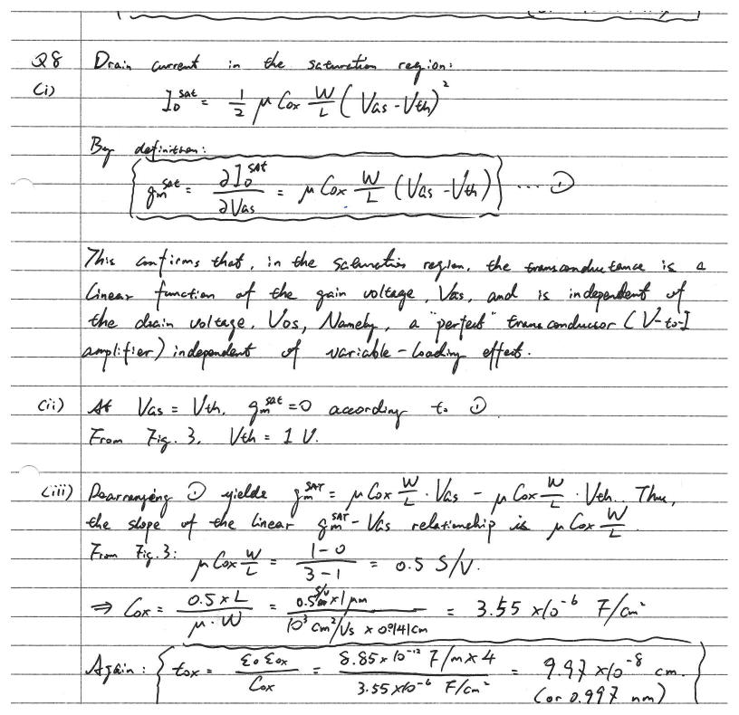

# Topic 19: End-of-topic test

Try each question first.
Then click to check.

Each answer says which notes section (§) it comes from.

ε₀ = 8.85 × 10⁻¹⁴ F/cm. ε_ox = 4.

---

## Part A: Tutorial and past-final questions

### Q6 (Tutorial Ch3 Q6)

Derive an expression for the transconductance of a MOSFET in the triode region.

Answer

Start from the drain current (formula sheet):

$$I_{DS} = \frac{\mu C_{ox}W}{L}\left[(V_{GS} - V_{th})V_{DS} - \frac{V_{DS}^2}{2}\right]$$

By definition, at constant V_DS:

$$g_m = \frac{\partial I_{DS}}{\partial V_{GS}} = \frac{\mu C_{ox}W}{L}V_{DS}$$

Same for n- and p-channel.

It depends on the **output** voltage V_DS: the gain is modulated by the load ("variable loading effect"). One reason analogue circuits use saturation instead.

From: §2, Equation 34

---

### Q8 (Tutorial Ch3 Q8)

g_m^sat is measured against V_GS. µ = 10³ cm²/Vs, gate width 0.0141 cm, gate length 1 µm.

(i) Derive g_m^sat in terms of µ, W and L.
(ii) Find V_th from the graph.
(iii) Find t_ox from the graph.

Answer

**(i)** I_DS^sat = ½µC_ox(W/L)(V_GS − V_th)² → **g_m^sat = µC_ox(W/L)(V_GS − V_th)**. Linear in V_GS, independent of V_DS.

**(ii)** g_m^sat = 0 at V_GS = V_th. From the graph, **V_th = 1 V**.

**(iii)** Slope = µC_ox W/L = (1 − 0) ÷ (3 − 1) = 0.5 S/V.

C_ox = 0.5 × 10⁻⁴ ÷ (10³ × 0.0141) = 3.55 × 10⁻⁶ F/cm²

t_ox = 8.85 × 10⁻¹⁴ × 4 ÷ 3.55 × 10⁻⁶ = **9.97 × 10⁻⁸ cm ≈ 1 nm**

From: §5

---

### F2016-1dii (Final 2016 Q1d ii)

Derive the expression of the transconductance of an n-channel enhancement mode MOSFET for V_GS > V_th and V_DS > V_GS − V_th. [4]

Answer

V_DS > V_GS − V_th means **saturation**. From the formula sheet, put V_DS = V_GS − V_th:

$$I_{DS} = \frac{\mu C_{ox}W_g}{2L_g}(V_{GS} - V_{th})^2$$

$$g_m = \frac{dI_{DS}}{dV_{GS}} = \frac{\mu C_{ox}W_g}{L_g}(V_{GS} - V_{th})$$

From: §2, Equation 34

---

### F2018-1c (Final 2018 Q1c vii and viii)

Answer yes or no. [1 each]

(vii) The transconductance g_m of a MOSFET in the triode region (low V_DS) will increase when the doping density in the substrate increases.

(viii) The equivalent gate–drain capacitance C_GD of a MOSFET can be neglected for the MOSFET in saturation.

Answer

**(vii) No.** g_m^triode = (µC_ox W/L)V_DS. No V_th, so no substrate doping.

**(viii) Yes.** The channel is pinched off at the drain, so C_gd ≈ 0.

From: §2, §4

---

## Part B: Exam-style questions

---

### M1: True or false

1. In saturation, g_m is independent of V_DS.
2. An ideal MOSFET in saturation has R_o = 0.
3. Channel length modulation makes the saturation current rise slowly with V_DS.
4. The DC input resistance of a MOSFET gate is very low.
5. In triode, C_gs ≈ C_gd ≈ ½ C_ox W L.

Answer

1. **True.** (Equation 34)
2. **False.** Ideal = flat curves = zero slope = R_o **infinite**. (§3)
3. **True.** (§3)
4. **False.** It's infinite: the oxide blocks DC current. (§4)
5. **True.** (§4)

---

### M2: Multiple choice

Doubling the overdrive (V_GS − V_th) of a MOSFET in saturation does what to g_m?

- A. Halves it
- B. No change
- C. Doubles it
- D. Quadruples it

Answer

**C.** g_m^sat ∝ (V_GS − V_th). (The **current** quadruples, but g_m only doubles.)

From: Equation 34

---

### M3: Calculate

nMOS: µC_ox W/L = 2 mA/V², V_th = 0.7 V, V_GS = 1.7 V, Early voltage V_A = 50 V.

(a) Find I_DS^sat (ignore channel length modulation).
(b) Find g_m.
(c) Find R_o.

Answer

**(a)** I = ½ × 2 mA/V² × (1.0)² = **1 mA**

**(b)** g_m = 2 mA/V² × 1.0 = **2 mS**

**(c)** R_o ≈ V_A ÷ I = 50 ÷ 10⁻³ = **50 kΩ**

From: Equation 34, §3

---

### M4: Sketch

Draw the small-signal equivalent circuit of a MOSFET (i) at high frequency in saturation (ii) at low frequency.

Answer

**(i)** G–S: C_gs. D–S: current source g_m v_gs with g_o in parallel. No C_gd (pinched off).

**(ii)** Remove C_gs: just g_m v_gs and g_o between D and S. Gate open.

From: §4, drawing checklist

---

### M5: Explain

What does the transconductance tell you about a MOSFET, and why do designers prefer to use it in saturation?

Answer

g_m = ∂I_DS/∂V_GS: how well the gate controls the channel current. Higher g_m = stronger control, higher gain, higher cut-off frequency.

In **triode**, g_m ∝ V_DS, so the gain changes with the output voltage. In **saturation**, g_m depends only on V_GS, so it's a clean voltage-to-current converter.

From: §2

