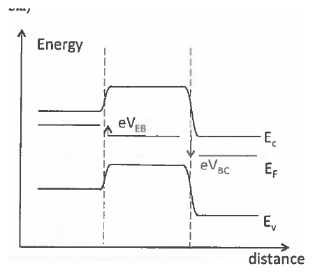
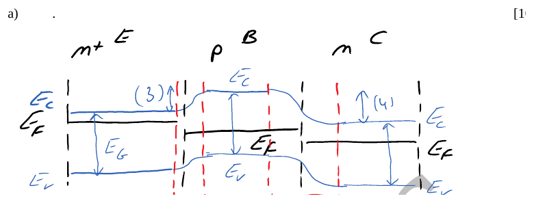
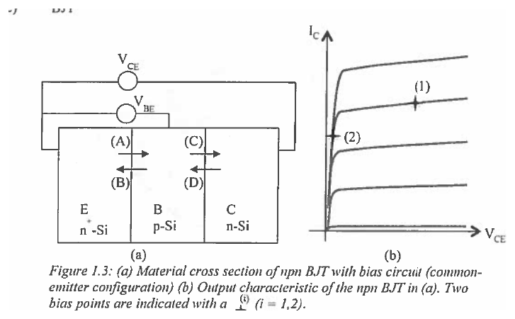
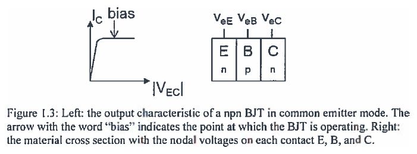

# Topic 20: End-of-topic test

Try each question first.
Then click to check.

Each answer says which notes section (§) it comes from.

There is no BJT tutorial sheet, so Part A is all past-final questions.

---

## Part A: Past-final questions

### F2018-3a (Final 2018 Q3a)

Draw the energy band diagram (E_C, E_F, E_V) from the emitter, through the base, into the collector of an n⁺pn BJT in forward active mode. Show the size of the voltage drops |V_EB| and |V_CB| and include the depletion regions. [10]

Answer

- Base E_F as the reference.
- Emitter E_F **eV_EB above** the base E_F (forward). Collector E_F **eV_BC below** (reverse).
- E_C closest to E_F in the n⁺ emitter.
- Flat bands inside each region, steps across the depletion regions (dashed lines).

Marks: ΔE_F correct [4], voltage shifts correct [2], general diagram correct [4].

From: §3, drawing checklist

---

### F2018-3b (Final 2018 Q3b)

Give the main carrier transport process (drift or diffusion) through each region of the short BJT in forward active mode: (i) emitter (ii) EB depletion region (iii) base (iv) BC depletion region (v) collector. [1 each]

Answer

(i) **diffusion** (ii) **diffusion** (iii) **diffusion** (iv) **drift** (v) **diffusion**

The reverse-biased BC junction has a big field that sweeps carriers across: drift. Everywhere else, minority carrier diffusion.

From: ⭐ table

---

### F2015-3a (Final 2015 Q3a)

Sketch the band diagram (E_C, E_V, E_F, E_G) of an n⁺pn BJT in forward active mode. The emitter doping is higher than the base and collector doping, which are the same. Include the depletion regions and make sure all relative distances are correct. [10]

Answer

- E_F in the emitter goes **up** relative to the base (forward), E_F in the collector goes **down** (reverse). The barriers change to match. [3]
- E_C is closer to E_F in the emitter than in the collector. E_C − E_F in the collector ≈ E_F − E_V in the base (same doping). [3]
- Depletion widths extend into the lower-doped regions. The forward EB depletion is narrower than the reverse BC one. [3]
- All symbols labelled. [1]

Main error (examiners): a slope in the base. Diffusion transport → slopes only across the junctions.

From: §3

---

### F2016-1c (Final 2016 Q1c)

(i) Give the bias condition (forward or reverse) across the EB and BC junctions for bias points (1) and (2). [4]
(ii) Which carriers (electrons, holes or both) must be injected into the base by the base current at bias point (1)? [2]
(iii) Give β in terms of (A), (B), (C), (D) for the BJT at bias point (1). (A) to (D) are the currents of the injected carriers shown by the arrows. [4]

Answer

**(i)** (1): EB **forward**, BC **reverse** (forward active). (2): EB **forward**, BC **forward** (saturation).

**(ii)** **Holes.**

**(iii)**

$$\beta = \frac{(C)}{(B) - (D)}$$

(C) is the electron current into the collector. The base current is the holes lost into the emitter (B) minus the holes gained from the collector leakage (D).

From: §6

---

### F2014-1f (Final 2014 Q1f)

An npn BJT in common emitter mode is biased at the point shown by the arrow. Give the relationship between V_eE and V_eB, and between V_eB and V_eC. [4]

Answer

The arrow is on the flat part: forward active.

- **V_eE < V_eB** (EB forward biased pn diode).
- **V_eB < V_eC** (BC reverse biased pn diode).

From: §7

---

### F2017-1j (Final 2017 Q1j)

Which region in the short BJT determines the size of the collector current? [2]

Answer

**The base region.** With all layers short, the minority carrier concentration gradient in the base sets the collector current.

From: §2

---

### F2018-1cx (Final 2018 Q1c x)

Yes or no: the output current I_C of a BJT in saturation, in common-emitter configuration, increases quasi-linearly with increasing bias across the emitter–collector junction |V_CE|. [1]

Answer

**Yes.** Saturation is the steep, nearly straight part near V_CE = 0 (BC forward biased).

From: §4

---

## Part B: Exam-style questions

---

### M1: True or false

1. In forward active mode, both junctions are forward biased.
2. A BJT only gives gain if the base is short compared with the minority carrier diffusion length.
3. In an npn BJT, the collector current is carried by electrons.
4. The band diagram of a BJT in forward active mode has a slope across the base.
5. BJT currents are mainly drift of majority carriers.
6. The base contact of a BJT is ohmic; the gate contact of a MOSFET is insulated.

Answer

1. **False.** EB forward, BC reverse. (⭐)
2. **True.** Otherwise the injected carriers recombine before reaching the collector. (§2)
3. **True.** (⭐)
4. **False.** Flat in the base; diffusion. (§3)
5. **False.** Diffusion of minority carriers. (Big idea)
6. **True.** (§5)

---

### M2: Multiple choice

A pnp BJT has V_EB = +0.7 V and V_CB = +0.5 V. Which mode is it in?

- A. Forward active
- B. Saturation
- C. Cut-off
- D. Reverse active

Answer

**B.** V_EB > 0: the p emitter is above the n base → EB **forward**. V_CB > 0: the p collector is above the n base → BC **forward** too. Both forward = saturation.

From: ⭐ table

---

### M3: Calculate

A BJT has I_C = 2.5 mA and I_B = 20 µA in forward active mode. Find I_E, β and the emitter efficiency γ = I_C/I_E.

Answer

I_E = I_B + I_C = **2.52 mA**

β = 2.5 × 10⁻³ ÷ 20 × 10⁻⁶ = **125**

γ = 2.5 ÷ 2.52 = **0.992**

From: ⭐ (nodal analysis), Topic 21

---

### M4: Sketch

Sketch the band diagram of a **p⁺np** BJT in forward active mode.

Answer

- p⁺ | n | p. Base E_F as reference.
- EB forward: for a **p** emitter, forward bias puts it at a **higher voltage**, so its E_F goes **down** by eV_EB. The barrier for holes (the step in E_V) shrinks.
- BC reverse: the p collector at a lower voltage → its E_F goes **up** by eV_BC. Bigger step.
- E_V closest to E_F in the p⁺ emitter. Flat bands in each region.

From: drawing checklist (pnp line)

---

### M5: Explain

Explain, in terms of the two junctions, why a small base current can control a large collector current.

Answer

The forward-biased EB junction injects minority carriers into the short base. Almost all of them diffuse across and are swept into the collector by the reverse-biased BC junction. That's I_C.

The base current only has to resupply the much smaller flow of the **other** carrier type that goes from the base into the (heavily doped) emitter. Keeping the base charge-neutral keeps the EB bias, and so the big I_C, going.

From: §2, Topic 21

