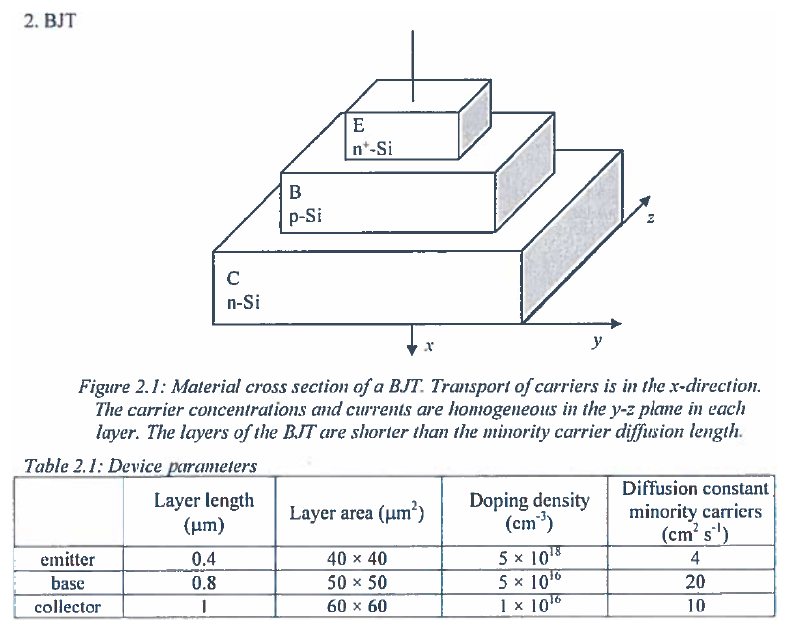
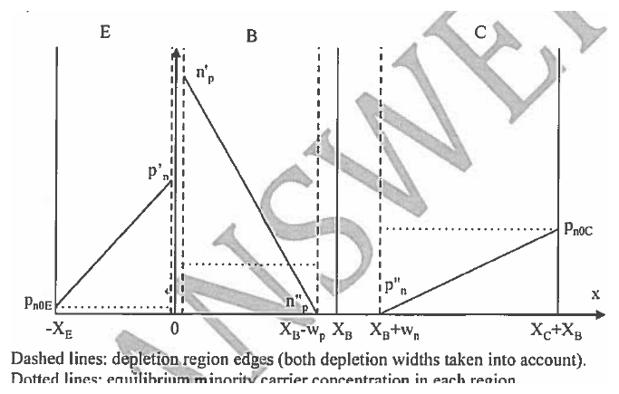
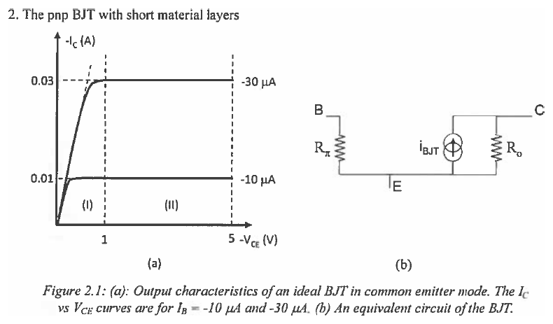
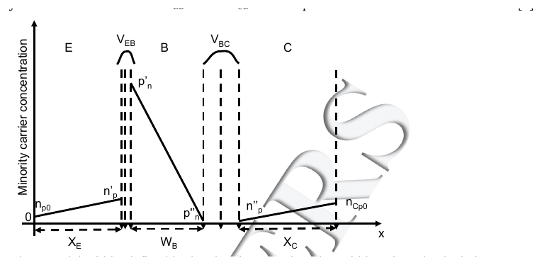
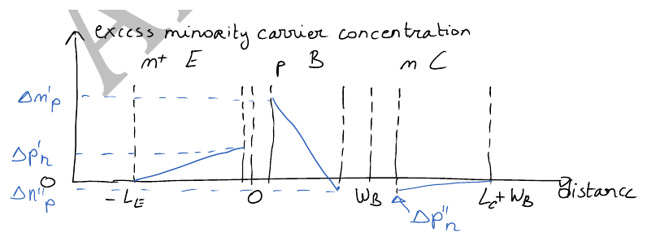

# Topic 21: End-of-topic test

Try each question first.
Then click to check.

Each answer says which notes section (§) it comes from.

kT/e = 0.026 V. nᵢ² ≈ 2.1 × 10²⁰ cm⁻⁶. e = 1.6 × 10⁻¹⁹ C. ε_Si = 11.

---

## Part A: Past-final questions

### F2016-2a (Final 2016 Q2a)

What is the meaning of "diffusion length of the minority carriers"? Use at most 30 words. [4]

Answer

The **average distance a minority carrier diffuses before it recombines with a majority carrier.**

From: §4

---

### F2016-2b (Final 2016 Q2b)

For the 2016 BJT (emitter 5 × 10¹⁸, base 5 × 10¹⁶, collector 10¹⁶ cm⁻³), calculate the minority carrier concentration at the contacts and at the edges of the depletion regions for a forward bias of 0.26 V across the EB junction and a reverse bias of 1 V across the BC junction. Ideal contacts. [6]

Answer

c = c₀ exp(V/V_T), c₀ = nᵢ²/N (learn this).

- **Emitter:** p_n0E = (1.45 × 10¹⁰)² ÷ 5 × 10¹⁸ = **42 cm⁻³**; p′_n = 42 × e^(0.26/0.026) ≈ **9 × 10⁵ cm⁻³**
- **Base:** n_p0 = **4205 cm⁻³**; n′_p = 4205 × e¹⁰ ≈ **9 × 10⁷ cm⁻³**; n″_p = 4205 × e^(−1/0.026) ≈ **8 × 10⁻¹⁴ cm⁻³**
- **Collector:** p_n0C = **2.1 × 10⁴ cm⁻³**; p″_n = 2.1 × 10⁴ × e^(−1/0.026) ≈ **4 × 10⁻¹³ cm⁻³**

From: §4, ⭐ boundary table

---

### F2016-2c (Final 2016 Q2c)

Plot the minority carrier concentration along x in each layer of the BJT. Take the depletion region at the BC junction into account. Label the axes. [6]

Answer

- Dashed lines: depletion region edges (both BC depletion widths shown: w_p in the base, w_n in the collector).
- Dotted lines: the equilibrium minority values.
- Straight lines between the boundary values.

Marks: [3] correct differences in concentration, [2] to the depletion edges, [1] linear.

From: §4, drawing checklist

---

### F2016-2d (Final 2016 Q2d)

Calculate the emitter, base and collector currents for the bias in (b), taking the BC depletion region into account. [9]

Answer

Neglect the BC leakage (forward active). I_E = the EB diode current; I_C = its electron part (in the base). Work in cm.

V_bi(BC) = 0.026 ln(5 × 10¹⁶ × 10¹⁶ ÷ (1.45 × 10¹⁰)²) = **0.74 V** [1]

w_p = √(2 × 8.85 × 10⁻¹⁴ × 11 × 1.74 × 10¹⁶ ÷ (1.6 × 10⁻¹⁹ × 6 × 10¹⁶ × 5 × 10¹⁶)) = **8.4 × 10⁻⁶ cm** [2]

I_E = eA_E D_E Δp_nE/X_E + eA_B D_B Δn_pB/(X_B − w_p) [4]

= 1.6 × 10⁻¹⁹ × (40 × 10⁻⁴)² × 4 × 9 × 10⁵ ÷ 0.4 × 10⁻⁴ + 1.6 × 10⁻¹⁹ × (50 × 10⁻⁴)² × 20 × 9 × 10⁷ ÷ (0.8 − 0.084) × 10⁻⁴

**I_E = 2.3 × 10⁻¹³ + 10⁻¹⁰ A**, **I_C = 10⁻¹⁰ A**, **I_B = 2.3 × 10⁻¹³ A** [2]

(Each layer has its own area. The examiners say it only matters for the currents.)

From: §4, Equation 35

---

### F2017-2a (Final 2017 Q2a)

For the pnp BJT biased in region II of Fig. 2.1, sketch the minority carrier concentration in the emitter, base and collector. Show the depletion widths, define all parameters and give symbols for the junction voltages. [6]

Answer

Region II = forward active: EB forward (V_EB > 0), BC reverse (V_CB < 0).

- Emitter: n_p0 at the contact up to n′_p at the EB edge.
- Base: p′_n at the EB edge down to p″_n ≈ 0 at the BC edge.
- Collector: n″_p ≈ 0 at the BC edge up to n_Cp0 at the contact.
- X_E, W_B, X_C = junction-to-contact widths **minus** the depletion regions.

The main error: not defining all the parameters.

From: §1, drawing checklist

---

### F2017-2bc (Final 2017 Q2b and c)

(b) Give I_E, I_C and I_B for the BJT in region II in terms of material parameters and the junction voltages from (a). Make appropriate assumptions. [6]

(c) Calculate I_E and I_B for I_C = 1 mA (region II), ignoring base width modulation. [3]

Answer

**(b)** I_E = A eD_n^E(n′_p − n_p0)/X_E + A eD_p^B(p′_n − p″_n)/W_B

Since n′_p ≫ n_p0 and p′_n ≫ p″_n:

$$I_E \approx A\frac{eD_n^E n_{p0}}{X_E}e^{V_{EB}/V_T} + A\frac{eD_p^B p_{n0}}{W_B}e^{V_{EB}/V_T}$$

Neglecting the leakage from the collector into the base:

$$I_C \approx A\frac{eD_p^B p_{n0}}{W_B}e^{V_{EB}/V_T} \qquad I_B \approx A\frac{eD_n^E n_{p0}}{X_E}e^{V_{EB}/V_T}$$

n_p0 = minority in the emitter, p_n0 = minority in the base. Common mistakes: leaving V undefined, and writing (e^(V/V_T) − 1) for the reverse junction term.

**(c)** β from the graph (region II): 0.03 A ÷ 30 µA = **1000**.

I_B = 1 mA ÷ 1000 = **1 µA**. I_E = I_C + I_B = **1.001 mA**.

From: §5, Equation 35

---

### F2015-3b (Final 2015 Q3b)

Sketch the **excess** minority carrier concentration against distance in each region of an n⁺pn BJT in forward active mode. Show the minority carrier type in each region and give the expression for the excess concentration at each junction. Include the depletion regions. [10]

Answer

- **Excess** → zero at the ohmic contacts. (2)
- EB junction: emitter side Δp′_n = p′_n − p_n0, base side Δn′_p = n′_p − n_p0. (2)
- BC junction: collector side Δp″_n = p″_n − p_n0, base side Δn″_p = n″_p − n_p0. (2)
- ′ = forward value, ″ = reverse value, each from c = c₀ e^(eV/kT).
- All lines straight. **Δp′_n < Δn′_p** (heavy emitter). Δp″_n and Δn″_p are **negative** (reverse bias). Start at the depletion edges.

Classic mistake: drawing the concentration, not the excess.

From: §1, drawing checklist

---

### F2015-3c (Final 2015 Q3c)

The BJT has emitter width L_E, base width W_B and collector width L_C.

(i) Derive simplified expressions for I_E, I_B and I_C in terms of the excess concentrations and material parameters. Do **not** neglect the leakage from the collector into the base. [6]
(ii) Show that β increases when the leakage is taken into account, compared with when it's neglected. [4]

Answer

**(i)**

J_E = −eD_nΔn′_p/W_B − eD_pΔp′_n/L_E

J_C = −eD_nΔn′_p/W_B − eD_p|Δp″_n|/L_C

J_B = J_E − J_C = −eD_pΔp′_n/L_E + eD_p|Δp″_n|/L_C

(Δn″_p is ignored: tiny next to Δn′_p.)

**(ii)**

Without leakage: β = (D_nΔn′_p/W_B) ÷ (D_pΔp′_n/L_E)

With leakage: β = (D_nΔn′_p/W_B + D_p|Δp″_n|/L_C) ÷ (D_pΔp′_n/L_E − D_p|Δp″_n|/L_C) = (I_C + I_L) ÷ (I_B − I_L)

The numerator grows and the denominator shrinks: **β increases**.

Weakness (examiners): going back to the formula-sheet diode equations instead of the gradients you just drew.

From: §3

---

### F2014-1g (Final 2014 Q1g)

Two npn BJTs are identical except for the emitter doping: N_E1 > N_E2. Under the same bias, is I_C1 >, < or = I_C2? Verify your answer. [6]

Answer

**I_C1 = I_C2.**

The EB current density:

$$J = \frac{eD_n n_i^2}{N_A W_B}\left(e^{eV/kT} - 1\right) + \frac{eD_p n_i^2}{N_D X_n}\left(e^{eV/kT} - 1\right)$$

In an npn, I_C is the **electron** diffusion current in the **base** (first term). It depends on the base doping and width, not the emitter's. Only the second term (I_B) changes, so β changes, not I_C.

Arguments based on β "all led to the wrong conclusion".

From: §2 trap

---

### F2018-1cix (Final 2018 Q1c ix)

Yes or no: the current gain of an n⁺pn BJT is larger than that of an npn BJT. [1]

Answer

**Yes.** β ∝ emitter doping ÷ base doping. A heavier emitter injects relatively fewer holes back from the base, so I_B is smaller.

From: Equation 36

---

## Part B: Exam-style questions

---

### M1: True or false

1. At an ohmic contact the excess minority carrier concentration is zero.
2. In forward active mode, the minority concentration in the base is high at the BC edge and low at the EB edge.
3. Doubling the base width roughly halves I_C.
4. The base current of an npn is mainly holes injected into the emitter.
5. γ = I_C/I_E is slightly larger than 1.

Answer

1. **True.** (⭐)
2. **False.** High at the forward EB edge, ≈ 0 at the reverse BC edge. (§1)
3. **True.** I_C ∝ 1/W_B. (Equation 35)
4. **True.** (§1)
5. **False.** Slightly **less** than 1 (I_E = I_B + I_C). (§2)

---

### M2: Multiple choice

Which change increases β the most without changing I_C?

- A. Halve the base width
- B. Double the emitter doping
- C. Double the base doping
- D. Increase V_EB

Answer

**B.** Emitter doping only reduces I_B (2014 Q1g). Halving W_B also raises β, but it changes I_C too. Base doping lowers β. V_EB scales I_C and I_B together.

From: Equation 36

---

### M3: Calculate

A short p⁺np BJT: emitter N_A = 10¹⁹ cm⁻³, X_E = 0.5 µm, D_n = 5 cm²/s. Base N_D = 10¹⁷ cm⁻³, W_B = 0.5 µm, D_p = 10 cm²/s. Area 10⁻⁵ cm². V_EB = 0.6 V.

Find I_C, I_B and β.

Answer

e^(0.6/0.026) = e^23.08 = 1.05 × 10¹⁰.

p_n0 = 2.1 × 10²⁰ ÷ 10¹⁷ = 2100 cm⁻³. n_p0 = 2.1 × 10²⁰ ÷ 10¹⁹ = 21 cm⁻³.

I_C = 1.6 × 10⁻¹⁹ × 10⁻⁵ × 10 × 2100 × 1.05 × 10¹⁰ ÷ 0.5 × 10⁻⁴ = **7.1 × 10⁻⁶ A**

I_B = 1.6 × 10⁻¹⁹ × 10⁻⁵ × 5 × 21 × 1.05 × 10¹⁰ ÷ 0.5 × 10⁻⁴ = **3.5 × 10⁻⁸ A**

β = (10 × 10¹⁹ × 0.5) ÷ (5 × 10¹⁷ × 0.5) = **200**

From: Equations 35, 36

---

### M4: Sketch

Sketch the minority carrier concentration (not excess) through an npn BJT in **saturation**.

Answer

- Emitter (holes): c₀ at the contact rising to a big value at the EB edge.
- Base (electrons): big at **both** edges (both junctions forward). A straight line between them, sloping down towards the BC side if V_BE > V_BC.
- Collector (holes): big at the BC edge, falling to c₀ at the contact.

The gradient across the base is smaller than in forward active mode for the same V_BE, so I_C/I_B drops: saturation.

From: §1, Topic 20 §3

---

### M5: Explain

Why do we use the **undepleted** layer widths, and not the diffusion lengths, in the BJT current expressions?

Answer

The layers are **shorter** than the diffusion length, so there's no recombination and the minority profile is a **straight line** from depletion edge to contact (or to the other depletion edge). The gradient is Δc ÷ the distance it actually falls over, which is the neutral (undepleted) width.

The diffusion length only appears for **long** layers, where the profile is an exponential decay (Topic 12).

From: ⭐, §4

