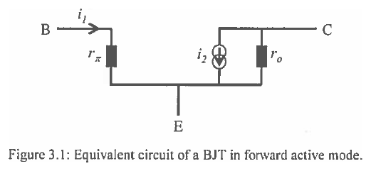
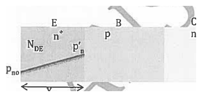
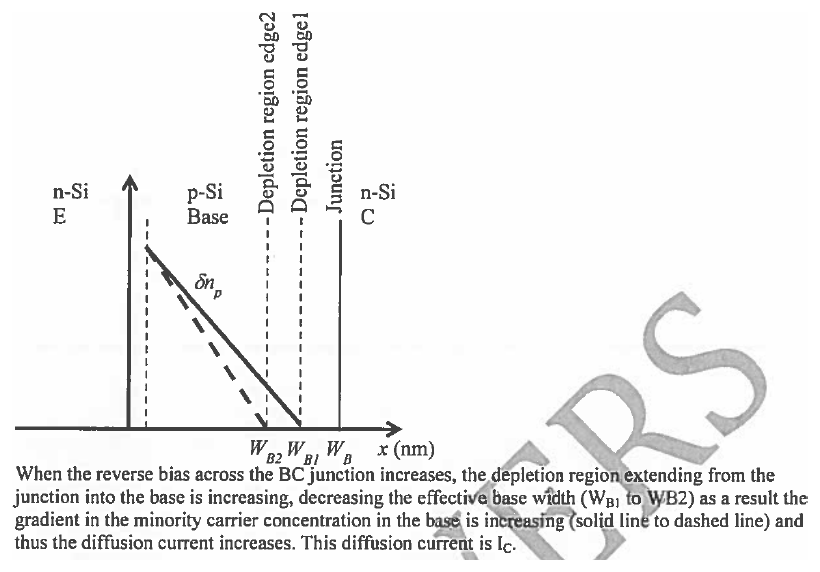
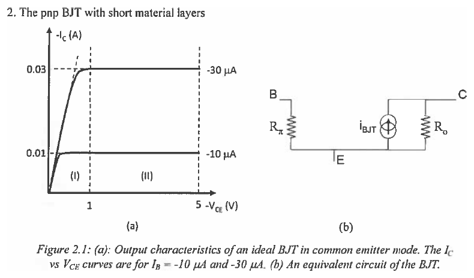
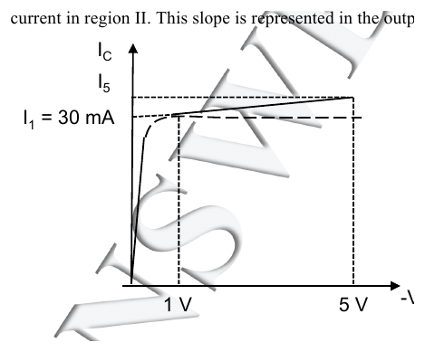

# Topic 22: End-of-topic test

Try each question first.
Then click to check.

Each answer says which notes section (§) it comes from.

V_T = kT/e = 0.026 V.

---

## Part A: Past-final questions

### F2018-3c (Final 2018 Q3c)

The equivalent circuit of an n⁺pn BJT in forward active mode is shown.

(i) What is the condition on the emitter–base AC voltage to allow use of this circuit? [4]
(ii) Give the expression for i₁ in terms of the BJT material parameters. Use X_E, X_B and X_C as the undepleted lengths of the emitter, base and collector. Identify clearly the doping type and region in the expression. [5]
(iii) Give the expression of i₂ in terms of the transconductance g_m. [2]
(iv) Why is the output conductance g_o = r_o⁻¹ larger than zero? Give a physical reason and illustrate with an equation or a sketch. [4]

Answer

**(i)** v_be small, such that the variation of I_C is **linear** within that range.

**(ii)** i₁ is due to the minority carrier gradient in the **emitter** (holes in the n⁺ emitter):

$$i_1 = \frac{eD_{pE}}{X_E}(p'_n - p_{n0})A = \frac{eD_{pE}n_i^2}{X_E N_{DE}}\left(e^{v_{be}/V_T} - 1\right)A$$

**(iii)** **i₂ = g_m v_be**

**(iv)** **Base width modulation.** I_C is the electron diffusion current in the base:

$$I_C = \frac{eD_{nB}n_i^2}{X_B N_{AB}}\left(e^{v_{be}/V_T} - 1\right)A$$

X_B is the undepleted base width. Raising |V_CE| raises the reverse bias |V_CB|, the BC depletion region extends further into the base, X_B shrinks, the gradient grows and I_C grows.

From: §1, §3

---

### F2017-2d (Final 2017 Q2d)

Derive expressions for the equivalent circuit components R_π, R_o and i_BJT as functions of I_E, I_C and I_B. [6]

Answer

**Input resistance:**

$$R_\pi = \left(\frac{dI_B}{dV_{EB}}\right)^{-1}, \quad I_B = I_s e^{V_{EB}/V_T} \;\Rightarrow\; \frac{dI_B}{dV_{EB}} = \frac{I_B}{V_T} \;\Rightarrow\; R_\pi = \frac{V_T}{I_B}$$

**Output resistance:**

$$R_o = \frac{\partial V_{CE}}{\partial I_C} = \frac{|V_A|}{I_C}$$

assuming V_CE ≈ V_BC, with V_A the Early voltage (base width modulation). For the ideal curves in Fig. 2.1a, R_o is infinite. Also from I_C = I₀(1 + V_CE/V_A).

**Source:** i_BJT = i_C = (eD_p^B p_n0/W_B) e^(V_EB/V_T) A, small signal **g_m v_eb**, g_m = I_C/V_T.

"These equations needed to be derived from their definition... Equations just learned by heart are not a sufficient answer."

From: Equation 37, §4

---

### F2017-2e (Final 2017 Q2e)

The BJT has an input resistance R_π = 8 kΩ and an output conductance g_o = 4 mS. Calculate g_m. [3]

Answer

Derive the link first:

$$R_\pi = \frac{dV_{EB}}{dI_B} = \frac{dV_{EB}}{dI_C}\times\frac{dI_C}{dI_B} = \frac{1}{g_m}\times\beta$$

β = 1000 (from the graph, region II).

g_m = β/R_π = 10³ ÷ 8 × 10³ = **0.125 S**

From: §4 e

---

### F2017-2f (Final 2017 Q2f)

Using the result of (e), plot the output characteristic for I_B = −30 µA taking base width modulation into account. Give I_C at V_CE = −5 V. [6]

Answer

Copy the −30 µA curve and give the active region a slope g_o.

R_o = ΔV/ΔI → ΔI = g_o ΔV

I₅ = I₁ + g_o ΔV = 0.03 + 4 × 10⁻³ × 4 = **0.046 A** (46 mA)

From: §4 f

---

## Part B: Exam-style questions

---

### M1: True or false

1. g_m of a BJT grows in proportion to I_C.
2. A MOSFET has a finite input resistance R_π like a BJT.
3. Base width modulation makes the BJT output curves slope up in the active region.
4. A larger Early voltage means a smaller output resistance.
5. The small-signal circuit works for any size of v_be.

Answer

1. **True.** g_m = I_C/V_T. (Equation 37)
2. **False.** The MOSFET gate draws no DC current: infinite input resistance. (Method table)
3. **True.** (§1)
4. **False.** R_o = V_A/I_C: larger V_A = larger R_o (flatter curves). (Equation 37)
5. **False.** Only small v_be (linear). (⭐)

---

### M2: Multiple choice

A BJT has I_C = 1 mA and β = 100. What is R_π?

- A. 26 Ω
- B. 260 Ω
- C. 2.6 kΩ
- D. 26 kΩ

Answer

**C.** g_m = 1 mA ÷ 26 mV = 38.5 mS. R_π = 100 ÷ 0.0385 = 2.6 kΩ.

From: Equation 37

---

### M3: Calculate

A BJT is biased at I_C = 2 mA, β = 150, V_A = 80 V. Find g_m, R_π and R_o.

Answer

g_m = 2 × 10⁻³ ÷ 0.026 = **77 mS**

R_π = 150 ÷ 0.077 = **1.95 kΩ**

R_o = 80 ÷ 2 × 10⁻³ = **40 kΩ**

From: Equation 37

---

### M4: Sketch

Sketch the minority carrier profile in the base for two values of |V_CB| on the same axes, and explain what happens to I_C.

Answer

- Both lines start at the **same** value at the EB edge (same V_EB).
- The larger |V_CB| line ends **closer to the EB junction** (the BC depletion region reaches further into the base).
- So it is **steeper**: larger gradient, larger diffusion current, **larger I_C**.

From: §1

---

### M5: Explain

Compare base width modulation in a BJT with channel length modulation in a MOSFET.

Answer

Both make the output current creep up with the output voltage in the "flat" region, giving a finite output resistance and an Early voltage.

- **BJT:** a larger |V_CB| widens the BC depletion region, thinning the base. I_C ∝ 1/W_B grows.
- **MOSFET:** past pinch-off, the pinch-off point moves towards the source, shortening the channel. I_DS ∝ 1/L grows.

From: §1, Topic 19 §3

